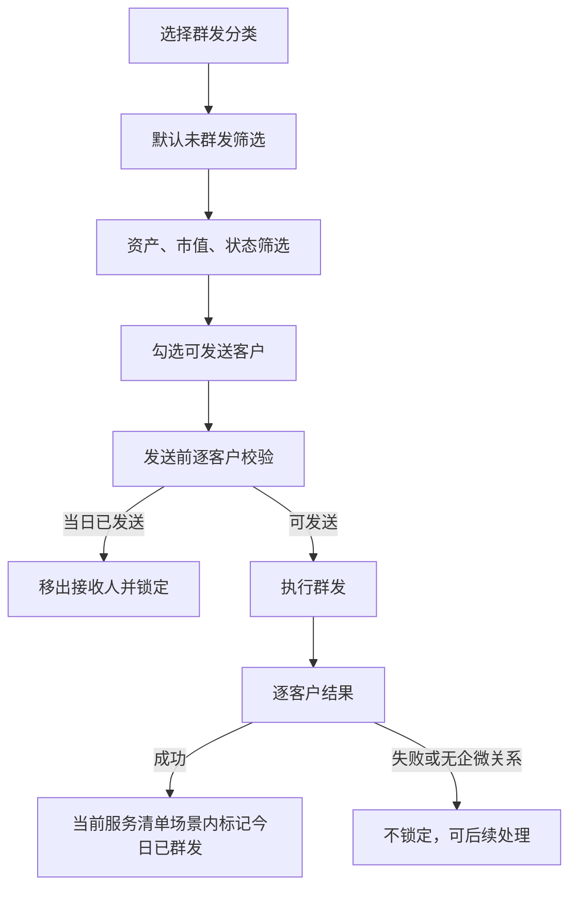

# 产品需求文档：AI+客户服务清单 v1.1

| 项 | 值 |
| -- | -- |
| **版本** | v1.1 |
| **日期** | 2026-10-08 |
| **作者** | 褚珍珍 |
| **状态** | 已评审（交付开发） |

---

## 一、核心术语速查表

| 术语 | 中文含义 | 说明 |
| -- | -- | -- |
| G1、G2、G3 | 已签约客户的信号服务场景 | 本期在客户维度展示近一月信号指标。 |
| G4 | 未签约客户场景 | 不展示客户级近一月信号指标；每只未签约标的可展示自身持仓命中信号盈亏率。 |
| 当日群发状态 | 客户在当前自然日、当前“AI+选好股服务清单”场景下是否已实际群发成功 | 该场景内任一 G1–G4 分类成功即对其余分类生效；其他服务场景不参与排除。 |
| 信号收益率 | 未签约标的的信号收益率 | 仅用于“未签约”客户列表排序。 |

## 二、任务元信息

| 项 | 值 |
| -- | -- |
| 产品名称 | AI+客户服务清单 |
| 任务类型 | 产品功能迭代与交互逻辑优化 |
| 适用终端 | PC Web |
| 设计基准 | 沿用已确认 V1.0 页面设计语言；仅改动本期模块。 |

## 三、业务背景与核心目标

### 3.1 业务背景

- 当前 AI+选好股服务清单缺少当日群发后的场景内锁定，容易向同一客户重复发送。
- 客户经理在大规模客群中难以按资产与当日群发状态快速圈选对象。
- G1、G2、G3 的客户级近一月指标重复显示在标的卡中，容易被误读为单票数据。
- 多标的客户在查看与收起长内容时，难以稳定定位操作入口。

### 3.2 核心目标

| 类别 | 指标 |
| -- | -- |
| 体验目标 | 客户在当日 AI+选好股服务清单场景内成功群发后，在 G1–G4 任意分类均不可再次勾选和发送。 |
| 效率目标 | 客户经理可在群发选人阶段用资产、证券市值和当日状态筛选所有场景客群。 |
| 认知目标 | 客户级近一月指标每位客户只展示一份，单项标的收展入口始终固定。 |

### 3.3 项目目标陈述

为执行 AI+投顾服务触达的客户经理提供更安全、更高效的服务清单，减少重复群发与信息误读，并提升多标的客户的服务准备效率。

### 3.4 非目标

- 不改 AI 信号生成、场景判定、行情计算、话术自动生成或投资推荐逻辑。
- 不改电话外呼、服务完成、待处理任务、客户详情、诊断链接和服务参考的既有规则。
- 不新增历史群发记录、跨日频控、审批、定时群发、新群发分类或新页面。
- 不将信号收益率扩展至非未签约客户。

## 四、目标用户与使用场景

### 4.1 涉及角色矩阵

| 角色 | 定位 | 主要交互 |
| -- | -- | -- |
| 客户经理 / 投顾 | 主使用者 | 筛选客户、群发、排序、查看信号、编辑话术、完成服务。 |
| 群发服务 | 外部依赖 | 校验企微关系与当日状态，返回逐客户发送结果。 |

### 4.2 核心使用场景

| 场景 | 优先级 | 完整操作路径 | 预期结果 |
| -- | --- | --- | --- |
| 批量群发 | P0 | 选择群发分类 → 设置筛选条件 → 勾选未群发客户 → 确认话术 → 发送 | 成功客户在当前服务清单场景内锁定，失败客户不误锁。 |
| 客户排序 | P0 | 选择客户列表 Tab → 选择排序字段与方向 | 保持完成置底、信号优先级不变。 |
| 多标的服务准备 | P0 | 打开客户 → 查看客户级指标 → 展开目标标的 → 查看并编辑话术 | 可快速定位标的，收展入口位置固定。 |

### 4.3 反场景

- 已完成服务客户不进入群发候选人。
- 当日已在 AI+选好股服务清单场景内成功群发的客户，不得通过切换 G1–G4 分类、筛选或确认弹窗再次发送；其他服务场景的成功记录不影响本次候选资格。

## 五、功能模块

### 5.1 整体结构框架

```
AI+客户服务清单
├── 客户列表
│   └── 分类、排序与已群发标记
├── 企微群发
│   ├── 分类选人、批量筛选
│   ├── 发送前复核
│   └── 逐客户结果回写与场景内锁定
└── 客户信号模块
    ├── 客户级近一月指标
    ├── 标的整体与单项收展
    └── 个性化话术
```

### 5.2 一级功能模块列表

| 模块 | 一句话描述 | 优先级 | 类型 |
| -- | -- | --- | --- |
| 客户列表排序 | 在既有优先级内按选定字段升降序排列。 | P0 | 改造 |
| 企微群发防重与筛选 | 在群发选人流程中筛选并阻止重复发送。 | P0 | 改造 |
| 客户级近一月指标 | 以客户维度一次性展示实时指标。 | P0 | 改造 |
| 标的收展 | 依据标的数给默认状态，并提供固定位置的单项操作。 | P0 | 改造 |
| 个性化话术展示 | 始终完整显示且保留既有编辑闭环。 | P0 | 改造 |

### 5.3 模块依赖关系

群发防重依赖群发服务按“AI+选好股服务清单”场景返回逐客户实际成功名单与当日状态；客户级指标依赖服务清单打开时返回实时客户维度数据。其他模块无新增外部依赖。

## 六、原子级功能详细需求

### 6.1 功能：企微群发防重与批量筛选

#### 业务描述

- **功能目的**：防止同一客户在同一自然日收到重复群发，并快速定位可触达客群。
- **功能描述**：假设客户经理在 AI+选好股服务清单的任一群发分类中，当其进入选人状态，那么默认按“未群发”筛选当前分类的未完成客户；当其切换为“全部”或“已群发”，那么该服务清单场景内已群发客户可查看但不可勾选。假设客户经理提交群发，当系统发送前校验发现客户已在当前服务清单场景内当日发送，那么移出该客户并提示，不向其发送。假设群发完成，当逐客户结果返回成功名单，那么仅成功与校验时已发送的客户更新为今日已群发，并在当前服务清单的 G1–G4 分类锁定。
- **关键规则**：
  - 覆盖亏损未止损、亏损已止损、盈利已了结、未签约四类群发分类；筛选能力仅出现在群发选人流程，不出现在普通客户列表。
  - 筛选字段为总资产区间、证券市值区间、当日群发状态；区间单位为“万”，空值表示不限制该端；默认状态为未群发。
  - 下限大于上限时不应用该次变更，并提示“区间下限不能高于上限，请修正后再筛选”。
  - 已群发状态以客户在 AI+选好股服务清单场景内任一 G1–G4 分类的当日实际成功发送为准，跨 G1–G4 分类生效；其他服务场景的当日成功记录不参与本次筛选、排除或锁定。客户卡片、筛选结果、选人状态、确认弹窗保持一致。
  - 仅成功客户在当前服务清单场景内锁定；失败、无企微关系客户不标记为成功，也不自动重发。发送期间禁止重复提交。
  - 条件变化后，移除不再符合条件或已群发的已选客户；筛选结果无可发送客户时，不能进入发送。

#### 字段与校验

| 字段 | 类型 | 必填 | 校验规则 | 默认值 | 错误文案 |
| -- | -- | :--: | -- | -- | -- |
| 总资产下限/上限 | 数值，单位万 | - | 下限不得大于上限；空值不限制 | 空 | 区间下限不能高于上限，请修正后再筛选 |
| 证券市值下限/上限 | 数值，单位万 | - | 下限不得大于上限；空值不限制 | 空 | 区间下限不能高于上限，请修正后再筛选 |
| 当日群发状态 | 枚举 | ✅ | 未群发、全部、已群发 | 未群发 | - |
| 群发话术 | 文本 | ✅ | 不为空；跨分类混选时不可发送 | 当前分类预置话术 | 发送条件不满足，请检查任务和登录状态 |

#### 异常场景

| 场景 | 触发条件 | 系统响应 | 用户文案 |
| -- | -- | -- | -- |
| 无匹配客户 | 筛选后结果为空 | 展示空结果，不进入确认弹窗 | 暂无该分类客户 |
| 发送前冲突 | 校验时客户已在当前服务清单场景内当日发送 | 从接收人移除并在当前场景锁定 | 群发完成，X人当日已发送 |
| 部分失败 | 部分客户发送失败或无企微关系 | 仅成功客户在当前场景锁定，聚合反馈结果 | 群发完成，X人成功，X人失败 / 无企微关系 |
| 发送失败 | 群发调用失败 | 结束发送中状态，保留当前选择以便重试 | 发送失败，请重试 |
| 无成功名单 | 外部服务无法给出当前场景的逐客户成功结果 | 本项已确认不发生；按逐客户成功名单执行场景内锁定 | 研发联调核验场景标识与成功结果一致 |

#### 验收标准（AC）

- [ ] 客户在 AI+选好股服务清单内任一 G1–G4 分类实际发送成功后，在该场景的四类群发分类中均显示今日已群发且不可勾选。
- [ ] 客户在其他服务场景当日群发成功后，仍可作为 AI+选好股服务清单的未群发候选人。
- [ ] 四类群发分类均支持三项筛选，默认仅显示未群发候选人。
- [ ] 已群发客户在“全部”和“已群发”筛选中可查看但不可选择。
- [ ] 区间非法时不刷新筛选结果，且显示规定提示。
- [ ] 部分成功时只有成功客户被锁定；失败和无企微关系客户不被误标。
- [ ] 发送前发现冲突客户时不发送给该客户；发送按钮在发送中不可重复提交。

### 6.2 功能：客户列表排序

#### 业务描述

- **功能目的**：让客户经理在不破坏既有服务优先级的前提下，按资产规模或未签约客户的信号表现排序。
- **功能描述**：假设客户经理在客户列表中选择排序字段，当选择总资产或证券市值，那么在同一优先级组内按升序或降序排序；当处于未签约 Tab，那么额外可选择信号收益率。假设关闭后再次打开服务清单，那么恢复默认排序。
- **关键规则**：已完成客户始终置底；其余客户优先级固定为亏损、盈利、未签约；仅在同一优先级组内排序。信号收益率取客户全部未签约标的中的最高值。选定字段缺失时排在本组末尾，再按既有紧急度排序。默认排序不显示方向切换；非默认排序支持升序和降序。

#### 异常场景

| 场景 | 触发条件 | 系统响应 | 用户文案 |
| -- | -- | -- | -- |
| 值缺失 | 客户缺少选定字段 | 排在同组末尾 | - |
| 切换非未签约 Tab | 当前字段为信号收益率 | 自动恢复默认排序 | - |

#### 验收标准（AC）

- [ ] 总资产、证券市值均支持升序和降序。
- [ ] 信号收益率仅在未签约 Tab 可选，且使用该客户最高未签约标的值。
- [ ] 排序不改变完成置底和亏损→盈利→未签约的优先级。
- [ ] 重新打开服务清单后恢复默认排序。

### 6.3 功能：客户级近一月信号指标

#### 业务描述

- **功能目的**：消除客户维度指标被误读为单只标的指标的风险。
- **功能描述**：假设打开服务清单且客户存在 G1、G2、G3 信号，当客户级指标数据返回，那么在信号模块标题下展示近一月信号胜率、近一月信号数量、近一月信号累计收益率各一份；当数据任一项缺失，那么该项显示“--”。
- **关键规则**：数据在每次打开服务清单时获取实时值；页面停留期间不自动轮询。G4 不展示该组指标。单标的卡片不得展示这三项指标。

#### 异常场景

| 场景 | 触发条件 | 系统响应 | 用户文案 |
| -- | -- | -- |
| 指标缺失 | 任一字段为空 | 对应位置显示缺失态 | -- |
| 实时数据加载失败 | 打开服务清单时指标未返回 | 不使用历史值或标的数据补齐 | -- |

#### 验收标准（AC）

- [ ] G1、G2、G3 客户的三项指标每位客户只展示一份。
- [ ] 任一单标的卡片均不显示上述三项指标。
- [ ] G4 不显示该客户级指标。
- [ ] 每次打开服务清单均使用最新实时数据；页面停留期间不自动刷新。

### 6.4 功能：信号关联标的收展

#### 业务描述

- **功能目的**：减少多标的客户的浏览成本，并让收展操作始终位于稳定位置。
- **功能描述**：假设客户有 1 个标的，当进入信号模块，那么默认展开且不显示模块级总控；假设有 2 个标的，那么默认全部展开并显示总控；假设有 3 个及以上标的，那么默认收起，仅保留每只标的标题行并显示总控。假设客户经理操作单项收展，那么入口始终位于该标的标题行右侧；展开后复制与收起并列展示，不在卡片内容底部另设收起入口。
- **关键规则**：模块级总控仅在标的数大于 1 时展示；客户级指标始终显示；关联标的按仓位占比降序排列，仓位占比为标的持仓金额 ÷ 客户 T-1 日持仓净资产，无法计算时显示“--”并置底；圈客逻辑标签右侧展示仓位占比；G4 未签约标的在展开详情中增加独立“持仓命中信号盈亏率”数据卡，紧跟在“持仓命中信号买入提示价格”数据卡后，沿用相同卡片样式；优先取上周自然周数据，缺失时用该标的信号买入价与最新市价计算；同一客户本次打开期间手动状态不因排序、筛选或数据刷新重置；重新打开服务清单后按标的数量重新计算默认状态。

#### 异常场景

| 场景 | 触发条件 | 系统响应 | 用户文案 |
| -- | -- | -- |
| 无标的 | 客户无关联标的 | 不展示信号模块 | - |
| 单标的 | 标的数为 1 | 不展示模块级总控 | - |
| 长话术 | 展开内容很长 | 收起入口仍保留在标题行右侧 | 收起 |

#### 验收标准（AC）

- [ ] 标的数为 1、2、3 及以上时，默认状态与总控展示严格符合规则。
- [ ] 单项“展开/收起”始终在对应标题行右侧。
- [ ] 展开态不在内容底部出现“收起”入口；复制与收起并列在标题行。
- [ ] 本次打开期间手动收展状态保留；重新打开后恢复数量驱动的默认状态。

### 6.5 功能：个性化话术展示与保存

#### 业务描述

- **功能目的**：减少对长话术的额外展开操作，保留既有服务话术编辑闭环。
- **功能描述**：假设客户经理展开标的，当查看个性化话术，那么完整话术直接展示且不提供展开/收起控件；当编辑后离开话术区域，那么保存修改并显示已保存提示。假设客户风险等级低于话术适用等级，那么仍允许查看和编辑，并展示谨慎使用提示。
- **关键规则**：保留编辑、失焦保存、风险提示、诊断入口和一键复制；不得新增话术折叠或裁切交互。

#### 异常场景

| 场景 | 触发条件 | 系统响应 | 用户文案 |
| -- | -- | -- |
| 保存失败 | 话术保存未成功 | 保留编辑内容并提示重试 | 保存失败，请重试 |
| 风险不匹配 | 客户风险等级低于话术适用等级 | 展示提示，不阻断编辑 | 客户风险等级低于话术适用等级，请谨慎使用 |

#### 验收标准（AC）

- [ ] 个性化话术始终完整展示，页面不存在话术展开/收起入口。
- [ ] 编辑后失焦触发保存，保存成功显示已保存提示。
- [ ] 风险提示、诊断入口和复制能力保持可用。

### 6.6 功能：客户搜索、联系标识与诊断路由补充

#### 业务描述

- **客户搜索**：客户列表支持按客户姓名或资金账号搜索，并与分类、资产、市值、今日联系、近 7 个交易日联系、今日新增条件叠加，全部条件使用且逻辑。
- **客户标识**：客户卡片展示“今日新增”“今日已联系”“近 7 个交易日已联系”。“今日是否已联系”与“最近 7 个交易日是否已联系”是两个独立字段；说明只放在筛选区域，不增加客户卡片说明浮层，不影响客户卡片点击。
- **联系口径**：今日已联系仅指当前 AI+选好股服务清单场景内，当日发生电话服务完成、企微单聊完成或企微群发实际成功；近 7 个交易日按中国大陆交易日历计算，包含今天在内的最近 7 个交易日。今日联系筛选默认“未联系”，近 7 个交易日联系和今日新增筛选默认“全部”。
- **个股诊断路由**：G1、G2、G3 使用个股诊断 AI+签约版；G4 客户签约 AI+选好股、AI股票解套、AI投ETF 任一产品时使用个股诊断 AI投顾签约版，否则使用个股诊断未签约版；多个产品同时签约仍统一使用 AI投顾签约版。诊断页面本身、登录流程和免登录能力不在本项目实现。

#### 异常场景与验收标准

- 联系记录缺失时按未联系处理，不前端推断为已联系；上一有效快照缺失时不标记今日新增，并提示数据暂不可用。
- G4 签约清单为空或查询失败时使用个股诊断未签约版，不阻断入口；新诊断动态参数未就绪时保留旧入口兜底。
- [ ] 搜索支持姓名、资金账号及与其他筛选条件的且逻辑组合。
- [ ] 今日联系和近 7 个交易日联系分别按各自口径筛选，默认值正确。
- [ ] 客户卡片标签与筛选结果保持一致，说明仅展示在筛选区且不影响卡片点击。
- [ ] G1-G3、G4 已签约/未签约、多产品签约均路由到正确个股诊断版本。

### 6.7 功能：圈客规则补充

#### 业务描述

- G1、G2 亏损场景的跟投亏损触发条件由“跟投亏损 >= 10%”调整为“跟投亏损 > 0%”；等于 0% 或盈利不满足该条件，其他既有圈客条件不变。
- G4 未签约场景剔除签约成长盈、价值盈、主题盈任一服务包的客户；服务包签约状态缺失或查询失败时跳过该客户，不将未知状态当作未签约。

#### 验收标准（AC）

- [ ] 跟投亏损大于 0% 的客户满足 G1/G2 亏损触发条件，等于 0% 和盈利客户不满足。
- [ ] 签约任一指定服务包的客户不进入 G4 未签约名单；服务包异常客户被跳过且不影响其他客户处理。

## 七、关键流程与状态

### 7.1 流程：群发选人及场景内锁定



### 7.2 页面状态枚举

#### 页面：AI+客户服务清单

| 状态 | 触发条件 | 展示内容 |
| -- | -- | -- |
| 正常 | 成功获得客户数据 | 客户列表、排序、服务详情和信号模块。 |
| 加载中 | 首次请求未完成 | 既有骨架屏；新增控件不可操作。 |
| 空态 | 无客户数据 | 暂无客户数据。 |
| 错误 | 页面数据请求失败 | 页面加载失败、重试按钮。 |
| 无权限 | 无客户数据访问权限 | 无权限访问及重试按钮。 |
| 群发选择态 | 选择一个群发分类 | 批量筛选、候选客户、已选数量、下一步。 |
| 群发确认态 | 存在可发送接收人 | 接收人、话术、发送按钮与冲突提示。 |
| 标的收起态 | 达到默认/手动收起条件 | 标题行和固定右侧展开入口。 |

## 八、非功能需求约束

- 当日群发防重以服务端在 AI+选好股服务清单场景内的最终校验和幂等保障为准，前端提示不得替代服务端拦截；其他服务场景不得被该校验误排除。
- 所有实时指标仅用于当前服务清单页面展示；指标缺失不得用历史数据或单标的值推断补齐。
- 客户姓名、账户、手机号、资产与话术内容不得因本期功能新增而进入未批准的埋点或日志。
- 保持 V1.0 既有设计语言；未在本 PRD 明确修改的页面区域和业务能力不变。

## 九、待补充清单

| 项目 | 需要对齐方 | 截止时间 | 责任人 |
| -- | -- | -- | -- |
| ✅ 群发服务已确认可按 AI+选好股服务清单场景返回逐客户实际发送成功名单；研发联调核验场景标识与成功结果一致。 | 研发 / 群发服务负责人 | 开发评审前 | 研发负责人 |

## 十、修订记录

| 版本 | 日期 | 修改内容 | 作者 |
| -- | -- | -- | -- |
| v1.1 | 2026-10-08 | 群发防重与筛选、客户排序、客户级实时指标、标的收展、个性化话术展示规则；防重范围限定为 AI+选好股服务清单场景内。 | 褚珍珍 |
| v1.1 | 2026-10-27 | 纳入客户搜索、今日/近7个交易日联系与今日新增标识筛选、个股诊断版本路由、G1/G2 亏损阈值和 G4 服务包排除规则；补齐主 PRD 与补充 Spec 的一致性。 | 褚珍珍 |
