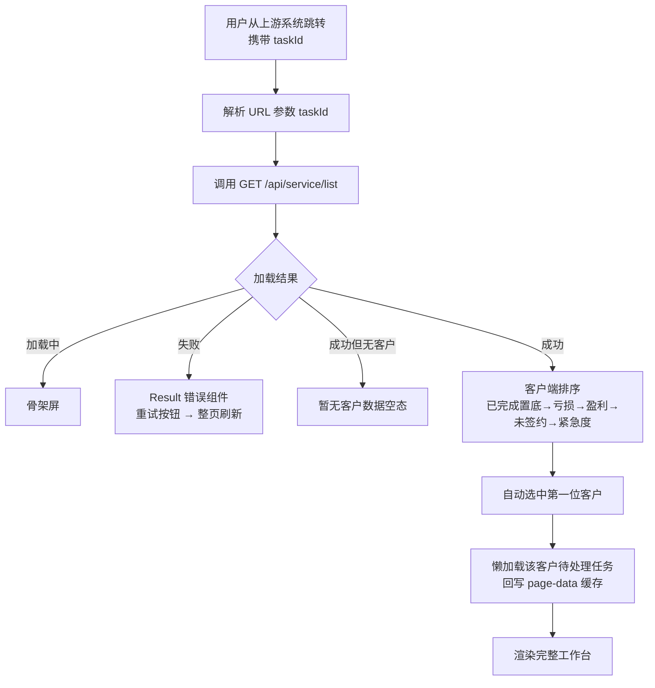
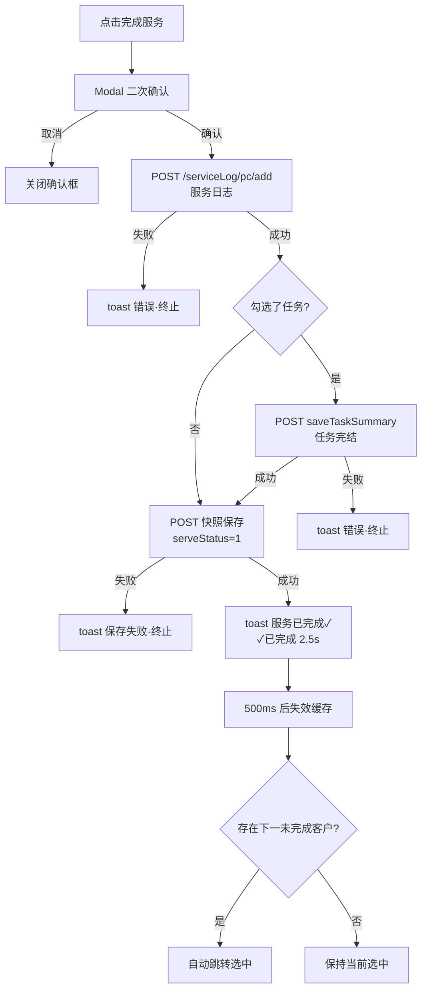
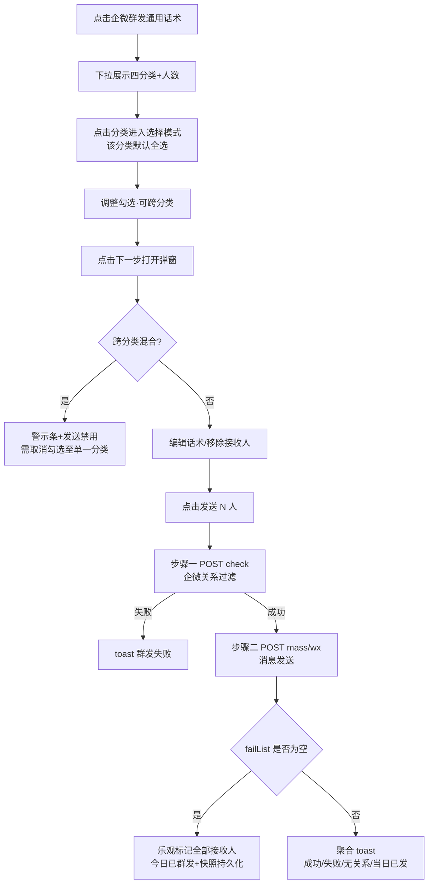
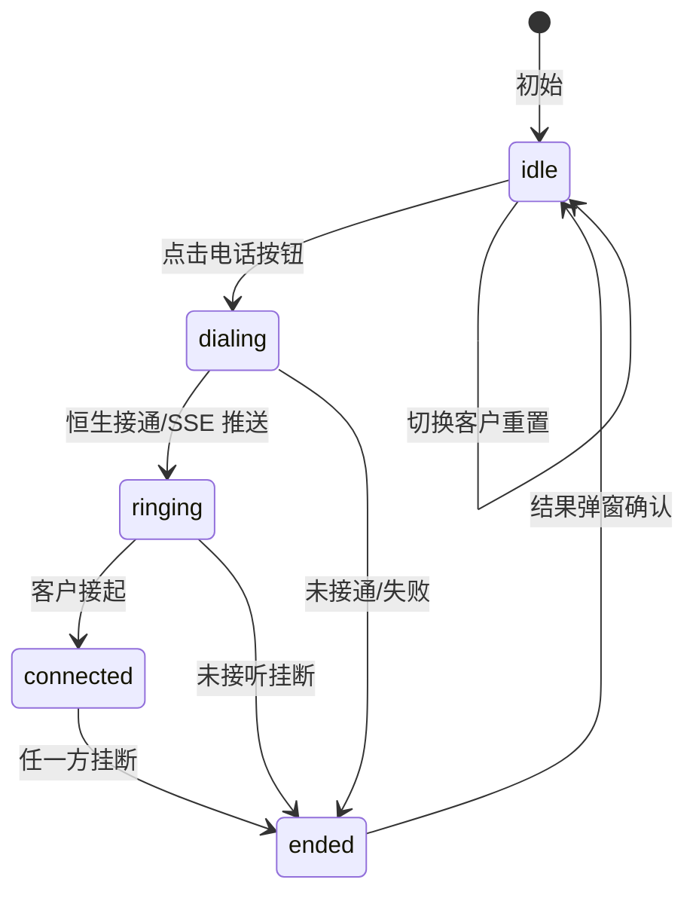
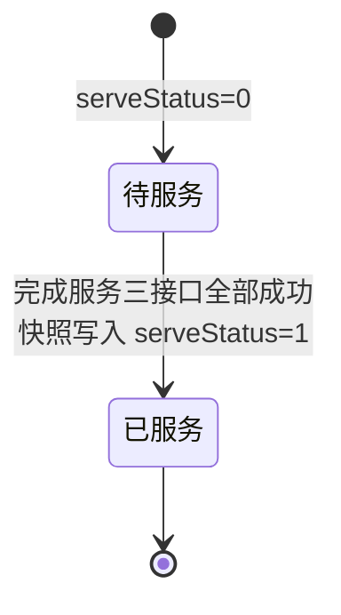

# 产品需求文档：AI+客户服务清单（逆向还原） V1.0

| <br />   | <br />                                  |
| -------- | --------------------------------------- |
| **版本**   | V1.0（存量系统逆向还原基线）                 |
| **日期**   | 2026-09-18                              |
| **作者**   | 产品逆向分析（基于源码 `src/features/ai-service-list`） |
| **状态**   | 已定稿（逆向基线，可供开发/测试评审）            |
| **任务类型** | 产品功能开发 / 交互逻辑（逆向需求还原）          |

***

## 文档说明

本文档为 **存量系统逆向产品分析文档**，非前瞻性需求文档。全部功能描述均由代码仓库 `ismp-frontend-pc-customer-info` 中 `src/features/ai-service-list` 模块的**现有源码逆向还原**，包括前端页面代码、接口请求代码（`api.ts` / `apiTypes.ts`）、数据转换逻辑（`transform.ts`）、状态管理（`store.ts`）、Mock 数据（`mock.ts` / `mock/index.ts`）与横切服务（`src/services/call` 电话外呼、`src/services/request.ts` 请求层、`src/hooks/useShortLinks.ts` 短链服务）。

文档约定：

- 每个功能点携带唯一编号 **REQ-xxx**，与 `demo/` 页面及原代码文件的映射关系见 `traceability.md`；
- 标注 ⏳ 的项目为待补充内容（代码信息不足，需补充后端/数据库源码确认）；
- 标注 **【未启用】** 的能力表示代码存在但无任何运行时调用路径（灰度/预留能力）；
- 标注 **【信息不足，需要补充源码确认】** 的内容表示前端仓库无法考证，禁止凭空补全；
- 本仓库为纯前端仓库，**后端接口逻辑与数据库表结构不在本仓库内**，相关章节基于接口出入参与错误码反推，均标注 ⏳。

后续版本节点：

- v1.1+：补充后端源码 / 数据库 DDL 后的细化版本
- v2.0：多方评审后的定稿版本（交付开发用）

***

## 一、核心术语速查表

| 缩写 / 术语 | 英文全称 / 代码标识 | 中文含义 | 说明 |
| --------- | --------------- | ------ | ---- |
| AI+投顾 | — | AI+投资顾问服务 | 国金证券面向客户的产品服务体系，下辖 AI选好股、AI股票解套、AI投ETF 等产品。本页面服务的客户均为 AI+投顾签约/触达客群 |
| 服务清单 | Service List | 每日客户服务作业清单 | 后端按 `taskId` 生成的当日客户服务任务集合，每条含客户画像、信号、话术 |
| 任务码 | `taskId` | 服务清单任务唯一标识 | 页面 URL 入参 `?taskId=xxx`，由上游系统（外呼任务系统）生成并跳转带入 |
| 信号闭环类型 | `signalType` | 客户持仓信号分类 | 枚举：`loss_unstopped`（亏损未止损）/ `loss_stopped`（亏损已止损）/ `profit_done`（盈利已了结）/ `unsigned`（未签约AI+）/ `hold`（持有）/ `recommend`（推荐）。前四类参与页面核心分类逻辑 |
| 场景编码 | `sceneCode` | AI 细分服务场景编码 | 枚举 21 个：G1-01~G1-10（亏损未止损族）、G2-01~G2-04（亏损已止损族）、G3-01~G3-06（盈利了结族）、G4-01~G4-03（未签约族），决定信号卡的标题/说明/关键字段布局 |
| 跟投/跟单 | Follow | 客户跟随 AI 信号买入标的 | 信号卡展示的持仓标的为客户跟随 AI 信号形成的持仓 |
| 止损/止盈 | Stop Loss / Take Profit | 风控平仓价格 | 关键数据字段：`stopLossPrice`、`takeProfitPrice`、`estimatedStopLossPct`（预估止损幅度） |
| 企微群发 | WeChat Work Mass Send | 企业微信群发助手 | 通过 ISMP 公共网关两步接口（客户过滤→消息发送）向客户企微发送话术 |
| +0 外显 | Plus-0 Dialing | 拨号前自动加 0 | 页面开关。开启后外呼时在被叫号码前拼 `0`（`isChecked=true`），按客户独立记忆 |
| 快照 | Snapshot | 服务状态持久化 | `POST /wb/support/ai-result/update`，将 `serveStatus`（服务状态）、`wxBroadcastStatus`（群发状态）、话术修改等写回后端 |
| 恒生呼叫中心 | HS Call Center | 外呼电话服务提供方 | `src/services/call` 模块对接的第三方外呼系统（`virtual/makeCall` 拨打 + SSE 推送通话状态） |
| 风险等级 | Risk Level `C1~C5` | 客户风险承受能力等级 | C1 最低 ~ C5 最高，另有"专业投资者"。话术适用性校验依据：`SCRIPT_MIN_RISK = 'C3'` |
| 服务状态 | `serveStatus` | 客户当日服务完成标记 | `0`=待服务，`1`=已完成。已完成客户卡片置灰置底，右侧面板隐藏服务操作 |
| 群发状态 | `wxBroadcastStatus` | 客户当日群发标记 | `0`=未发送，`1`=已发送；配合 `wxBroadcastTime` 判定"今日已发" |
| 个股/ETF/板块诊断 | Diagnosis | 诊断工具链接 | 信号携带的 `diagnosisUrls`（`sector` 板块 / `underlying` 个股或 ETF），跳转诊断页或复制短链 |
| 埋点 | Analytics | 用户行为数据采集 | `@gjzq/sdk` 的 `trackEvent`，`page_name='ai_service_list'` |
| 空态 | Empty State | 数据为空展示 | 代码存在 `EmptyState` 组件（三种空态），**当前未被任何页面引用【未启用】** |

***

## 二、任务元信息

| 项 | 值 |
| -- | -- |
| 项目名称 | AI+客户服务清单（ai-service-list）页面逆向产品分析 |
| 需求文档版本 | V1.0（存量功能逆向基线） |
| 任务类型 | 逆向产品分析（前端源码 → 需求还原），覆盖产品功能开发 / 交互逻辑 |
| 交付输出格式 | Markdown / Mermaid / HTML Demo（原生 HTML+CSS+JS） |
| 输出粒度 | 原子级细节还原 |
| 适用终端 | PC Web（现代浏览器，无移动端适配） |
| 设计基准分辨率 | ≥1280px 宽（代码含 980px / 760px 两档响应式降级断点） |
| 预期交付物数量 | PRD 1 份 + HTML Demo 1 套（导航页 + 主工作台页 + 状态页 + mock 数据 + 模拟接口层）+ 三方映射表 1 份 |

***

## 三、业务背景与核心目标

### 3.1 业务背景

- **当前业务现状**：国金证券客户经理/投顾需要对 AI+投顾签约客户进行每日服务触达。服务依赖三类信息：客户持仓盈亏信号（亏损未止损/亏损已止损/盈利了结/未签约）、AI 生成的个性化服务话术、待处理任务（如必做任务、紧急任务）。历史上上述信息分散在多个系统，客户经理需人工筛选客户、查询行情、组织话术、逐个外呼或群发，再手工登记服务日志。
- **待解决核心痛点**（由已实现功能反推）：
  1. 客户优先级不清晰——哪些客户今天必须先服务缺乏排序依据；
  2. 话术组织成本高——需针对每类盈亏场景手工撰写合规话术；
  3. 触达效率低——逐个外呼、逐个发企微，无法按分类批量触达；
  4. 服务过程无沉淀——服务是否完成、话术是否发送缺乏系统记录。
- **本次需求发起原因**：本页面为已上线存量功能。本文档因**逆向还原现有系统真实能力**而产出，作为后续开发、测试评审与需求迭代的基线。

### 3.2 可量化核心目标

> ⏳ 原始立项 KPI 未在前端代码中体现，以下为代码中**可观测的度量行为**，原始量化目标【信息不足，需要补充源码确认（PRD立项文档）】。

| 类别 | 指标（代码可观测） |
| -- | -- |
| 业务目标 | 顶栏实时统计"待服务 N / 已完成 N"（`TopBar`）；完成服务后自动跳转下一个待服务客户，驱动当日清单清零 |
| 产品/体验目标 | 页面首屏骨架屏加载（`isLoading`）；任务数据 staleTime 30s 自动刷新；行情 staleTime 10s 自动刷新 |
| 技术/设计/性能目标 | 请求层自动去重（`pendingMap`）；React Query 缓存失效后精准跳转；短链模块级缓存避免重复换取 |
| 合规目标 | 话术风险等级校验（低于 C3 弹红色警示）；企微群发前客户过滤（当日已发自动排除）；群发跨分类禁止 |
| 风险容忍度 | 快照保存失败仅 toast"保存失败，请重试"不阻断主流程；短链生成失败回退原长链 |

### 3.3 项目目标陈述

> 我们为【客户经理/投顾】做【AI+客户服务清单 PC 工作台】，解决【当日服务客户筛选排序难、话术组织成本高、触达与记录割裂】的痛点，预期【通过 21 类场景识别 + 个性化话术 + 电话外呼 + 企微群发 + 服务快照形成"识别-触达-记录"闭环】，本页面已上线运行（本文档为逆向基线）。

### 3.4 非目标（防过度设计）

- 本次不实现功能：本文档不设计任何代码中不存在的新功能；
- 本次不拓展范围：不含 KYC 标签维护（属 `kyc-tag` 模块）、投顾场景清单（属 `ai-advisor-service-list` 模块）、投后看板（属 `post-service` 模块）；
- 本次不修改内容：不改动现有交互与接口契约；
- 其他禁止项：后端接口内部逻辑、数据库表结构不在本仓库范围，**禁止推测补全**，统一标注 ⏳。

***

## 四、目标用户与使用场景

### 4.1 涉及角色矩阵

| 角色 | 在功能中的定位 | 主要交互 |
| -- | ---------- | ------ |
| 客户经理 / 投顾（员工） | 主使用者 | 浏览清单、筛选客户、编辑话术、外呼、群发、勾选任务、完成服务、跳转客户详情/诊断页 |
| 客户（投资者） | 被服务者（间接） | 接收电话外呼、接收企微群发话术；不直接操作本页面 |
| 上游任务系统 | 任务发起方（外部系统） | 生成 `taskId` 并以 URL 参数跳转进入本页面 ⏳（生成机制在后端，需补充源码确认） |
| AI 清单生成服务（后端） | 数据供给方 | 按任务维度生成客户清单、信号、话术 ⏳（生成逻辑需补充源码确认） |

###

### 4.2 核心使用场景

| 场景 ID | 优先级 | 使用时机 | 完整操作路径 | 用户预期结果 |
| ----- | --- | ------ | ------ | ------ |
| S01 | P0 | 每日工作开始 | 从上游系统携带 `taskId` 跳转进入 `/ai-service-list?taskId=xxx` → 页面加载骨架屏 → 展示客户清单 → 顶栏查看"待服务/已完成"统计与生成时间 | 一屏获取当日服务客户全景，系统自动选中第一位客户 |
| S02 | P0 | 单客户深度服务 | 点击客户卡片 → 右侧查看画像/资产/信号卡 → 查看并按需编辑个性化话术（失焦保存）→ 点击电话按钮外呼（可选 +0）→ 通话结束确认 → 点击"完成服务"→ 二次确认 → 提交服务日志（+任务小结+快照）→ 自动跳转下一个待服务客户 | 单客户服务闭环：看数据→改话术→触达→记录 |
| S03 | P0 | 分类批量触达 | 点击"企微群发通用话术"下拉 → 选择分类（亏损未止损/亏损已止损/盈利已了结/未签约）→ 进入选择模式勾选客户 → 下一步 → 弹窗内编辑话术/移除接收人 → 发送 → 两步接口（过滤+发送）→ 聚合结果提示 | 一键向同特征客群批量发送对应话术，当日已发客户自动排除 |
| S04 | P1 | 待办任务处理 | 点击画像卡底部"待处理任务 N 条"→ 抽屉展开任务列表 → 查看任务标签（紧急/必做）与截止日期（逾期红字）→ 勾选已完成任务 → 完成"完成服务"时随服务日志一并提交 | 任务完结随服务动作一次提交，无需重复操作 |
| S05 | P1 | 跨系统信息查询 | 点击画像卡"↗客户详情"（新开客户视图系统）或诊断入口"板块诊断结果/个股诊断结果"（新开诊断页）/ 复制诊断短链 | 在新标签页获取客户全貌或标的诊断结果 |

### 4.3 反场景（不应被使用）

- 本页面不用于证券交易下单（页面内无任何交易能力）；
- 不用于历史服务记录回溯——清单仅展示当日 `taskId` 维度数据，无历史查询入口；
- 不用于 KYC 标签维护（该能力在 `/kyc-tag` 模块）；
- 不用于向"亏损未止损"以外的混合特征客户一次性群发（跨分类群发被系统显式禁止并提示"请分开群发"）；
- 已完成（`serveStatus=1`）客户不可重复完成服务、不显示服务底栏（按钮区域整体隐藏）。

### 4.4 客群分层与差异化

| 客群（信号分类） | 入口 | 功能差异 | 数据展示差异 | 服务模式 |
| ---------- | -- | ------ | ------ | ------ |
| 亏损未止损（`loss_unstopped`） | 列表Tab"亏损" | 群发分类①；排序优先级最高 | 绿色信号标签；G1-01~G1-10 场景（含止损价/预估止损幅度等风控字段） | 优先电话触达 |
| 亏损已止损（`loss_stopped`） | 列表Tab"亏损" | 群发分类② | 绿色信号标签；G2-01~G2-04 场景（含卖出价/了结盈亏等复盘字段） | 电话/群发 |
| 盈利已了结（`profit_done`） | 列表Tab"盈利" | 群发分类③ | 红色信号标签；G3-01~G3-06 场景（含了结盈亏率/总收益率等战绩字段） | 群发为主 |
| 未签约（`unsigned`） | 列表Tab"未签约" | 群发分类④；**专属**展示"AI+投顾服务介绍"参考模块（`ServiceRefSection`） | G4-01~G4-03 场景；展示 AI+投顾产品介绍（AI选好股/AI股票解套/AI投ETF） | 转化推介 |
| 高资产客户（高客 N 星） | 无独立入口 | 无功能差异 | 画像展示客户等级（如"高客五星"） | 同上，等级仅展示 |
| 已完成客户 | 列表底部 | 卡片置灰（透明度 0.45）+ 绿色✓；服务底栏隐藏 | 服务时间展示 | 不可再操作 |

***

## 五、功能模块

### 5.1 整体结构框架

```
AI+客户服务清单页面（/ai-service-list?taskId=xxx）
├── M01 页面初始化与数据加载
│   ├── 任务参数解析（URL taskId）
│   ├── 清单数据加载（page-data）+ 自动选中首个客户
│   ├── 全屏状态（骨架屏 / 错误重试 / 空数据）
│   └── 任务数据懒加载（选中客户时按需拉取）
├── M02 顶栏（TopBar）
│   ├── 任务名称与业务线标识
│   ├── 待服务/已完成统计
│   ├── 清单生成时间
│   └── 当前用户头像
├── M03 客户列表（ClientListPanel + ClientCard）
│   ├── 分类筛选Tab（全部/亏损/盈利/未签约）
│   ├── 排序（已完成置底 > 亏损 > 盈利 > 未签约 > 紧急度）
│   ├── 客户卡片（信号聚合标签/完成态/任务红点/今日已群发）
│   ├── 面板折叠（300px ↔ 72px）
│   └── 自定义滚动指示器
├── M04 客户画像（RightPanel + PortraitCard）
│   ├── 基本信息（姓名/账号/性别/等级/风险等级）
│   ├── 资产指标（总资产/证券市值/本次服务计数）
│   ├── 联系方式（电话脱敏 + +0外显开关）
│   ├── 客户详情跳转（跨系统）
│   └── 待处理任务入口（抽屉）
├── M05 电话外呼（services/call + CallStatusBar）
│   ├── 联系电话获取（selectContactsList）
│   ├── 外呼发起（恒生 makeCall / 开发环境模拟）
│   ├── 通话状态条（拨出/振铃/通话中+计时/挂断）
│   └── 通话结果弹窗
├── M06 待处理任务（TaskDrawer + TaskRow）
│   ├── 任务列表（紧急/必做标签、截止日、逾期标识）
│   └── 任务勾选（随服务完成提交）
├── M07 信号与关联标的（SignalSection + SignalCard + KeyDataGrid + EventsSection）
│   ├── 信号卡头部（标的/类型/场景标签 + 一键复制）
│   ├── 场景化关键数据网格（21 场景字段映射）
│   ├── 热门概念（前3 + 弹窗全量）
│   └── 关联异动/热点事件（Popover）
├── M08 个性化话术（ScriptSection）
│   ├── 话术展示/展开收起
│   ├── contentEditable 编辑 + 失焦保存
│   └── 风险等级适用性校验（C3 基准）
├── M09 企微群发（BroadcastToolbar + BroadcastDropdown + BroadcastModal + 选择模式）
│   ├── 分类群发入口（四分类 + 人数统计）
│   ├── 跨分类选择模式（勾选/取消/下一步）
│   ├── 群发弹窗（接收人管理/话术编辑/混合警示）
│   └── 两步发送（客户过滤 + 消息发送）+ 乐观更新
├── M10 服务完成与快照（ServiceFooter + useCompleteService + useSaveSnapshot）
│   ├── 服务内容备注（选填）
│   ├── 完成服务（二次确认 + 三接口级联）
│   └── 数据快照持久化（状态/话术/群发标记）
├── M11 服务介绍参考（ServiceRefSection，未签约客户专属）【P1】
└── M12 埋点（analytics.ts，16 个埋点函数）【P1】
```

### 5.2 一级功能模块列表

| 模块 ID | 模块名称 | 一句话描述 | 优先级 | 类型 |
| ----- | ------ | ------ | --- | ---- |
| M01 | 页面初始化与数据加载 | 解析 taskId、拉取清单、管理全屏加载/错误/空态 | P0 | 存量已实现 |
| M02 | 顶栏 | 任务标识、服务统计、生成时间、用户信息 | P0 | 存量已实现 |
| M03 | 客户列表 | 四分类筛选、智能排序、折叠、卡片聚合信息 | P0 | 存量已实现 |
| M04 | 客户画像 | 基本信息与资产指标展示、联系方式、任务入口 | P0 | 存量已实现 |
| M05 | 电话外呼 | 对接恒生呼叫中心的一键外呼与通话状态管理 | P0 | 存量已实现 |
| M06 | 待处理任务 | 任务列表展示与勾选，随服务完成提交 | P0 | 存量已实现 |
| M07 | 信号与关联标的 | 场景化信号卡、关键数据、概念、异动热点 | P0 | 存量已实现 |
| M08 | 个性化话术 | 话术展示/编辑/保存与风险校验 | P0 | 存量已实现 |
| M09 | 企微群发 | 四分类批量话术群发（两步接口） | P0 | 存量已实现 |
| M10 | 服务完成与快照 | 完成服务三接口级联与状态持久化 | P0 | 存量已实现 |
| M11 | 服务介绍参考 | 未签约客户的 AI+投顾产品介绍参考 | P1 | 存量已实现 |
| M12 | 埋点 | 16 个用户行为埋点 | P1 | 存量已实现 |

### 5.3 模块依赖关系

1. **M01 是全部模块的前置**：page-data 加载成功后才渲染 M02~M11；加载失败进入全屏错误态，其余模块不渲染。
2. **M04 依赖 M01**（画像来自 page-data）与外呼联系人接口（横切服务）；M05 依赖 M04（号码来自画像兜底 + contacts 接口优先）。
3. **M06 依赖 M01**：任务数据按客户懒加载（`useClientTasks`，staleTime 30s），选中客户后写入 page-data 缓存（`setQueryData`）。
4. **M07 依赖 M01**（securityList）与行情接口（横切：`useMarketData`，staleTime 10s 自动刷新，按 `securityCode+sceneCode` 拉取 fieldsMap）。
5. **M08 依赖 M07**：话术来自 `ApiSecurity.sceneScript`，保存走 M10 的快照接口。
6. **M09 依赖 M01**：群发分类按客户 `securities` 信号计算；分类话术来自 `defaultScripts`（按 `BroadcastCategory` 取用）。
7. **M10 依赖 M04/M06/M08/M09**：完成服务时聚合勾选任务（M06）、服务内容备注、触发任务小结接口与快照接口；M09 群发成功后同样调用快照接口。
8. **M12 横切所有模块**：页面浏览、客户选择、筛选、群发、任务勾选、完成服务、通话、诊断、复制、话术保存等动作均有埋点。

### 5.4 验收标准

1. 访问 `/ai-service-list?taskId=xxx` 可完整加载页面；无 `taskId` 时页面数据加载失败进入错误态（代码未对缺失 taskId 做前置校验，依赖接口报错 ⏳）。
2. 四个筛选 Tab 切换后列表内容与计数正确；已完成客户始终位于列表底部且置灰。
3. 完成服务后：该客户置灰置底、顶栏统计数字变化、页面自动跳转至下一个未完成客户（若存在）。
4. 群发流程中"当日已发"客户被自动排除；跨分类选择时发送按钮禁用并显示警示。
5. 话术编辑后失焦自动保存（内容有变化才触发），刷新后从缓存恢复。
6. 通话全过程状态条正确流转：拨出 → 振铃 → 通话中（计时）→ 结束弹窗 → 重置。

***

## 六、原子级功能详细需求（核心执行区）

> 编号规则：功能编号 F01~F32，对应唯一需求编号 REQ-001~REQ-032。每条功能注明实现状态（已实现 / 未启用）。

### 6.1 功能 F01：页面加载与全屏状态管理（REQ-001）【已实现】

#### 业务描述

- **功能目的**：以 `taskId` 为维度加载当日服务清单，并在数据未就绪/加载失败/无数据时提供明确的全屏反馈。
- **功能描述**：Given 用户从上游系统跳转至 `/ai-service-list?taskId=xxx`，When 页面挂载并调用 `GET /api/service/list?taskId=xxx`，Then ① 加载中显示骨架屏；② 失败显示 Result 错误组件与"重试"按钮（点击执行 `window.location.reload()` 整页刷新）；③ 成功但 `customers` 为空显示"暂无客户数据"。
- **主要使用者**：客户经理/投顾。
- **核心价值**：保证任务数据加载的确定性反馈，避免白屏。
- **关键规则**：
  - 规则 1：`taskId` 仅从 URL 查询参数读取（`useSearchParams`），页面内无输入 taskId 的入口；
  - 规则 2：React Query 缓存键为 `['ai-service-list','page-data',taskId]`，`staleTime: Infinity`（会话内不重复拉取，仅快照/完成服务后定向失效）；
  - 规则 3：加载成功且无选中客户时，自动选中排序后第一位客户（`setCurrentUuid(sorted[0].uuid)`）；
  - 规则 4：任务数据懒加载——首次选中某客户时调用待处理任务接口，结果通过 `queryClient.setQueryData` 写回 page-data 缓存（避免重复请求）。
- **依赖**：`usePageData`、`useClientTasks`、ISMP 客户信息后端。
- **交互描述**：骨架屏为页面结构占位动画；错误态含图标、错误说明与重试按钮；空态为居中文案"暂无客户数据"。
- **Figma url**：⏳ 无（存量逆向）。
- **异常处理**：
  - 网络错误/HTTP 4xx 5xx：请求层统一 toast 提示（400/401/403/404/500/502/504 各有文案，401 清 token 跳 SSO），页面进入错误态；
  - 业务码非 0：toast `message` 字段；客户列表异常码 2001（MongoDB 异常）等见附录 D。

### 6.2 功能 F02：顶栏信息与统计（REQ-002）【已实现】

#### 业务描述

- **功能目的**：固定展示任务标识、服务进度统计与清单生成时间。
- **功能描述**：Given 页面数据加载完成，When 用户查看页面顶部（61px 固定顶栏），Then 看到左侧 logo + 分隔线 + 业务线名称标题，右侧"待服务 N / 已完成 N"统计（18px 数字）、"生成时间：M月D日 周X"与用户头像。
- **主要使用者**：客户经理/投顾。
- **核心价值**：服务进度一屏可见，驱动当日清单清零。
- **关键规则**：
  - 规则 1：统计基于全部客户（不受筛选 Tab 影响）：`pending = serveStatus=0 数量`，`done = serveStatus=1 数量`；
  - 规则 2：生成时间取 `createTime`（UTC 时间）+8 小时转换为北京时间，格式化为"M月D日 周X"（如"9月18日 周五"）；
  - 规则 3：头像取登录用户信息，静态资源 `Frame23.png`。
- **依赖**：page-data（`businessLine`、`createTime`、`customers[].serveStatus`）、用户信息 hook。
- **交互描述**：顶栏无交互（纯展示），头像仅展示不点击。
- **Figma url**：⏳ 无。
- **异常处理**：`createTime` 缺失时不渲染生成时间区域（条件渲染）；`businessLine` 为空时仅展示默认标题。

### 6.3 功能 F03：客户列表分类筛选（REQ-003）【已实现】

#### 业务描述

- **功能目的**：按服务策略快速聚焦同特征客群。
- **功能描述**：Given 客户列表加载完成，When 用户点击"全部 / 亏损 / 盈利 / 未签约"任一 Tab，Then 列表立即切换为对应客户子集（不含已完成客户）。
- **主要使用者**：客户经理/投顾。
- **核心价值**：与群发四分类对齐，服务于分类触达策略。
- **关键规则**：
  - 规则 1：Tab 与信号映射——"亏损"=`loss_unstopped` 或 `loss_stopped`；"盈利"=`profit_done`；"未签约"=`unsigned`；"全部"=全部；
  - 规则 2：**筛选恒排除已完成客户**（`serveStatus=1`），即"全部"Tab 也不展示已完成客户；
  - 规则 3：激活 Tab 样式为蓝底（#2b73ff）白字药丸（32px 高），非激活灰底；
  - 规则 4：当前选中客户被筛除时，自动切换选中列表第一位客户（若无则清空选中）。
- **依赖**：Zustand `filterTab` 状态。
- **交互描述**：点击 Tab 即时切换（无请求）；某分类无客户时列表区显示"📋 暂无该分类客户"文案。
- **Figma url**：⏳ 无。
- **异常处理**：空分类展示空态文案（注意：通用 `EmptyState` 组件存在但**未启用**，实际空态为内联文案）。

### 6.4 功能 F04：客户列表排序（REQ-004）【已实现】

#### 业务描述

- **功能目的**：让最需要服务的客户排在最前。
- **功能描述**：Given 客户列表（含筛选），When 系统渲染列表，Then 按以下优先级排序：① 已完成客户置底；② 信号优先级：亏损（`loss_unstopped`/`loss_stopped`）> 盈利（`profit_done`）> 未签约（`unsigned`）> 其他；③ 紧急度降序 = 待处理任务数 × 5 + 信号数。
- **主要使用者**：客户经理/投顾（无感知，系统自动）。
- **核心价值**：亏损客户（风险最高）始终优先展示。
- **关键规则**：
  - 规则 1：信号优先级仅取客户 securities 中出现的最高优先级信号类型判定；
  - 规则 2：紧急度权重——1 条待处理任务 = 5 个信号；
  - 规则 3：排序在客户端（`filterAndSortClients`）执行，不依赖后端顺序。
- **依赖**：`utils/clientSort.ts`、任务数据（懒加载后紧急度变化会重排）。
- **交互描述**：无显式交互，自动生效。
- **Figma url**：⏳ 无。
- **异常处理**：无任务数据时紧急度仅按信号数计算（任务数按 0 处理）。

### 6.5 功能 F05：客户卡片信息聚合（REQ-005）【已实现】

#### 业务描述

- **功能目的**：单卡片呈现客户核心服务要素。
- **功能描述**：Given 客户列表渲染，When 用户查看单个客户卡片，Then 看到：头像、姓名、聚合信号标签（"N 亏损未止损"等，按信号类型聚合计数，未止损绿/已止损灰/已盈利红/未签约灰）、已完成态（透明度 0.45 + 绿色✓ + 服务时间）、待处理任务红点（5px，选择模式或已完成时不显示）、今日已群发标记（"✓ {时间} {类型}话术已群发"或"✓今日已群发"）。
- **主要使用者**：客户经理/投顾。
- **核心价值**：不点开客户即可判断服务优先级与触达历史。
- **关键规则**：
  - 规则 1：信号标签按 SignalType 聚合计数，展示顺序按固定枚举顺序；
  - 规则 2：红点出现条件 = 存在未完成任务 且 非选择模式 且 未完成；
  - 规则 3：群发标记判定 `isBroadcastToday(wxBroadcastTime)`——时间为"MM-DD"或"YYYY-MM-DD..."且等于今日即视为今日已发；
  - 规则 4：选中卡片蓝框高亮；hover 浮起效果。
- **依赖**：page-data、任务数据、`utils/format.ts`。
- **交互描述**：点击卡片切换当前客户（同步埋点 `client_select`）。
- **Figma url**：⏳ 无。
- **异常处理**：姓名/头像缺失时按空值兜底渲染；群发时间为空不显示标记。

### 6.6 功能 F06：客户列表面板折叠（REQ-006）【已实现】

#### 业务描述

- **功能目的**：为右侧内容区释放宽度。
- **功能描述**：Given 列表面板展开（300px；≤980px 时 240px），When 用户点击面板标题右侧折叠按钮"‹"，Then 面板收窄至 72px，卡片变为 48×48 头像块；再次点击恢复。
- **主要使用者**：客户经理/投顾。
- **核心价值**：小屏/长内容场景的布局弹性。
- **关键规则**：
  - 规则 1：折叠状态下卡片仅显示头像与完成态标识，不显示文本信息；
  - 规则 2：**选择模式中触发折叠会同时退出选择模式并清空已选**；
  - 规则 3：折叠状态持久于 Zustand（会话级，不落 localStorage）。
- **依赖**：Zustand `collapsed`、`selectMode`。
- **交互描述**：折叠按钮位于"客户列表"标题（18px 粗体）右侧。
- **Figma url**：⏳ 无。
- **异常处理**：无。

### 6.7 功能 F07：列表自定义滚动指示器（REQ-007）【P1 已实现】

#### 业务描述

- **功能目的**：替代原生滚动条的自定义滚动反馈。
- **功能描述**：Given 客户列表内容溢出，When 用户滚动列表，Then 右侧显示 4px 宽半透明滚动指示器（位置/高度按滚动比例计算），停止滚动 500ms 后渐隐；内容不足一屏时不显示。
- **主要使用者**：客户经理/投顾。
- **核心价值**：视觉一致性。
- **关键规则**：指示器高度 = 容器高 × 可视高 / 内容高；window resize 时重算。
- **依赖**：`hooks/useSideScroll.ts`。
- **交互描述**：见功能描述。
- **Figma url**：⏳ 无。
- **异常处理**：`scrollHeight <= clientHeight` 时隐藏。

### 6.8 功能 F08：客户画像卡（REQ-008）【已实现】

#### 业务描述

- **功能目的**：展示客户静态画像与核心资产指标。
- **功能描述**：Given 已选中某客户，When 用户查看右侧面板顶部画像卡，Then 看到：42px 蓝底白字首字头像 + 姓名（18px）+ 资金账号 + "↗客户详情"链接 + 性别/客户等级（空显示"无"）/风险等级（C 级标签）三行信息 + 右侧三列指标（总资产（元）、证券市值（元），20px 数字字体）+ 本次服务信号计数（按信号类型聚合，未止损/已止损绿色、已盈利红色、未签约灰色，无信号显示蓝色"—"）+ 电话区 + 待处理任务行。
- **主要使用者**：客户经理/投顾。
- **核心价值**：通话前 3 秒建立客户认知。
- **关键规则**：
  - 规则 1：资产格式化 `formatAssetToWan`——≥10000 时转为"万"单位保留 2 位小数（如 1528640.50 → "152.86 万"）；
  - 规则 2：风险等级解析 `parseRiskLevel`——后端形如"C4 中高风险"拆分为编码与名称；
  - 规则 3：卡片高度——有任务 150px / 无任务 120px；任务抽屉展开时底部圆角变 0。
- **依赖**：page-data `customerPortraits`。
- **交互描述**："↗客户详情"点击后先换取一次性 token 再新开窗口（见 F09）。
- **Figma url**：⏳ 无。
- **异常处理**：`phoneNo` 为 null 时电话号码由联系人接口兜底（见 F11）；等级为空显示"无"；资产为空显示"--"。

### 6.9 功能 F09：客户详情跨系统跳转（REQ-009）【已实现】

#### 业务描述

- **功能目的**：从清单直达客户全量视图。
- **功能描述**：Given 画像卡展示中，When 用户点击"↗客户详情"，Then 系统以当前 `ycas_token` 调用 `POST /ycas/getThirdPartyInstantToken/v2` 换取一次性 token，成功后 `window.open` 打开客户视图系统（携带 token 与 `from_page=ismp-frontend-pc-customer-info`），并触发埋点 `client_detail_open`。
- **主要使用者**：客户经理/投顾。
- **核心价值**：免二次登录的单点跳转。
- **关键规则**：token 换取失败时不跳转（请求层统一错误提示）。
- **依赖**：`src/utils/jump.ts`、ISMP 公共后端。
- **交互描述**：新标签页打开。
- **Figma url**：⏳ 无。
- **异常处理**：换 token 失败 toast 错误；浏览器弹窗拦截场景 ⏳ 未在代码中特殊处理。

### 6.10 功能 F10：+0 外显开关（REQ-010）【已实现】

#### 业务描述

- **功能目的**：满足特定线路外呼需加拨 0 的要求。
- **功能描述**：Given 选中客户的电话区，When 用户点击 15px 方框开关（title="拨打时自动在号码前加0"），Then 该客户的外呼号码前缀标记切换（开→联系人 `isChecked=true`，号码前拼"0"），状态按客户独立记忆。
- **主要使用者**：客户经理/投顾。
- **核心价值**：合规外显线路控制。
- **关键规则**：
  - 规则 1：`plus0Map` 以客户 uuid 为 key 存储，互不影响；
  - 规则 2：切换时若有通话进行中不生效于当前通话（构造联系人时读取当前值）。
- **依赖**：Zustand `plus0Map`。
- **交互描述**：方形复选开关，点击即切换。
- **Figma url**：⏳ 无。
- **异常处理**：无。

### 6.11 功能 F11：联系电话获取与脱敏展示（REQ-011）【已实现】

#### 业务描述

- **功能目的**：展示可外呼号码（脱敏）。
- **功能描述**：Given 选中客户，When 画像卡渲染，Then 优先调用 `POST /api/yjbadmin/work/calloutTask/selectContactsList`（入参 `account_id=资金账号`、`account_type='12'`）取 `type=1`（联系电话）的号码，接口无数据或失败时回退 page-data 画像的 `phoneNo`；展示为脱敏格式（16px 粗体）："前 3 位 + **** + 后 4 位"（号码不足 7 位时原样展示——`maskPhone` 仅处理 ≥7 位号码）。
- **主要使用者**：客户经理/投顾。
- **核心价值**：多来源号码容错 + 隐私保护。
- **关键规则**：
  - 规则 1：外呼实际使用号码与展示号码同源（contacts 优先，兜底画像）；
  - 规则 2：联系人接口返回多条时取 `type=1` 第一条；返回结构含 `last_contact`（上次接通状态）字段，当前代码未消费 ⏳。
- **依赖**：外呼网关 selectContactsList。
- **交互描述**：号码旁为 32px 蓝底电话图标按钮（见 F12）。
- **Figma url**：⏳ 无。
- **异常处理**：两来源均无号码时电话按钮禁用（灰色）；Mock 中"武静"客户 `phoneNo=null` 为该边界用例（由 contacts 接口兜底）。

### 6.12 功能 F12：电话外呼发起（REQ-012）【已实现】

#### 业务描述

- **功能目的**：一键外呼客户。
- **功能描述**：Given 已获取客户号码（F11）且无通话进行中，When 用户点击电话按钮，Then ① 开发环境：前端定时器模拟状态机（拨出 1.5s → 振铃 1.5s → 通话中 8s → 结束）；② 生产环境：调用恒生外呼接口 `POST /api/yjbadmin/work/virtual/makeCall`（主叫=员工分机号，来自 `query/telNo` 初始化；被叫=客户号码，`isChecked=true` 时前缀加 0，`applicationName='PC'`），显示"正在拨打电话"loading，同时 Web Worker 建立 SSE 连接（`/sse/queryResult?uniqueId=xxx`）接收通话状态推送；埋点 `call_start`（含 `plus0_used`）。
- **主要使用者**：客户经理/投顾。
- **核心价值**：PC 端免拨号触达。
- **关键规则**：
  - 规则 1：同一时间仅一路通话（通话中电话按钮禁用）；
  - 规则 2：分机号在 `CallProvider` 挂载时初始化（`POST /api/yjbadmin/work/query/telNo`，Mock 返回 `extTelNo: 8001`），写入全局 `agentTelStore`；
  - 规则 3：切换客户时通话状态重置（store `setCurrentUuid` 副作用）；
  - 规则 4：SSE 断线支持 `Last-Event-ID` 续传重连。
- **依赖**：`src/services/call/CallProvider.tsx`、恒生呼叫中心、员工分机号接口。
- **交互描述**：点击后立即进入"拨出"状态（CallStatusBar 出现）。
- **Figma url**：⏳ 无。
- **异常处理**：主叫号码不存在/被叫号码不存在/呼叫失败——分别 toast 对应错误文案；SSE 超时由后端 `EndReason=timeout` 结束 ⏳（超时时长后端控制，需补充源码确认）。
- **补充**：模块内另有一条呼叫接口 `POST /client/call`（`callClient`，走 WORKBUDDY_AI_SERVICE_LIST 前缀，入参含 `uuid/advisorId/plus0/signalId?`）**未被任何运行时代码调用【未启用】**（详见 6.32 与附录 C）。

### 6.13 功能 F13：通话状态条（REQ-013）【已实现】

#### 业务描述

- **功能目的**：全页面固定反馈通话进度。
- **功能描述**：Given 通话已发起，When 状态流转，Then 顶栏下方出现 36px 固定蓝色状态条（左偏移随列表折叠状态联动：折叠 72px/展开 300px）：拨出="正在拨出 {号码}…"；振铃="振铃中"；通话中="通话中"+ MM:SS 计时 + 红色"挂断"按钮（调用 `POST /api/yjbadmin/work/virtual/call/hangUp`）。
- **主要使用者**：客户经理/投顾。
- **核心价值**：通话可控（可挂断）与时长感知。
- **关键规则**：
  - 规则 1：状态映射——`ringDuration>0`→振铃；`callDuration>0`→通话中；`finished`→结束（`dialResult=1` 接通/`0` 未接通区分文案）；
  - 规则 2：计时格式 `fmtSecs`（MM:SS）。
- **依赖**：`components/CallStatusBar.tsx`、恒生 SSE。
- **交互描述**：挂断按钮点击即结束通话。
- **Figma url**：⏳ 无。
- **异常处理**：空闲（idle）不显示状态条。

### 6.14 功能 F14：通话结果弹窗（REQ-014）【已实现】

#### 业务描述

- **功能目的**：通话结束确认与时长告知。
- **功能描述**：Given 通话转为结束态，When 状态条隐藏，Then 弹出结果弹窗："通话已结束 客户：{姓名}，通话时长：{duration}。"+ 确认按钮；点击确认或遮罩关闭弹窗并重置通话状态；埋点 `call_ended`（ismp_show，含 `call_phase`/`duration`）。
- **主要使用者**：客户经理/投顾。
- **核心价值**：通话留痕感知。
- **关键规则**：未接通时文案区分（`ended_no_answer`）。
- **依赖**：`CallProvider` 上下文。
- **交互描述**：见功能描述。
- **Figma url**：⏳ 无。
- **异常处理**：无。

### 6.15 功能 F15：待处理任务抽屉（REQ-015）【已实现】

#### 业务描述

- **功能目的**：展示客户待办任务明细。
- **功能描述**：Given 选中客户存在待处理任务（画像卡底部行"待处理任务"+ 红底计数徽标"N 条"+ 展开/收起），When 用户点击展开，Then 任务抽屉（`TaskDrawer`）展示任务列表：每行 = 22px 复选框 | 任务内容 | 标签（"紧急"/"必做"红标签，其他灰）+ 截止日期（逾期红字"逾期 MM-DD"，未逾期灰字"MM-DD"）。
- **主要使用者**：客户经理/投顾。
- **核心价值**：必做/紧急任务不遗漏。
- **关键规则**：
  - 规则 1：任务数据 `useClientTasks`（staleTime 30s，pageSize 50）懒加载，仅选中客户时请求；
  - 规则 2：已完成（`done`）任务勾选框禁用、名称删除线灰字；
  - 规则 3：任务截止时间格式"YYYY.MM.DD"（展示时 `.` 转 `-`）；逾期判定 = 截止日期早于今日；
  - 规则 4：切换客户自动收起抽屉。
- **依赖**：外呼网关 taskList 接口、page-data 缓存回写。
- **交互描述**：勾选行为见 F16。
- **Figma url**：⏳ 无。
- **异常处理**：任务接口失败 toast；任务数 0 时画像卡无任务行（高度 120px）；Mock"陈建国/孙丽华"为 0 任务边界用例。

### 6.16 功能 F16：任务勾选与完结提交（REQ-016）【已实现】

#### 业务描述

- **功能目的**：任务完结随服务动作一次提交。
- **功能描述**：Given 任务抽屉展开，When 用户勾选任务（埋点 `task_check`，含 `task_urgency`/`task_category`），Then 勾选状态暂存本地；When 用户点击"完成服务"（F25）确认后，Then 系统在服务日志提交成功后调用 `POST /api/yjbadmin/work/calloutTask/saveTaskSummary`（`account_type=12`、`serviceType='1'`、`service_record='1'`、`user_type='12'`，`multitask` 携带勾选任务的 `task_id`/`template_id`/`user_id`）完成任务完结。
- **主要使用者**：客户经理/投顾。
- **核心价值**：一次操作完成"服务+任务"双记录。
- **关键规则**：无勾选任务则跳过小结接口（勾选数 0 时不调用）。
- **依赖**：外呼网关 saveTaskSummary、F25 完成服务流程。
- **交互描述**：见功能描述。
- **Figma url**：⏳ 无。
- **异常处理**：小结接口失败 toast 错误（不回滚已提交的服务日志——级联顺序决定 ⏳ 补偿策略需后端确认）。

### 6.17 功能 F17：信号卡头部与一键复制（REQ-017）【已实现】

#### 业务描述

- **功能目的**：标识标的与场景，提供整合话术复制。
- **功能描述**：Given 客户存在关联标的（securities 非空），When 用户查看信号卡头部，Then 看到：3×34px 颜色指示条（亏损绿/盈利红/默认蓝）+ 标的名称（20px 粗体）+ 代码（16px 灰）+ 标的类型标签（securityType=`stock`→"个股"，否则"ETF"）+ 信号类型标签 + 场景标题标签（蓝）+ 场景描述标签（点击弹 Popover 显示场景 tooltip，空格转换行）+ 右侧"一键复制"按钮。
- **主要使用者**：客户经理/投顾。
- **核心价值**：单按钮打包"话术+诊断链接"。
- **关键规则**：
  - 规则 1：一键复制内容 = 场景话术（`sceneScript`）+ 板块诊断链接 + 个股/ETF 诊断链接（`buildDiagUrl` 拼接 `scenesId/employeeId/clientId`），多行拼接；
  - 规则 2：链接先经 `useShortLinks` 批量转短链（`POST /short/link/exchange/batch`，默认有效期 30 天，模块级缓存），**短链失败回退原长链不报错**；
  - 规则 3：复制成功按钮文案变"✓已复制"持续 2s；埋点 `script_copy`；
  - 规则 4：复制用 `copyToClipboard`（Clipboard API 优先，execCommand 降级）。
- **依赖**：诊断 URL 构造、短链服务、剪贴板工具。
- **交互描述**：见功能描述。
- **Figma url**：⏳ 无。
- **异常处理**：剪贴板权限拒绝走降级方案；诊断链接为空则该行不拼接。

### 6.18 功能 F18：场景化关键数据网格（REQ-018）【已实现】

#### 业务描述

- **功能目的**：按 21 类场景展示差异化关键字段。
- **功能描述**：Given 信号卡渲染，When 行情接口返回该标的 `fieldsMap`（`POST /api/realTime/data`，10s 自动刷新），Then 按 `SCENE_FIELD_LAYOUT[sceneCode]` 配置渲染 5 列网格（≤980px 3 列 / ≤760px 2 列）灰底圆角数据块：label + 值（20px 数字字体）+ 可选 description（问号图标 Tooltip）。
- **主要使用者**：客户经理/投顾。
- **核心价值**：不同盈亏场景突出不同决策字段（如 G1 族突出止损价、G3 族突出收益率战绩、G4 族突出 AI 信号内容）。
- **关键规则**：
  - 规则 1：21 个场景字段布局硬编码于 `utils/realTimeData.ts`（字段清单详见附录 B.3）；
  - 规则 2：值格式化——percent：×100 保留 2 位小数 + %；price：两位小数 + 元；amount：千分位 + 元；count：N 个；direction：1 买入/2 卖出/0 不变；
  - 规则 3：盈亏着色 `getTone`——正值红（#f93838）、负值绿（#12b76a）；
  - 规则 4：字段配置可带 `tone` 覆盖默认着色；`multiline` 类型超 2 行截断 + Tooltip 完整内容；
  - 规则 5：热门概念字段（`popularConcepts`，JSON 字符串）解析后按 rank 升序展示前 3 个（rank 蓝底徽标 + 名称）+ "详情"按钮。
- **依赖**：行情接口（ISMP 客户信息后端）、场景布局配置。
- **交互描述**：见功能描述；"详情"见 F19。
- **Figma url**：⏳ 无。
- **异常处理**：行情接口失败 toast（错误码 2004）；fieldsMap 缺字段显示"--"；极端数值按千分位完整展示（无上限截断）。

### 6.19 功能 F19：热门概念弹窗（REQ-019）【P1 已实现】

#### 业务描述

- **功能目的**：查看标的全量热门概念。
- **功能描述**：Given 关键数据网格展示热门概念前 3 个，When 用户点击"详情"，Then 弹出 560px 弹窗"当前热门概念（共 N 个）"，3 列网格展示全部概念（rank 蓝徽标 + 名称，超长截断）。
- **主要使用者**：客户经理/投顾。
- **核心价值**：热点全量视角。
- **关键规则**：概念按 rank 升序。
- **依赖**：`components/PopularConceptsModal.tsx`。
- **交互描述**：见功能描述。
- **Figma url**：⏳ 无。
- **异常处理**：概念 JSON 解析失败按空处理。

### 6.20 功能 F20：关联异动 / 热点事件（REQ-020）【已实现】

#### 业务描述

- **功能目的**：展示标的关联市场事件辅助话术解释。
- **功能描述**：Given 信号卡存在 events（或 underlying 诊断），When 渲染"关联异动 / 热点"区，Then 展示事件药丸列表：前缀"热点："/"异动："；label 超 10 字截断加"..."；情绪着色 positive 红 / negative 绿 / 其他灰；点击药丸弹 280px Popover 展示完整 label + content；区块右侧为"板块诊断结果"入口（DiagnosisEntry mode=sector）。
- **主要使用者**：客户经理/投顾。
- **核心价值**：话术佐证材料。
- **关键规则**：
  - 规则 1：无事件但存在 underlying 诊断时仍渲染区块（事件区显示"暂无异动/热点"）；
  - 规则 2：事件与诊断均无则整块不渲染。
- **依赖**：page-data `events`、诊断 URL。
- **交互描述**：Popover 悬浮/点击展示。
- **Figma url**：⏳ 无。
- **异常处理**：事件 content 为空时 Popover 仅显示 label。

### 6.21 功能 F21：个性化话术编辑与保存（REQ-021）【已实现】

#### 业务描述

- **功能目的**：提供可在服务现场微调的话术载体。
- **功能描述**：Given 信号卡话术区展示 `sceneScript`，When 用户点击文本进入编辑（contentEditable），编辑后失焦，Then 若内容发生变化即调用快照接口保存（`securityList[].sceneScript`），成功后更新 page-data 缓存并显示"✓已保存"2s（埋点 `script_save`）；默认收起态（max-height 56px + 底部渐变遮罩），点击"展开完整话术 ▾"展开（max-height 800px），再点"收起 ▴"。
- **主要使用者**：客户经理/投顾。
- **核心价值**：话术二次加工能力（AI 生成非最终答案）。
- **关键规则**：
  - 规则 1：**失焦触发、内容比对**——未变化不请求；
  - 规则 2：保存静默（仅失败 toast"保存失败，请重试"）。
- **依赖**：快照接口（ISMP 客户信息后端）。
- **交互描述**：见功能描述；话术区右侧为"个股/ETF诊断结果"入口。
- **Figma url**：⏳ 无。
- **异常处理**：保存失败 toast，不回滚编辑内容（本地已改）。

### 6.22 功能 F22：话术风险等级校验（REQ-022）【已实现】

#### 业务描述

- **功能目的**：防止话术超出客户风险承受能力。
- **功能描述**：Given 话术区渲染，When 计算话术最低适用风险等级，Then ① 客户风险等级满足时显示灰字提示"话术适用于 {minRiskCode} 及以上风险等级客户"；② 不满足时显示红色警示条"客户风险等级（{riskCode}）低于话术适用等级（{minRiskCode}），请谨慎使用"，话术区边框变红。
- **主要使用者**：客户经理/投顾。
- **核心价值**：适当性合规防线。
- **关键规则**：
  - 规则 1：话术最低风险等级计算 `getScriptMinRisk`——标的代码前缀为 `300/301/688/920/87/88/83`（创业板/科创板/北交所）时为 **C4**，否则 **C3**；
  - 规则 2：比较基准 `RISK_RANK`：C1<C2<C3<C4<C5<专业投资者；`isRiskLevelSatisfied` 判定客户等级 ≥ 话术要求等级。
- **依赖**：`utils/format.ts`、客户风险等级、标的代码。
- **交互描述**：警示为展示型（不阻断编辑/复制/群发）。
- **Figma url**：⏳ 无。
- **异常处理**：客户风险等级为空时 ⏳（`parseRiskLevel` 空值返回 undefined，按不满足展示，需源码复核；Mock 全量客户均有等级）。

### 6.23 功能 F23：诊断入口（板块 / 个股 / ETF）（REQ-023）【已实现】

#### 业务描述

- **功能目的**：跳转诊断工具或复制诊断链接。
- **功能描述**：Given 信号存在诊断 URL（`diagnosisUrls.sector` / `diagnosisUrls.underlying`），When 用户点击"板块诊断结果"（异动区右侧）或"个股/ETF诊断结果"（话术区右侧），Then 展示入口按钮 + "复制"按钮：① 点击主按钮 `window.open` 新开诊断页并 toast"已在浏览器中打开诊断页面：{securityName}"（埋点 `sector_diag_open`/`target_diag_open`，区分 target_type）；② 点击复制按钮将"{label}结果： {shortUrl}"写入剪贴板（短链化，失败回退长链），toast"诊断链接已复制"，按钮变"✓ 已复制"1.4s（埋点 `diag_link_copy`）。
- **主要使用者**：客户经理/投顾。
- **核心价值**：服务证据链工具直达。
- **关键规则**：诊断 URL 由后端下发（前端不构造；仅"一键复制"场景由 `buildDiagUrl` 拼接 `scenesId/employeeId/clientId` 参数 ⏳ 具体域名与参数语义需后端文档确认）。
- **依赖**：诊断 URL、短链服务。
- **交互描述**：见功能描述。
- **Figma url**：⏳ 无。
- **异常处理**：诊断 URL 为空时入口不渲染。

### 6.24 功能 F24：服务介绍参考（未签约客户专属）（REQ-024）【P1 已实现】

#### 业务描述

- **功能目的**：为未签约客户的转化推介提供口径参考。
- **功能描述**：Given 客户 securities 中存在 `signalType='unsigned'`，When 渲染右侧面板，Then 在信号卡后展示"服务介绍"参考模块（`ServiceRefSection`）：AI+投顾整体服务介绍（8 段固定文案）+ 费用提示（万 9 佣金）+ 三大产品介绍（AI选好股 / AI股票解套 / AI投ETF，各含提示语与可复制长文案）。
- **主要使用者**：客户经理/投顾。
- **核心价值**：标准化推介物料。
- **关键规则**：
  - 规则 1：文案为**前端静态硬编码**（`SERVICE_REF_DATA`），不来自接口；
  - 规则 2：仅未签约客户渲染（其他客户不显示）。
- **依赖**：静态配置。
- **交互描述**：长文案支持复制。
- **Figma url**：⏳ 无。
- **异常处理**：无。

### 6.25 功能 F25：完成服务（三接口级联）（REQ-025）【已实现】

#### 业务描述

- **功能目的**：结束单客户当日服务并留痕。
- **功能描述**：Given 选中客户未完成（`serveStatus=0`），When 用户在底部服务栏（60px 固定）"服务内容"输入框填写备注（选填，placeholder"记录本次服务内容… 选填"）并点击"完成服务"，Then 弹出二次确认（"完成服务后，该客户将标记为已服务并移至列表底部。确认继续吗？"）；确认后依次执行：
  1. `POST /serviceLog/pc/add` 服务日志（`custType='1'`、`custName=客户姓名`、`fundAccountOrSource=资金账号`、`serviceDate=当前时间 YYYY-MM-DD HH:mm:ss`、`serviceType=8`、`content=服务内容备注`、`source='12'`）；
  2. 若勾选了任务 → `POST /api/yjbadmin/work/calloutTask/saveTaskSummary` 任务完结；
  3. `POST /wb/support/ai-result/update?taskId=` 快照保存（`serveStatus=1` + `serveTime`）。
  全部成功后：toast"服务已完成✓"、显示"✓已完成"2.5s、500ms 后失效 page-data 缓存并自动跳转至下一个未完成客户；埋点 `complete_service`（含 `checked_task_count`/`has_content`）。
- **主要使用者**：客户经理/投顾。
- **核心价值**：单按钮完成全部记录动作。
- **关键规则**：
  - 规则 1：按钮 loading 态文案"提交中..."，防重复提交；
  - 规则 2：任务小结仅在"服务日志成功且有勾选任务"时调用（级联短路）；
  - 规则 3：已完成客户（`serveStatus=1`）整个底栏隐藏；
  - 规则 4：服务日期取客户端当前时间。
- **依赖**：渠道网关（服务日志）、外呼网关（任务小结）、客户信息后端（快照）。
- **交互描述**：见功能描述。
- **Figma url**：⏳ 无。
- **异常处理**：任一步失败 toast 对应错误（错误码 3001 重复提交等见附录 D）；失败不跳转、不置灰客户；快照失败不回滚服务日志（幂等性由 taskId+uuid 维度保证 ⏳ 需后端确认）。

### 6.26 功能 F26：群发入口与分类选择（REQ-026）【已实现】

#### 业务描述

- **功能目的**：按信号分类批量触达。
- **功能描述**：Given 客户列表非空且非选择模式，When 用户点击工具栏"企微群发通用话术"按钮（白底浅蓝边框 + 下箭头），Then 展示 260px 下拉：四分类行——亏损未止损（绿点）/ 亏损已止损（灰点）/ 盈利已了结（红点）/ 未签约（灰点），每行右侧"N 人"（宽口径计数：一客户可属多分类）；某分类总数 0 时禁用（opacity 0.4）；可发送数（排除今日已发）为 0 时显示 warning"该分类客户今日均已发送，无需重复群发"；存在排除时显示 info"已自动排除今日已发送的 N 位客户"；埋点 `broadcast_entry`/`broadcast_category`。
- **主要使用者**：客户经理/投顾。
- **核心价值**：触达策略的入口收敛。
- **关键规则**：
  - 规则 1：分类归属（宽口径 `getClientGroups`）——按客户 securities 信号判断，一客户可同时属于多分类；
  - 规则 2：已完成客户不参与群发（分类统计同样排除）。
- **依赖**：`utils/broadcast.ts`、`defaultScripts`。
- **交互描述**：点击分类行进入该分类选择模式（F27）。
- **Figma url**：⏳ 无。
- **异常处理**：见功能描述。

### 6.27 功能 F27：跨分类选择模式（REQ-027）【已实现】

#### 业务描述

- **功能目的**：群发前精确圈选接收人。
- **功能描述**：Given 用户从下拉选择某分类，When 进入选择模式，Then 列表卡片出现复选框（该分类客户默认全选），工具栏变为"已选 N 人"+ "取消" + "下一步"（0 人禁用）；用户可跨分类勾选/取消任意未完成客户（已完成客户不可选）；点击"下一步"打开群发弹窗（F28），点击"取消"退出并清空选择。
- **主要使用者**：客户经理/投顾。
- **核心价值**：接收人可控。
- **关键规则**：
  - 规则 1：选择模式下任务红点隐藏；
  - 规则 2：折叠面板会退出选择模式并清空选择；
  - 规则 3：分类预填话术按所选分类加载（`getBroadcastScript`），跨分类混合时弹窗内另行处理（F28）。
- **依赖**：Zustand `selectMode`/`selectedUuids`/`broadcastCategory`。
- **交互描述**：见功能描述。
- **Figma url**：⏳ 无。
- **异常处理**：无。

### 6.28 功能 F28：群发弹窗（接收人管理与话术编辑）（REQ-028）【已实现】

#### 业务描述

- **功能目的**：发送前的最后编辑与确认。
- **功能描述**：Given 用户点击"下一步"，When 打开 640px 群发弹窗，Then 展示：
  - **接收客户（N 人）**标签列表：今日已发客户黄色"⚠︎今日已发"标记，可点 × 移除；超 10 人折叠显示"展开（共 N 人）▾"；
  - **跨分类警示**：所选客户横跨多分类（窄口径 `getClientPrimaryGroup` 互斥判定，`loss_unstopped` 优先）时显示黄色警示条"当前所选客户特征不统一，建议分开群发"，话术区显示"客户特征不统一，请分开群发后查看对应话术"，**发送按钮禁用**；
  - **群发话术**：按主分类预填 `defaultScripts`（标注"通用话术 · WorkBuddy 预置"），contentEditable 可编辑，空话术 placeholder"暂无预置话术，请手动输入群发内容"；
  - **底部**：提示"将通过企微一键群发发送，并同步记录服务动作"+ 发送按钮"发送（N 人）"。
- **主要使用者**：客户经理/投顾。
- **核心价值**：防误发（混合拦截/已发标记/手动编辑）。
- **关键规则**：
  - 规则 1：可发送条件 = 话术非空 && 接收人 > 0 && 非发送中 && 非混合分类；
  - 规则 2：接收人清零弹窗自动关闭；
  - 规则 3：移除"今日已发"客户仅本地移除，不更新后端状态。
- **依赖**：Zustand 群发状态、`utils/broadcast.ts`。
- **交互描述**：见功能描述。
- **Figma url**：⏳ 无。
- **异常处理**：见功能描述。

### 6.29 功能 F29：群发发送两步调用与乐观更新（REQ-029）【已实现】

#### 业务描述

- **功能目的**：企微侧安全批量发送。
- **功能描述**：Given 弹窗内点击"发送（N 人）"，Then 依次执行：
  1. **步骤一 客户过滤** `POST /workBuddy/mass/externalUserId/check`（`type:'clientId'`，`users=客户ID数组`，≤1 万人）：返回企微关系用户（`WxRelationUser`，含 `thatDaySendFlag` 当日已发标记）与无企微关系名单；
  2. **步骤二 消息发送** `POST /workBuddy/mass/wx`（`externalUsersList` 企微用户、`noWxRelationList` 无关系名单、`text.content` 话术）：返回 `msgId` 与 `failList`。
  发送后聚合提示（`useBroadcast`）：分别 toast"N 人成功"/"N 人失败"/"N 人无企微关系"/"N 人当日已发送"（有失败为 warning，全成功为 success）；埋点 `broadcast_send`（`recipient_count`/`category_type`）。
- **主要使用者**：客户经理/投顾。
- **核心价值**：分层结果反馈。
- **关键规则**：
  - 规则 1：**乐观更新**——失败数为 0 时，本地将全部接收客户 `wxBroadcastStatus=1` + 当前时间为 `wxBroadcastTime`（列表卡片立即显示"今日已群发"）；
  - 规则 2：乐观更新后调用快照接口持久化（`wxBroadcastStatus`/`wxBroadcastTime`）；
  - 规则 3：发送按钮 sending 态防重复。
- **依赖**：ISMP 公共网关两接口、快照接口。
- **交互描述**：见功能描述。
- **Figma url**：⏳ 无。
- **异常处理**：步骤一失败（错误码 2006）toast；部分失败进入聚合提示；有失败客户**不**乐观标记（仅失败清单为空时标记 ⏳ 逐客户成功名单未在返回结构中体现，按失败清单推断，需后端确认）。

### 6.30 功能 F30：数据快照持久化（REQ-030）【已实现】

#### 业务描述

- **功能目的**：将页面操作产生的状态变化写回后端。
- **功能描述**：Given 话术编辑保存（F21）/ 群发成功（F29）/ 完成服务（F25）触发，When 调用 `POST /wb/support/ai-result/update?taskId=`，Then 按客户维度提交变更字段：`serveStatus`/`serveTime`/`wxBroadcastStatus`/`wxBroadcastTime`/`securityList[].sceneScript`（仅提交有变化的 security）。
- **主要使用者**：系统（自动）。
- **核心价值**：状态可回溯（刷新后不丢失）。
- **关键规则**：
  - 规则 1：静默保存（业务主流程 toast 之外仅失败提示）；
  - 规则 2：`taskId` 在 URL query，body 为 customers 数组。
- **依赖**：ISMP 客户信息后端。
- **交互描述**：无显式交互。
- **Figma url**：⏳ 无。
- **异常处理**：失败 toast"保存失败，请重试"；成功后更新 React Query 缓存。

### 6.31 功能 F31：用户行为埋点（REQ-031）【P1 已实现】

#### 业务描述

- **功能目的**：采集服务过程行为数据。
- **功能描述**：Given 用户在页面操作，When 触发埋点事件（共 16 项，明细见第九章埋点表），Then 通过 `@gjzq/sdk` 的 `trackEvent` 上报（统一携带 `page_name='ai_service_list'`）。
- **主要使用者**：产品/数据分析（间接受益）。
- **核心价值**：服务过程量化。
- **关键规则**：埋点不阻塞业务（异常静默）。
- **依赖**：`@gjzq/sdk`（鉴权成功后 `initFinder` 初始化）。
- **交互描述**：无感。
- **Figma url**：⏳ 无。
- **异常处理**：上报失败静默忽略。

### 6.32 未启用能力（REQ-032）【代码存在但未启用】

以下能力代码存在但无任何运行时调用路径（经全库引用检索验证），为预留/灰度能力，**不计入现有功能**：

| 能力 | 代码位置 | 说明 |
| -- | ------ | ---- |
| 前端模拟电话 Hook `usePhoneCall` | `hooks/usePhoneCall.ts` | 完整状态机（dialing→ringing 1.5s→connected 1.5s→ended 8s）与失败提示，无组件引用 |
| 电话呼叫接口 `callClient` | `api.ts` 接口 5（`POST /client/call`，WORKBUDDY_AI_SERVICE_LIST 前缀） | 仅被未启用的 `usePhoneCall` 引用 |
| 通话状态推送类型 `CallStatusPush` | `apiTypes.ts` | 类型已导出，无消费方 |
| 通用空态组件 `EmptyState` | `components/EmptyState.tsx` | 三种空态（empty-filter / all-completed / no-signals）配置完整，无引用 |
| 网格列数计算 `getGridCols` | `utils/sceneConfig.ts` | 已导出，无调用（列数由 CSS 断点实现） |
| 场景摘要 `buildSceneSummary` | `utils/sceneConfig.ts` | 已导出，无调用 |
| 弹窗关闭判定 `shouldCloseBroadcastModal` | `utils/format.ts` | 已导出，无调用（关闭逻辑内联于组件） |
| 任务逾期独立函数 `isTaskOverdue` | `utils/format.ts` | 已导出，无调用（TaskRow 内联了逾期判定） |

***

## 七、关键流程与状态

### 7.1 流程一：页面初始化与数据加载



**步骤说明**：

| 步骤 | 角色 | 系统动作 | 预期耗时 | 失败处理 |
| -- | -- | ------ | ------ | ------ |
| 1 | 上游系统 | 生成 taskId 并跳转 | - | ⏳ 无 taskId 时接口报错进错误态 |
| 2 | 前端 | 解析参数、发起请求 | <1s | 请求层去重取消重复请求 |
| 3 | 前端 | 排序与默认选中 | 立即 | - |
| 4 | 前端 | 任务接口懒加载 | ~200ms | 失败 toast，卡片无任务行 |
| 5 | 前端 | 行情数据拉取（10s 轮询） | ~200ms | 失败 toast（2004） |

### 7.2 流程二：完成服务（三接口级联）



**步骤说明**：

| 步骤 | 角色 | 系统动作 | 预期耗时 | 失败处理 |
| -- | -- | ------ | ------ | ------ |
| 1 | 用户 | 填写选填备注、点击按钮 | - | 通话进行中仍可提交（代码未拦截 ⏳） |
| 2 | 前端 | 级联调用三接口 | 1~3s | 级联短路，任一失败终止后续 |
| 3 | 前端 | 乐观置灰+跳转 | 500ms | 失败不置灰不跳转 |

### 7.3 流程三：企微群发（两步调用）



### 7.4 状态流转：电话外呼状态机



**状态与 UI 映射**：

| 状态 | UI 表现 | 退出条件 |
| -- | ------ | ------ |
| idle | 无状态条 | 点击电话按钮 |
| dialing | 蓝色状态条"正在拨出 {号码}…" | SSE 进展 / 定时器 1.5s |
| ringing | "振铃中" | 接起 / 定时器 1.5s |
| connected | "通话中"+ MM:SS 计时 + 挂断按钮 | 挂断 / 定时器 8s |
| ended | 结果弹窗（接通/未接通文案） | 确认/遮罩点击 |

### 7.5 状态流转：客户服务状态（serveStatus）



> 说明：已完成状态在当日任务内为终态（无逆向接口）；"待服务"期间客户可经历话术保存、群发标记（wxBroadcastStatus 0→1）等子状态，均可独立持久化。

***

## 八、非功能需求约束

| 类别 | 约束（源自代码实现） |
| -- | ---------------- |
| 性能-缓存 | 页面数据 staleTime=Infinity；任务数据 staleTime=30s；行情 staleTime=10s 自动刷新；短链模块级 Map 缓存（重复链接不重复请求） |
| 性能-请求 | Axios 请求去重（method+url+params+data 哈希 key，重复请求自动取消）；页面数据任务回写缓存避免重复拉取 |
| 性能-渲染 | 列表/面板组件级 memo；Zustand Selector Hooks 按需订阅，避免全局重渲染 |
| 兼容性 | 现代浏览器（Chrome/Edge 内核）；无 IE 适配代码；≥760px 响应式降级（980px/760px 两档断点） |
| 安全-鉴权 | 所有请求自动注入 ycas_token 请求头（skipAuth 除外）；401/10001 清 token 跳 SSO；跨系统跳转用一次性 token（不复用长效 token） |
| 安全-隐私 | 电话号码页面内脱敏展示（前3+****+后4）；外呼经恒生中转不直显全号 |
| 可用性 | HTTP 400/401/403/404/500/502/504 与业务码非 0 统一 toast；快照保存失败不阻断主流程；短链失败回退长链 |
| 数据合规 | 话术风险等级校验（C3/C4 基准）；群发当日已发自动排除；跨分类群发禁止 |
| 可维护性 | Feature-Domain 模块自包含；TypeScript strict；统一 ApiResponse 结构 |

***

## 九、埋点

> 格式说明：埋点共 16 项，为保持可读性将模板横向表转置为纵向（字段与模板一致）。事件类型分 ismp_view（曝光）/ ismp_click（点击）/ ismp_show（展示）。统一参数：`page_name='ai_service_list'`。

| # | 触发时机 | 事件中文名 | event_name | module_name | element_name / 位置 | 携带参数 | 备注 |
| - | ------ | ------- | ---------- | ----------- | ----------------- | ------ | ---- |
| 1 | 页面加载完成 | 页面浏览 | ismp_view | 页面 | - | - | 路由页触发 |
| 2 | 点击客户卡片 | 客户选择 | client_select | client_list | 客户卡片 | client_id | - |
| 3 | 切换筛选 Tab | 分类筛选 | filter_type | 列表筛选 | Tab | filter_type（all/loss/profit/unsigned） | - |
| 4 | 点击群发入口按钮 | 群发入口 | broadcast_entry | broadcast | 企微群发通用话术按钮 | - | - |
| 5 | 点击群发分类 | 分类选择 | broadcast_category | broadcast | 分类下拉项 | category_type、matched_count | - |
| 6 | 点击发送 | 群发发送 | broadcast_send | broadcast | 发送按钮 | recipient_count、category_type | - |
| 7 | 勾选任务 | 任务勾选 | task_check | task_drawer | 任务复选框 | task_urgency、task_category | - |
| 8 | 完成服务确认后 | 完成服务 | complete_service | service_footer | 完成服务按钮 | checked_task_count、has_content | - |
| 9 | 点击电话按钮 | 外呼发起 | call_start | call | 电话按钮 | plus0_used | - |
| 10 | 通话结束 | 通话结束展示 | call_ended | call | 结果弹窗 | call_phase、duration | ismp_show 类型 |
| 11 | 打开板块诊断页 | 板块诊断跳转 | sector_diag_open | diagnosis | 板块诊断结果入口 | - | - |
| 12 | 打开个股/ETF诊断页 | 标的诊断跳转 | target_diag_open | diagnosis | 个股/ETF诊断结果入口 | target_type | - |
| 13 | 复制诊断链接 | 诊断链接复制 | diag_link_copy | diagnosis | 复制按钮 | - | - |
| 14 | 一键复制话术 | 话术复制 | script_copy | signal_card | 一键复制按钮 | - | - |
| 15 | 话术保存成功 | 话术保存 | script_save | script_section | - | - | - |
| 16 | 点击客户详情 | 客户详情跳转 | client_detail_open | portrait | ↗客户详情 | client_id | - |

> ⏳ 对应老埋点 event_id、产品代码 product_code、from_page/page_to 等字段代码中未显式携带（由 SDK 统一注入或未配置），需与埋点平台对齐。

***

## 十、待补充清单

汇总所有 ⏳ 项，**这些必须在交付开发前解决**：

| 项目 | 需要对齐方 | 截止时间 | 责任人 |
| -- | ------- | ------ | ---- |
| 后端服务清单生成逻辑（page-data 上游：客户筛选、信号计算、话术生成规则） | 后端/AI 服务 | 评审前 | ⏳ |
| 数据库表结构与字段释义（客户清单、任务、服务日志、快照存储） | 后端/DBA | 评审前 | ⏳ |
| 8 个模块接口 + 5 个横切接口的后端内部业务逻辑与幂等策略 | 后端 | 评审前 | ⏳ |
| SSE 通话状态推送的超时时长与重连策略参数 | 恒生/外呼平台 | 评审前 | ⏳ |
| 群发部分失败时逐客户成功名单（当前按 failList 差集推断） | 公共网关后端 | 评审前 | ⏳ |
| 诊断 URL 参数语义（scenesId/employeeId/clientId）与域名规则 | 诊断平台 | 评审前 | ⏳ |
| taskId 生成机制与上游跳转链路 | 外呼任务系统 | 评审前 | ⏳ |
| 原始立项 KPI 与量化目标 | 产品 | 评审前 | ⏳ |
| Figma 设计稿（存量无） | 设计 | 评审前 | ⏳ |
| 未启用能力（usePhoneCall/callClient/EmptyState 等）的启用计划 | 产品/后端 | 迭代规划 | ⏳ |

***

## 十一、修订记录

| 版本 | 日期 | 修改内容 | 作者 |
| -- | -- | ------ | -- |
| V1.0 | 2026-09-18 | 初稿（基于前端源码逆向还原全部已实现/未启用/缺失能力） | 产品逆向分析 |

***

## 附录 A：接口清单（逆向自 api.ts / apiTypes.ts / services）

> 通用响应结构：`{ code: number, message: string, result: T }`，`code=0` 成功。所有请求自动携带请求头 `ycas_token`。
> 完整请求 URL = `config.js.apiBaseUrl`（`/yjbapi/`）+ 服务前缀 + 接口路径。

### A.0 服务前缀映射

| 服务常量 | 前缀 | 用途 |
| ------ | ---- | ---- |
| ISMP_CUSTOMERINFO_BACKEND | `/yjbapi/ismpgw/ismp-customerinfo-backend` | 客户信息后端（清单/行情/快照） |
| ISMP_CALLOUT_BACKEND | `/yjbapi/ismpgw/ims-middleware-callout` | 中间件外呼网关（任务/联系人/外呼/小结） |
| IMS_CHANNELVISIT_BACKEND | `/yjbapi/ismpgw/ismp-channel-backend` | 渠道网关（服务日志） |
| ISMP_COMMONGW_BACKEND | `/yjbapi/ismpgw/ismp-common-backend` | 公共网关（企微群发两步） |
| WORKBUDDY_AI_SERVICE_LIST | `/yjbapi/workbuddy-backend/ai-service-list` | AI+服务清单后端【仅未启用接口 5 使用】 |
| ISMP_COMMON_BACKEND | `/yjbapi/ismp-common-backend` | 公共后端（短链/一次性 token） |

### A.1 接口 1：获取服务清单初始数据

- **方法/路径**：`GET /api/service/list?taskId=xxx`（ISMP_CUSTOMERINFO_BACKEND）
- **用途**：页面主数据源——任务维度客户清单、画像、信号、话术、群发话术模板。
- **请求入参**：

| 字段 | 类型 | 必填 | 说明 |
| -- | -- | -- | -- |
| taskId | string | 是 | URL query；任务码，来自上游系统跳转 |

- **响应出参（result，PageDataResp）**：

| 字段 | 类型 | 说明 |
| -- | -- | -- |
| id / userId / processId / taskId / uuid / status | string | 任务/流程维度字段 |
| sceneId / sceneName / templateType | string | 话术流程场景标识 |
| finalScript / reviewRounds / regenerationsUsed | string / number | 话术终稿与生成轮次 |
| terminateReason / reasonCode / detail | string | 终止原因与详情 |
| createTime | string | 清单生成时间（UTC，前端 +8h 转北京时间展示） |
| businessLine | string | 业务线名称（顶栏标题） |
| defaultScripts | DefaultScript[] \| null | 四分类群发通用话术（`signalType` + `content`） |
| customers | ApiCustomer[] \| null | 客户清单（见 B.1） |
| customerPortraits | CustomerPortrait[] \| null | 客户画像独立数组（见 B.1） |

- **前端业务逻辑**：页面挂载即调；staleTime=Infinity；成功后客户端排序并自动选中首位客户；话术保存/快照/完成服务后定向失效。

### A.2 接口 2：查询待处理任务

- **方法/路径**：`POST /api/pending/task/query/taskList`（ISMP_CALLOUT_BACKEND）
- **用途**：查询客户待处理任务（抽屉展示 + 勾选完结）。
- **请求入参**：

| 字段 | 类型 | 必填 | 说明 |
| -- | -- | -- | -- |
| clientIdOrUserNo | string | 否 | 客户号（页面传 clientId） |
| uuid | string | 否 | 客户 uuid |
| pageStart / pageSize | number | 否 | 分页（页面固定 pageSize=50） |

- **响应出参（result）**：`{ total: number, list: IsmpTask[] }`；IsmpTask 字段见 B.2。
- **前端业务逻辑**：选中客户时懒加载（staleTime 30s）；结果写回 page-data 缓存；total 用于卡片红点与画像任务行计数。

### A.3 接口 3：查询标的实时行情（场景化字段）

- **方法/路径**：`POST /api/realTime/data`（ISMP_CUSTOMERINFO_BACKEND）
- **用途**：按"标的+场景"拉取关键数据键值对，驱动关键数据网格。
- **请求入参**：

| 字段 | 类型 | 说明 |
| -- | -- | -- |
| taskId | string | 任务码 |
| clientId | string | 客户号 |
| securityScenes | `{securityCode, sceneCode}[]` | 标的+场景对（来自 securityList） |

- **响应出参（result）**：`MarketDataItem[]`，元素 = `{ sceneCode, securityCode, fieldsMap: Record<string, unknown> }`，fieldsMap 字段集合随 sceneCode 不同（21 套布局，见 B.3）。
- **前端业务逻辑**：staleTime 10s 自动刷新；前端按 SCENE_FIELD_LAYOUT 映射渲染与格式化。

### A.4 接口 4：服务完成提交（新增服务日志）

- **方法/路径**：`POST /serviceLog/pc/add`（IMS_CHANNELVISIT_BACKEND）
- **用途**：完成服务时写入渠道服务日志（完成服务级联第一步）。
- **请求入参（CompleteReq）**：

| 字段 | 类型 | 说明 |
| -- | -- | -- |
| custType | string | 固定 "1"（正式客户） |
| custName | string | 客户姓名（customerPortraits） |
| fundAccountOrSource | string | 资金账号（accountNo） |
| serviceDate | string | 提交时间 "YYYY-MM-DD HH:mm:ss" |
| serviceType | number | 默认 8 |
| content | string | 服务内容备注（选填） |
| source | string | 固定 "12"（服务报告） |

- **响应出参**：`result: null`（code=0 即成功）。
- **前端业务逻辑**：完成服务三接口级联第一步；成功后（如有勾选任务）继续任务小结。

### A.5 接口 5：电话呼叫【未启用】

- **方法/路径**：`POST /client/call`（WORKBUDDY_AI_SERVICE_LIST）
- **状态**：**未启用**——仅被未启用的 `usePhoneCall` hook 引用，无运行时调用路径。实际外呼走横切接口 A.11。
- **请求入参（CallReq）**：`{ uuid, advisorId, plus0: boolean, signalId? }`
- **响应出参（CallResp）**：`{ callRecordId, callPhase, calledNumber, startTime }`；配套定义 `CallStatusPush`（WebSocket/SSE 推送）与 `CallRecord`（完整记录含 `recordUrl` 录音地址）。
- **前端业务逻辑**：无（预留）。设计意图 ⏳：按信号维度外呼并记录（signalId、录音回溯），需后端确认启用计划。

### A.6 接口 6a：企微群发—步骤一（客户过滤）

- **方法/路径**：`POST /workBuddy/mass/externalUserId/check`（ISMP_COMMONGW_BACKEND）
- **用途**：按客户号批量校验企微好友关系与当日已发标记。
- **请求入参（MassCheckReq）**：`{ type: 'clientId', users: string[]（≤10000） }`
- **响应出参（MassCheckResp）**：

| 字段 | 类型 | 说明 |
| -- | -- | -- |
| hasWxRelations | WxRelationUser[] \| null | 有企微关系客户（`externalUserId`/`user`/`adAccount`/`thatDaySendFlag`） |
| noWxRelations | WxRelationUser[] \| null | 无企微关系客户 |

- **前端业务逻辑**：群发弹窗点击发送后第一步；返回结果直接进入步骤二。

### A.7 接口 6b：企微群发—步骤二（消息发送）

- **方法/路径**：`POST /workBuddy/mass/wx`（ISMP_COMMONGW_BACKEND）
- **请求入参（MassWxReq）**：

| 字段 | 类型 | 说明 |
| -- | -- | -- |
| externalUsersList | ExternalUser[] | 步骤一 hasWxRelations（`adAccount`/`externalUserId`/`fundAccount?`） |
| noWxRelationList | ExternalUser[] | 步骤一 noWxRelations（后端记录触达失败） |
| text.content | string | 群发话术文本 |
| attachmentUrlList / attachments | 数组 | 本页面默认空/不传（仅文本） |

- **响应出参（MassWxResp）**：`{ msgId: string, failList: string[] | null }`
- **前端业务逻辑**：两步完成后前端聚合（BroadcastResp）：`sentCount = hasWxRelations.length - failList.length`，`failedCount = failList.length`，`noWxRelationCount`，`thatDaySentCount`（hasWxRelations 中 thatDaySendFlag=true 数）→ 分层 toast；`failedCount=0` 时乐观标记接收人今日已群发并调快照持久化。

### A.8 接口 7：更新数据快照

- **方法/路径**：`POST /wb/support/ai-result/update?taskId=xxx`（ISMP_CUSTOMERINFO_BACKEND，taskId 在 query）
- **用途**：话术保存/群发标记/完成服务状态持久化。
- **请求入参（SnapshotSaveReq）**：`{ taskId, customers: SnapshotCustomerUpdate[] }`，元素：`{ uuid, serveStatus?, serveTime?, wxBroadcastStatus?, wxBroadcastTime?, securityList?: [{ securityCode, sceneScript? }] }`（仅传变化字段）。
- **响应出参（SnapshotSaveResp）**：`{ taskId, updatedFields: string[], savedAt }`
- **前端业务逻辑**：三处触发（F21/F25/F29）；静默保存，失败 toast"保存失败，请重试"。

### A.9 接口 8：待处理任务提交（服务小结）

- **方法/路径**：`POST /api/yjbadmin/work/calloutTask/saveTaskSummary`（ISMP_CALLOUT_BACKEND）
- **用途**：完成服务时提交服务小结并完结勾选任务（级联第二步，仅勾选任务 >0 时调用）。
- **请求入参（TaskSummaryReq）**：

| 字段 | 类型 | 说明 |
| -- | -- | -- |
| account_id | string | 客户号（clientId） |
| account_type | number | 固定 12 |
| callout_summary_comment | string | 服务内容备注 |
| serviceType / service_record | string | 固定 "1" |
| multitask | TaskSummaryItem[] | 勾选任务（`task_id`/`template_id`/`user_type="12"`/`user_id`） |
| list | TaskSummaryContact[] | 客户联系电话（selectContactsList 的 list：`type`/`phone`/`this_contact=""`） |
| call_list | string[] | 固定空数组 |

- **响应出参**：`result` 为空对象（code=0 即成功）。

### A.10 横切接口：客户联系电话查询

- **方法/路径**：`POST /api/yjbadmin/work/calloutTask/selectContactsList`（ISMP_CALLOUT_BACKEND）
- **用途**：获取客户可外呼联系电话（展示与外呼号码优先来源，任务小结 list 字段来源）。
- **请求入参**：`{ account_id: 资金账号, account_type: '12' }`
- **响应出参**：`{ client_name, client_gender, list: IContactInfoItem[] }`；元素：`{ clientId, custName, isBlack, isNative, last_contact, this_contact?, phoneFlag?, isChecked, phone, sort, type, type_name }`（type=1 联系电话 / type=3 交易留存电话）。
- **前端业务逻辑**：选中客户时查询；取 `type=1` 首条为展示与外呼号码；失败/无数据回退画像 `phoneNo`。

### A.11 横切接口：恒生外呼三件套

| 接口 | 方法/路径 | 入参 | 出参 |
| -- | ------ | -- | -- |
| 员工分机号查询 | `POST /api/yjbadmin/work/query/telNo` | 无 body | `{ adAccount, userName, extTelNo, callNo, crmTeamId, isHsRole }`（isHsRole=false 不应发起外呼） |
| 发起外呼 | `POST /api/yjbadmin/work/virtual/makeCall` | `{ clientId?, agentTel, customerTel, callingTel, applicationName }` | `{ uniqueId }` |
| 挂断 | `POST /api/yjbadmin/work/virtual/call/hangUp` | `{ unique_id }` | - |

- **前端业务逻辑**：CallProvider 挂载时 queryTelNo 初始化分机号；拨打时构造 IContactInfoItem（isChecked=plus0 时号码前加 0）；外呼后 Web Worker 通过 SSE `/sse/queryResult?uniqueId=xxx` 接收状态（1 接通 / 2、9 挂断），断线 `Last-Event-ID` 续传；开发环境用定时器模拟（1.5s/1.5s/8s）。

### A.12 横切接口：批量短链生成

- **方法/路径**：`POST /short/link/exchange/batch`（ISMP_COMMON_BACKEND）
- **用途**：诊断链接/一键复制内容中的长链转短链。
- **请求入参**：`{ urls: string[], aliveMinutes?: number（默认 30 天） }`
- **响应出参**：`Record<longUrl, shortUrl>`
- **前端业务逻辑**：模块级 Map 缓存；失败回退原长链不报错。

### A.13 横切接口：一次性 Token 换取（跨系统跳转）

- **方法/路径**：`POST /ycas/getThirdPartyInstantToken/v2`（ISMP_COMMON_BACKEND）
- **请求入参**：`{ ycasToken: 长期token, type: 'pc' }`
- **响应出参**：`{ thirdPartyInstantToken: string }`
- **前端业务逻辑**：点击"↗客户详情"时换取，拼入客户视图 URL（`client_id` + `imToCustomerInstantToken` + `from_page`）新开窗口。

### A.14 通用错误码表（ApiErrorCode 枚举）

| code | 含义 |
| -- | -- |
| 0 | 成功 |
| 1001 | 参数校验失败 |
| 1002 | Token 无效或过期 |
| 1003 | 无权限操作该客户数据 |
| 1004 | 客户不存在 |
| 2001 | 客户列表加载失败（MongoDB 连接异常） |
| 2003 | 任务数据加载失败（ISMP 服务异常） |
| 2004 | 行情数据获取失败 |
| 2005 | 电话外呼失败（恒生呼叫中心异常） |
| 2006 | 企微群发失败 |
| 2007 | ISMP 任务同步失败 |
| 3001 | 服务完成状态不可撤销（重复提交） |

***

## 附录 B：数据结构与字段释义（逆向自 apiTypes.ts / types.ts / transform.ts）

### B.1 客户维度（ApiCustomer）

| 字段 | 类型 | 说明 |
| -- | -- | -- |
| uuid | string | 客户在任务内唯一标识（页面选中/快照/群发接收人均以此关联） |
| clientId | string | 客户号（任务接口/群发过滤/外呼/任务小结的关联键） |
| serveStatus | 0 \| 1 \| null | 服务状态：0 待服务 / 1 已服务 |
| serveTime | string \| null | 服务完成时间（ISO 8601）；卡片已完成态展示 |
| wxBroadcastStatus | 0 \| 1 | 企微群发状态 |
| wxBroadcastTime | string \| null | 最近群发时间（"MM-DD" 或 "YYYY-MM-DD..."格式，今日已发判定依据） |
| securityList | ApiSecurity[] \| null | 关联标的（信号）列表 |

### B.2 客户画像（CustomerPortrait）

| 字段 | 类型 | 页面展示 |
| -- | -- | ---- |
| uuid / clientId | string | 与 ApiCustomer 关联 |
| customerName | string | 姓名（18px；头像取首字） |
| customerGender | string | 性别行 |
| customerLevel | string | 客户等级（空显示"无"，如"高客四星"） |
| customerRiskLevel | string | 风险等级（"C4 中高风险"格式，拆分展示；话术校验基准） |
| customerStyle | string \| null | 客户风格（当前页面未渲染 ⏳ 预留字段） |
| accountNo | string | 资金账号（服务日志 fundAccountOrSource 来源） |
| phoneNo | string \| null | 画像电话（展示/外呼兑底来源；可为 null） |
| totalAsset | string | 总资产（元，≥1万转"万"单位 2 位小数） |
| holdingAsset | string | 证券市值（元，同上） |

### B.3 标的/信号维度（ApiSecurity）

| 字段 | 类型 | 页面展示 |
| -- | -- | ---- |
| securityType | 'ETF' \| 'stock' | 类型标签：stock→"个股"，否则"ETF" |
| securityCode | string | 代码（风险等级前缀判定：300/301/688/920/87/88/83→C4） |
| securityName | string | 标的名称（20px 粗体） |
| signalType | string | 信号类型（枚举见术语表；决定颜色/分类/排序） |
| signalSubtype | string[] \| null | 信号子类型（当前页面未渲染 ⏳ 预留字段） |
| scenario | string | 场景描述标签（信号卡头部） |
| events | ApiEvent[] \| null | 关联异动/热点事件 |
| sceneCode | string | 场景编码（G1-01~G4-03，决定关键数据布局） |
| sceneScript | string | 个性化话术（可编辑/保存/复制） |
| diagnosisUrls | { sector, underlying }[] \| null | 诊断链接（板块/个股 ETF） |
| keyData | ApiKeyDataItem[] \| null | 兼容字段（V1 文档未声明；当前页面关键数据实际来自行情接口 fieldsMap） |
| serviceRef | ApiServiceRefItem[] \| null | 兼容字段（服务介绍实际为前端静态 SERVICE_REF_DATA） |

ApiEvent：`{ label（事件标题，>10字截断）, content（Popover 详情）, type（positive红/negative绿/其他灰；兼容 up/dn/-）, event_type?（hotspot热点/anomaly异动，决定前缀文案） }`

### B.4 待处理任务（IsmpTask）

| 字段 | 类型 | 页面展示 |
| -- | -- | ---- |
| taskId / templateId | number | 任务/模板 ID（任务小结 multitask 提交字段） |
| taskName | string | 任务名称（已完成时删除线灰字） |
| startTime / endTime | string | 起止时间（YYYY.MM.DD，展示时 . 转 -；endTime 早于今日为逾期） |
| mustDo / mustDoDesc | number / string | 必做标记（1→红色"必做"标签） |
| priority / priorityDesc | number / string | 优先级（描述匹配：紧急→urgent红标签 / 较高→high / 一般→normal / 低→low；fallback 按 code 9→urgent、3→normal） |
| appointment / appointmentDesc | number / string | 预约标记 |
| taskDesc | string \| null | 任务描述 |

> 任务分类 TaskCategory（service/marketing）仅用于埋点参数 ⏳ 字段实际来自任务系统，页面未单独渲染分类标签。

### B.5 行情 fieldsMap 字段元数据（FIELD_CONFIG）

| 字段 key | 默认 label | 格式化 | 着色 | 说明 |
| ------ | ------ | ------ | -- | -- |
| closeWinRate | 近一月闭环信号胜率 | percent | - | 0.68→"68%" |
| closedProfitSignalCount | 近一月闭环盈利信号数 | count | - | 17→"17个" |
| totalProductReturnRate | 近一月平均闭环收益率 | percent | ✓ | |
| signalDirection | 信号方向 | direction | - | 1买入/2卖出/0不变 |
| followAmount | 跟单金额 | text | - | |
| followType / followTime | 跟单类型/时间 | text | - | |
| thsConceptCode / thsConceptName | 概念代码/名称 | text | - | 同花顺口径 |
| popularConcepts | 当前热门概念 | conceptList | - | JSON 数组，rank 升序取前 3+弹窗全量 |
| signalTime | 信号卖出提示时间 | text | - | G1-07 |
| sellPrice | 信号卖出提示价格 | price | - | 两位小数+元 |
| profitRate | 信号盈亏率 | percent | ✓ | 各场景 label 可能覆盖 |
| totalProfitRate / totalProfit | 累计跟单盈亏率/持仓盈亏额 | percent/amount | ✓ | |
| closeProfitRate / closeProfit | 客户实际卖出收益率/清仓盈亏额 | percent/amount | ✓ | G1-08 |
| closeAvgPrice / entrustPrice | 清仓均价/委托价格 | price | - | |
| floatingProfit | 持仓盈亏额 | amount | ✓ | |
| buyPrice | 信号买入提示价格 | price | - | |
| stopLossPrice | 信号止损价 | price | - | |
| Last | 最新价 | price | - | G1-08/09 场景 label 为"当前标的最新价" |
| estimatedStopLossPct | 理论止损比例 | percent | ✓ | 按客户实际跟买价计算 |
| negativeAnnouncement | 负面公告 | text（多行截断） | - | G2-02 |
| signalContent | 推荐理由 | text（多行截断） | - | G2-02/G4 |
| takeProfitPrice / costPrice | 信号止盈价/跟随成本价 | price | - | G3 |
| openDate / saleDate | 最大收益开/卖出日期 | text | - | G4 |
| serviceDescAI / serviceDescAIPlus | AI投顾/AI+投顾服务介绍 | text（多行截断） | - | 字段已定义；页面服务介绍实际为静态文案 ⏳ |

### B.6 21 场景布局总表（SCENE_FIELD_LAYOUT）

| 场景 | 标题 | 细分描述 | 字段集 |
| -- | -- | ------ | ---- |
| G1-01 | 客户跟随亏损且信号未止损 | 板块下跌异动 + 仓位不重（<10%） | 基线 A |
| G1-02 | 客户跟随亏损且信号未止损 | 板块下跌异动 + 仓位较重（≥10%） | 基线 A |
| G1-03 | 客户跟随亏损且信号未止损 | 无板块异动→行情原因 + 仓位不重 | 基线 A |
| G1-04 | 客户跟随亏损且信号未止损 | 无板块异动→行情原因 + 仓位较重 | 基线 A |
| G1-05 | 客户跟随亏损且信号未止损 | 无板块异动→不在热点概念 + 仓位不重 | 概念 B |
| G1-06 | 客户跟随亏损且信号未止损 | 无板块异动→不在热点概念 + 仓位较重 | 概念 B |
| G1-07 | 客户跟随亏损且信号盈利闭环 | 无板块异动：没有跟卖（信号盈利闭环，客户未跟卖） | G1-07 集 C |
| G1-08 | 客户跟随亏损且信号未止损 | 无板块异动：卖早了（客户亏损清仓，信号未闭环） | G1-08 集 D |
| G1-09 | 客户跟随亏损且信号未止损 | 无板块异动：正常调整 + 仓位不重（浮亏<7%） | G1-09 集 E |
| G1-10 | 客户跟随亏损且信号未止损 | 无板块异动：正常调整 + 仓位较重（浮亏<7%） | G1-09 集 E |
| G2-01 | 客户跟投亏损且信号已止损 | 板块出现异动 | 基线 A |
| G2-02 | 客户跟投亏损且信号已止损 | 板块无异动：推荐逻辑变动（负面公告） | G2-02 集 F |
| G2-03 | 客户跟投亏损且信号已止损 | 板块无异动：行情原因 | 基线 A |
| G2-04 | 客户跟投亏损且信号已止损 | 板块无异动：不在热点概念 | G2-04 集 G |
| G3-01 | 客户跟投盈利且信号盈利了结 | 板块触发向上异动 + 仓位较重（≥10%） | G3 集 H |
| G3-02 | 客户跟投盈利且信号盈利了结 | 板块触发向上异动 + 仓位不重且属风口板块 | G3 集 H |
| G3-03 | 客户跟投盈利且信号盈利了结 | 板块触发向上异动 + 仓位不重且非风口板块 | G3 集 H |
| G3-04 | 客户跟投盈利且信号盈利了结 | 板块未触发向上异动 → 仓位较重 | G3 集 H |
| G3-05 | 客户跟投盈利且信号盈利了结 | 板块未触发向上异动 → 仓位不重且风口板块 | G3 集 H |
| G3-06 | 客户跟投盈利且信号盈利了结 | 板块未触发向上异动 → 仓位不重且非风口板块 | G3 集 H |
| G4-01 | 客户未签约AI+，持仓出现AI信号 | 持仓标的属于风口概念 | G4 集 I |
| G4-02 | 客户未签约AI+，持仓出现AI信号 | 持仓标的属于热点事件涉及板块 | G4 集 I |
| G4-03 | 客户未签约AI+，持仓出现AI信号 | 未命中风口概念或热点事件 | G4 集 I |

**字段集说明**（完整字段序列见 realTimeData.ts）：

- **基线 A**：信号方向/跟单金额/跟单类型/跟单时间/信号买入提示价格/信号卖出提示价格/信号盈亏率/标的所属概念代码/标的所属概念/近一月信号胜率/近一月信号数量/近一月信号累积收益率（12 项）；
- **概念 B**：基线 A 中概念名称后插入"当前热门概念（同花顺前 20）"（13 项）；
- **G1-07 集 C**：基线 A 将信号盈亏率位置后追加"信号卖出提示时间"与"持仓盈亏额（实时）"；
- **G1-08 集 D**：追加减仓/止损相关字段：客户清仓均价/客户实际卖出收益率/当前标的最新价/信号当前收益率/信号止损价/理论止损比例（按客户实际跟买价计算）；
- **G1-09 集 E**：追加累计跟单成本价/累积跟单盈亏率/当前标的最新价/信号止损价；
- **G2-02 集 F**：首位置追加"标的相关负面公告"与"AI选好股推荐理由"（多行截断）；
- **G2-04 集 G**：首位置追加"当前热门概念"；
- **G3 集 H**：基线 A 的卖出价格后插入"信号止盈价"；
- **G4 集 I**（近一年口径）：持仓命中信号买入/卖出提示价格/AI选好股推荐理由/该标的近一年闭环信号胜率/该标的近一年信号次数/近一年最大收益率信号开仓日期/卖出日期/收益率/标的所属概念代码/概念名称（10 项）。

> 场景 tooltip（信号卡头部 Popover 展开内容）为上述场景规则的完整口径描述，含数据统计窗口（跟单数据取近 20 自然日截止 T-1 日；G4 为上周盈利信号命中持仓截止周五收盘）。未知 sceneCode 兜底：按 FIELD_CONFIG 默认顺序输出所有已知字段。

### B.7 数据库表与字段释义【信息不足，需要补充源码确认】

本仓库为纯前端仓库，**不含后端源码与数据库 DDL**，以下仅为基于接口契约与错误码的可考证推测，**禁止作为开发依据**：

| 推测存储域 | 依据 |
| ------- | -- |
| 客户清单存储（疑为 MongoDB） | 错误码 2001 描述"客户列表加载失败（MongoDB 连接异常）"；PageDataResp 含流程字段（processId/reviewRounds/regenerationsUsed 等），疑为 AI 话术生成流程引擎的文档型存储 |
| 任务数据存储（ISMP 任务系统） | 错误码 2003"任务数据加载失败（ISMP 服务异常）"；IsmpTask 为标准任务表字段（taskId/templateId/mustDo/priority/appointment） |
| 服务日志存储（渠道服务日志） | 接口 4 落 ISMP 渠道网关服务日志（custType/serviceType/source 枚举体系） |
| 快照存储（AI 结果表） | 接口 7 响应 updatedFields/savedAt，疑为按 taskId+uuid 维度的 AI 结果快照表 |
| 企微发送记录 | thatDaySendFlag 当日已发标记，疑为公共网关侧按 adAccount+externalUserId 维度的发送流水 |

> 完整表结构、索引、字段类型与生命周期（快照保留天数/任务过期策略等）需后端/DBA 补充源码确认。

***

## 附录 C：能力分类清单（已实现 / 未启用 / 缺失）

### C.1 已实现能力（运行时可达，REQ-001~REQ-031）

| 能力域 | 明细 |
| ---- | -- |
| 页面框架 | URL taskId 解析、骨架屏/错误重试/空数据三态、自动选中首位客户、任务数据懒加载回写缓存 |
| 顶栏 | 业务线标题、待服务/已完成统计、生成时间（UTC+8h 转北京时间）、用户头像 |
| 客户列表 | 四分类筛选 Tab、排序（完成置底→亏损→盈利→未签约→紧急度=任务×5+信号数）、卡片信号聚合标签、任务红点、今日已群发标记、完成态置灰、面板折叠（300px↔72px）、自定义滚动指示器 |
| 客户画像 | 首字头像、姓名/账号/性别/等级/风险等级、总资产/证券市值（万单位格式化）、本次服务信号计数、客户详情跳转（一次性 token） |
| 电话外呼 | 联系人接口优先+画像兑底、号码脱敏、+0 外显按客户记忆、恒生 makeCall/hangUp、SSE 状态推送（Web Worker）、开发环境模拟状态机、通话状态条+计时、通话结果弹窗、分机号初始化（isHsRole 判断） |
| 待处理任务 | 任务抽屉、紧急/必做标签、逾期红字、勾选、随完成服务提交任务小结、切换客户收起 |
| 信号展示 | 信号卡头部（颜色指示条/标的/类型/场景标签/Popover）、21 场景关键数据网格（格式化/着色/Tooltip）、热门概念前 3+全量弹窗、多行截断、关联异动/热点事件 Popover |
| 话术 | 展示/展开收起、contentEditable 编辑、失焦保存（变化比对）、✓已保存反馈、风险等级校验（C3/C4 前缀规则+红色警示）、一键复制（话术+诊断链接短链化） |
| 诊断入口 | 板块/个股/ETF诊断跳转（新窗口+toast）、诊断链接复制（短链+✓已复制） |
| 服务介绍 | 未签约客户专属 AI+投顾介绍（静态文案、三大产品） |
| 企微群发 | 四分类入口+人数统计（宽口径）、当日已发排除+提示、跨分类选择模式（全选/取消/下一步）、群发弹窗（接收人管理/今日已发标记/移除/折叠、话术编辑、混合警示禁发）、两步调用、聚合结果 toast、乐观更新+快照持久化 |
| 完成服务 | 服务内容备注、二次确认、三接口级联、loading 防重、✓已完成反馈、缓存失效+自动跳转下一客户 |
| 横切能力 | 请求去重、统一错误处理、401 跳 SSO、批量短链（缓存+失败回退）、剪贴板降级、16 项埋点 |

### C.2 代码存在但未启用能力（REQ-032）

| 能力 | 位置 | 推测定位 ⏳ |
| -- | ---- | -------- |
| `usePhoneCall` 前端模拟通话 Hook | hooks/usePhoneCall.ts | 早期开发/演示用模拟实现，被 services/call 真实实现替代 |
| `callClient` 接口（POST /client/call） | api.ts 接口 5 | 按信号维度外呼+录音回溯（CallResp/CallRecord 含 recordUrl），待后端就绪后启用 |
| `CallStatusPush` 类型 | apiTypes.ts | 配套 callClient 的 WebSocket/SSE 推送契约 |
| `EmptyState` 通用空态组件 | components/EmptyState.tsx | 三种空态设计稿实现，当前页面用内联文案 |
| `getGridCols` / `buildSceneSummary` | utils/sceneConfig.ts | 早期网格列数/信号摘要方案，被 CSS 断点与卡片标签替代 |
| `shouldCloseBroadcastModal` | utils/format.ts | 弹窗关闭判定抽离函数，逻辑已内联 |
| `isTaskOverdue` | utils/format.ts | 逾期判定抽离函数，TaskRow 内联实现 |
| `signalSubtype` / `customerStyle` / `keyData` / `serviceRef` 字段 | apiTypes.ts | 接口预留字段，页面未渲染 |
| `serviceDescAI` / `serviceDescAIPlus` 行情字段 | realTimeData.ts | 字段映射已定义，服务介绍当前用静态文案 |
| 群发附件（attachmentUrlList / attachments） | apiTypes.ts MassWxReq | 接口支持，页面固定不传（仅文本群发） |
| `last_contact` 联系人字段 | call.types.ts | 上次接通状态，页面未消费 |

### C.3 缺失未实现能力（前端可考证范围内）

| 缺失项 | 佐证 |
| ---- | -- |
| 任务列表分页 UI | 请求固定 pageSize=50，无分页控件；任务超 50 条时超出部分不可见 |
| 通话记录查询/录音播放 | `CallRecord.recordUrl` 类型存在，但无查询接口调用与播放 UI |
| 服务状态回退/撤销 | 无逆向接口（错误码 3001 明确"不可撤销"），完成即终态 |
| 历史清单查询 | 页面仅当日 taskId 维度，无历史入口 |
| 前端细粒度权限控制 | 无按钮/菜单级权限码；页面级依赖鉴权与后端 1003 错误码（"无权限操作该客户数据"）；外呼能力仅 isHsRole 判断 |
| 页面内 taskId 输入/切换 | 仅从 URL 读取；缺失时报错进全屏错误态，无引导 |
| 通话中拦截完成服务 | 通话进行中仍可提交完成服务（未验证是否有意为之 ⏳） |
| 话术字数限制 | contentEditable 无长度校验（后端是否限制未知 ⏳） |
| 移动端适配 | 无；仅 980px/760px 两档降级 |
| 数据库表结构 / 后端接口内部逻辑 | 后端仓库不在本仓库，见 B.7【信息不足，需要补充源码确认】 |

***

## 附录 D：异常边界场景汇总（测试用例索引）

### D.1 鉴权与权限

| # | 场景 | 触发条件 | 系统行为 |
| - | -- | ------ | ------ |
| D1-01 | 未登录/token 失效 | ycas_token 缺失或无效（1002/401） | 清除 token，跳转 SSO 登录页 |
| D1-02 | 无页面权限 | HTTP 403 | toast"没有权限访问" |
| D1-03 | 无客户数据权限 | 业务码 1003 | toast 后端 message（"无权限操作该客户数据"） |
| D1-04 | 无外呼角色 | queryTelNo 返回 isHsRole=false | 不应发起外呼（代码注释约束；前端未见强拦截 ⏳） |

### D.2 数据加载异常

| # | 场景 | 触发条件 | 系统行为 |
| -- | -- | ------ | ------ |
| D2-01 | 页面数据网络失败 | 断网/5xx/超时 | 全屏 Result 错误组件+重试（整页刷新） |
| D2-02 | 客户列表存储异常 | 业务码 2001 | toast MongoDB 异常文案，页面错误态 |
| D2-03 | 清单为空 | customers 为空数组/null | 全屏"暂无客户数据" |
| D2-04 | 某分类为空 | 筛选 Tab 无匹配客户 | 列表区"📋 暂无该分类客户"；选中客户被切走时自动切换/清空 |
| D2-05 | 任务接口失败 | 业务码 2003/网络错误 | toast；卡片无任务行（高度 120px） |
| D2-06 | 行情接口失败 | 业务码 2004/网络错误 | toast；关键数据网格不渲染（fieldsMap 空） |
| D2-07 | taskId 缺失 | URL 无参数 | 接口报错→全屏错误态（无前置引导 ⏳） |
| D2-08 | 联系人接口失败/无数据 | selectContactsList 报错/空 | 回退画像 phoneNo；两者均空→电话按钮禁用 |

### D.3 业务规则边界

| # | 场景 | 触发条件 | 系统行为 |
| -- | -- | ------ | ------ |
| D3-01 | 话术风险不匹配 | 客户风险 < 话术最低适用等级（C3/C4） | 红色警示条+话术区红边框（不阻断操作） |
| D3-02 | 群发跨分类 | 所选客户含多分类（窄口径） | 黄色警示+发送禁用+话术区占位文案 |
| D3-03 | 分类全部今日已发 | 可发送数=0 | 下拉 warning"该分类客户今日均已发送，无需重复群发" |
| D3-04 | 群发部分失败 | failList 非空 | 聚合 toast（成功/失败/无关系/当日已发），不乐观标记 |
| D3-05 | 群发接收人清零 | 弹窗内逐个移除至 0 | 弹窗自动关闭 |
| D3-06 | 完成服务重复提交 | 二次点击/3001 | loading 防重；后端 3001 toast"不可撤销（重复提交）" |
| D3-07 | 已完成客户 | serveStatus=1 | 卡片置灰置底；服务底栏隐藏；不可再操作 |
| D3-08 | 任务逾期 | endTime 早于今日 | 任务行红字"逾期 MM-DD"（可勾选） |
| D3-09 | 通话中切换客户 | 通话中点其他卡片 | 通话状态重置（store 副作用）|
| D3-10 | 话术未修改即失焦 | 内容无变化 | 不触发保存请求 |
| D3-11 | 保存失败 | 快照接口报错 | toast"保存失败，请重试"；本地内容保留 |

### D.4 展示边界

| # | 场景 | 触发条件 | 系统行为 |
| -- | -- | ------ | ------ |
| D4-01 | 超长事件标题 | events[].label > 10 字 | 药丸截断"..."；Popover 展示完整 |
| D4-02 | 超长概念名称 | 概念名超出容器 | truncate；弹窗内同样截断 |
| D4-03 | 超长多行文本 | negativeAnnouncement/signalContent > 2 行 | 2 行截断+Tooltip 完整内容 |
| D4-04 | 极端资产数值 | totalAsset ≥ 10000 | 转"万"单位保留 2 位（如 152.86 万） |
| D4-05 | 极端盈亏数值 | 金额千分位完整展示 | 135,000元 / -135,000元；无上限截断 |
| D4-06 | 极端百分比 | percent ×100 保留 2 位 | 0.68666→68.67% |
| D4-07 | 客户等级为空 | customerLevel 空串 | 显示"无" |
| D4-08 | 无信号客户 | securities 空 | 信号区不渲染（SignalSection 返回 null）；本次服务显示蓝"—" |
| D4-09 | 无事件有诊断 | events 空但 underlying 诊断存在 | 异动区渲染"暂无异动/热点"+诊断入口 |
| D4-10 | 无事件无诊断 | 两者均空 | 异动区整体不渲染 |
| D4-11 | 诊断链接为空 | diagnosisUrls 空 | 诊断入口不渲染；一键复制不拼该行 |
| D4-12 | 短链服务失败 | 短链接口报错 | 回退原长链，不报错不阻断 |
| D4-13 | 剪贴板权限拒绝 | Clipboard API 不可用 | execCommand 降级 |
| D4-14 | 生成时间缺失 | createTime 空 | 顶栏不渲染生成时间区域 |
| D4-15 | 群发接收人 > 10 | 弹窗内接收人超 10 个 | 折叠"展开（共 N 人）▾" |
| D4-16 | 未知 sceneCode | 后端返回未定义场景 | 兑底按 FIELD_CONFIG 默认顺序输出 |
| D4-17 | 概念 JSON 非法 | popularConcepts 解析失败 | 按空处理 |

### D.5 通话异常

| # | 场景 | 触发条件 | 系统行为 |
| -- | -- | ------ | ------ |
| D5-01 | 主叫分机不存在 | 恒生返回错误 | toast"主叫号码不存在" |
| D5-02 | 被叫号码不存在 | 恒生返回错误 | toast"被叫号码不存在" |
| D5-03 | 呼叫失败 | 恒生/网络异常（2005） | toast"呼叫失败，请重试" |
| D5-04 | 客户未接听 | dialResult=0 | 结果弹窗未接通文案（ended_no_answer） |
| D5-05 | SSE 断线 | 网络波动 | Last-Event-ID 续传重连 |
| D5-06 | 通话中挂断 | 点击挂断按钮 | 调 hangUp 接口，转结束态 |

***

> 本文档到此结束。配套交付物：`demo/`（HTML 交互原型）、`README.md`（使用说明）、`traceability.md`（需求编号↔页面↔源码三方映射）。
