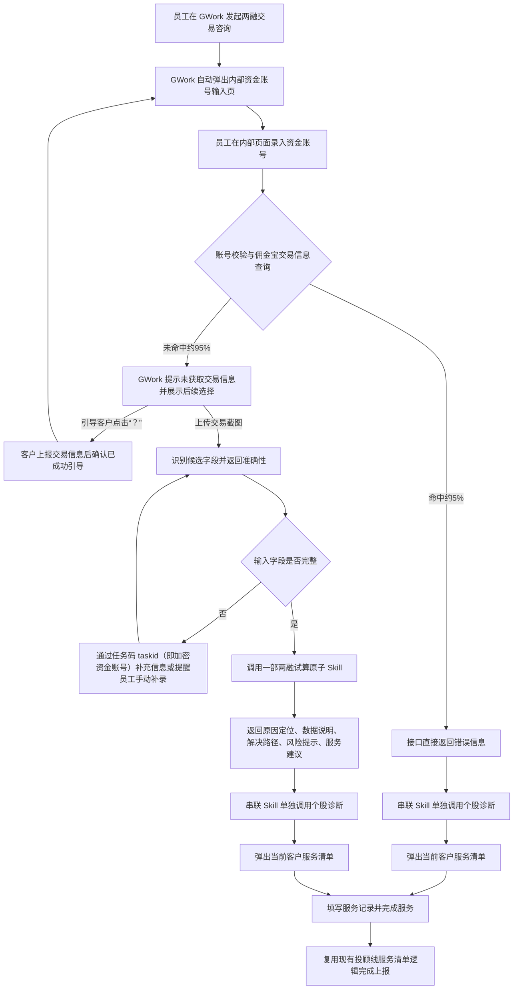

# 两融交易咨询承接串联 Skill

**版本**：v1.0  
**首期范围**：单客户咨询承接  
**承接端**：GWork 员工端

## 1. 背景与目标

客户在信用账户交易时，可能在提交委托前因可买/可卖数量、试算结果产生疑问，也可能在提交委托后收到失败信息。员工需要在不直接传递资金账号的前提下，快速取得当前客户的交易上下文，并获得可直接用于服务的标准内容。

本期将两融交易咨询做成 GWork 串联场景：员工发起咨询后，GWork 自动弹出内部资金账号输入页面。账号查询命中时，接口直接返回错误内容并进入服务清单；未命中时，员工通过引导客户点击“？”重新查询或上传截图继续补充交易信息。截图字段完整后才调用一部两融试算原子 Skill，最终由串联 Skill 单独调用个股诊断并展示当前客户服务清单。

## 2. 首期范围

- 只支持 GWork 发起的单客户咨询承接，不做批量客户列表。
- 不做咨询来源选择，不区分佣金宝 APP 与其他交易 APP 主路径；所有咨询统一从内部资金账号输入页面开始。
- 资金账号只在国金内部专用页面录入，GWork 不承载账号明文。
- 内部页面完成账号录入后生成受保护标识任务码 `taskid`，即加密资金账号；“任务码”和“加密资金账号”指同一标识，不是两个字段或两种凭据。
- 账号查询任务码沿用既有理财产品投钱场景的公共能力：有效期 10 分钟、一次性使用；本期不重复研发、不新增流程节点。
- 约 5% 查询命中时，接口直接返回错误内容并进入服务清单，不调用两融试算原子 Skill。
- 约 95% 查询未命中时，GWork 提示未获取交易信息，员工可选择引导客户点击佣金宝“？”后重新查询，或上传客户交易截图。
- 截图只用于当次识别和确认，不落库。GWork 返回候选字段及识别准确性，字段完整后才进入两融试算原子 Skill；字段不完整时通过 `taskid`（即加密资金账号）获取补充信息或提示员工手动补录，补充后重新校验，不另造并列凭据字段。
- 服务清单中的客户身份关联当前 GWork 会话客户上下文，服务页只消费上游返回结果。
- “两融交易咨询服务”采用纵向单列服务清单，直接展示当前客户基础信息、信用账户资产、待处理任务、逐笔交易诊断和个股诊断入口，不使用左侧客户列表或诊断侧栏。
- 资金账号录入、任务码签发/校验和过期提示由专门页面承接；服务页不展示或检测任务码。
- 当前浏览器原型不与 GWork 建立交互，不提供客户视图跳转、返回 GWork、重新查询或对话框内流程操作的模拟能力。
- 完成服务和回流完全复用现有投顾线服务清单完成服务上报逻辑，不新增回流字段、状态分支或数据处理规则。

## 3. 主流程

**任务码安全规则（既有公共能力）**：账号校验流程使用 10 分钟有效、一次性使用的任务码 `taskid`；该 `taskid` 即加密资金账号标识，也用于截图字段补充，不与另一个加密账号字段混用。过期或已消费时由既有专用页面提示并重新签发。本流程图不将其拆成新增研发节点。

## 4. 原子能力边界

| 能力 | 负责方 | 输入 | 输出 |
|---|---|---|---|
| 账号录入与身份校验 | 国金内部页面 / 既有公共能力 | 资金账号 | 受保护的查询上下文及任务码 `taskid`（即加密资金账号）；不向 GWork 返回账号明文 |
| 佣金宝交易信息查询 | 账号查询接口 | 受保护的查询上下文 | 命中：错误信息；未命中：未获取交易信息 |
| 截图字段识别与补充 | GWork 串联流程 | 当次交易截图、候选字段、任务码 `taskid`（即加密资金账号）或人工补录 | 字段及完整性结果 |
| 两融试算与原因解释 | 一部两融试算原子 Skill | 完整的截图/补录试算字段 | 原因定位、数据说明、解决路径、风险提示、服务建议 |
| 个股诊断 | GWork 串联 Skill 单独调用 | 证券标的与客户上下文 | 个股诊断入口链接；当前清单不展示诊断摘要 |
| 服务完成回流 | 现有投顾线服务清单 | 客户服务记录、完成服务动作 | 按现有逻辑写入服务结果 |

## 5. 服务清单展示

- 客户基础信息：姓名、脱敏资金账号、脱敏手机号、客户标签、电话外呼。
- 信用账户资产：信用账户总资产、信用账户净资产、信用账户总负债，使用同一数据时点。
- 待处理任务：默认收起；展开后展示任务描述、必做/选做、截止时间。
- 咨询记录：同一次咨询内多次错误或多张截图，按当前交互形式形成可切换的明细记录，最新一次置顶。
- 诊断内容：命中接口错误或原子 Skill 的结果均逐笔展示；原子 Skill 的五段内容完整展示；个股诊断提供跳转链接和“复制诊断链接”入口。数据说明中的账户数值、委托数量等字段由系统自动填充，缺失时显示“数据暂不可用”，不得臆造。
- 未得出诊断时仍可完成服务，服务上报逻辑不变。

## 6. 异常与兜底

| 场景 | 页面处理 |
|---|---|
| 账号校验失败 | 由专用账号页面提示，不进入服务清单 |
| 任务码过期或已消费 | 由既有公共页面提示并重新签发，不在服务清单处理 |
| 查询命中（约 5%） | 接口直接返回错误信息，进入服务清单，不调用两融试算原子 Skill |
| 查询未命中（约 95%） | GWork 提供“引导点击‘？’重新查询”或“上传截图”选择 |
| 截图字段不完整 | 通过任务码 `taskid`（即加密资金账号）补充信息或人工补录，重新校验；截图不落库 |
| 原子 Skill 无诊断结果 | 展示当前可用信息，允许完成服务并按投顾线逻辑回流 |
| 个股诊断不可用 | 标记入口不可用，不阻断错误信息/两融试算结果和完成服务 |

## 7. 不在本期范围

- 咨询来源选择及佣金宝 APP / 其他交易 APP 分流。
- 批量失败客户查询、左侧客户列表、自动任务、消息提醒、定时推送。
- 重复研发既有任务码页面/公共能力，或在流程图中为任务码安全规则新增独立节点。
- 截图持久化、截图历史检索、错误码维护后台、接口字段和数据库设计。
- 企微单聊、企微群发、独立服务记录保存按钮。
- 修改一部两融试算原子 Skill 内部诊断规则。
- 修改现有投顾线服务完成上报逻辑。
