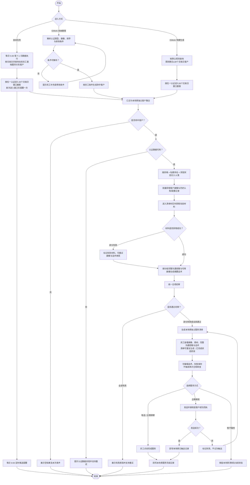

# 产品需求文档：存量合格投资者临近到期提醒服务清单

## 1. 项目概览

**项目名称**：存量合格投资者临近到期提醒服务清单  
**平台类型**：PC Web

### 背景与目标

认证仍有效的私募、资管客户，其认证、持仓、历史认购与配置记录、沟通材料和服务动作分散在多个系统。员工需要在服务前手动拼接信息，难以按客户特征快速开展续期权益沟通，也不易区分不同服务场景的结果。

本期维护独立的存量合格投资者临近到期提醒服务清单。员工可从自动任务或 GWork 进入清单，完成客户识别、画像查看、素材准备、话术编辑和服务记录。清单客户、筛选结果、服务状态和记录与资产升级、资产降级及既有高净值客户服务清单独立。

### 目标用户原型

- **用户特征**：负责名下高净值客户经营的客户经理或投顾，日常使用内部服务清单、电话和企微工具。
- **底层动机**：快速确认客户仍可服务的认证状态，带着完整的客户信息和合规沟通材料开展有针对性的服务。
- **典型场景**：客户认证首次进入距到期日 30 个交易日窗口时触发一次提醒；员工也可在 GWork 查询同一范围的存量合格投资者客户，查看认证、持仓、历史配置、沟通思路和话术，并开展电话或企微服务。

### 核心价值主张

为客户经理和投顾提供按认证与配置状态分层的独立服务清单，降低服务准备成本，并形成可追溯的服务闭环。

### 成功判定标准

- **独立清单可用**：员工可从自动任务或 GWork 生成本场景独立清单，且与资产升级、资产降级清单的客户、筛选和状态隔离。
- **服务准备完整**：清单内客户可展示私募/资管认证、持仓、历史认购与配置信息，以及对应的 8 类沟通思路。
- **异常可继续服务**：动态素材失败不阻断员工查看画像、生成初审话术和完成服务。
- **服务结果可追溯**：电话/单聊完成服务、企微群发成功回执均能按本场景独立回流服务结果。

## 2. 产品发现结论

### 价值层级分析

| 价值层级 | 表面需求 | 底层动机 | 隐含假设 |
| --- | --- | --- | --- |
| 客群识别 | 判断私募/资管认证是否仍可服务，并形成 8 类分组 | 员工优先服务仍可承接的认证客户 | 私募、资管认证数据能独立返回且按任一有效条件准确圈客 |
| 服务准备 | 汇总认证、持仓、认购记录、材料与沟通思路 | 员工无需跨系统拼接信息即可开展服务 | 资配状态、历史记录和材料版本可获得且可用 |
| 独立闭环 | 在本场景记录电话、单聊和群发结果 | 经营结果可追溯，且不干扰其他服务清单 | 服务完成动作、群发成功回执可携带本场景标识回流 |

### 风险评估

| 价值层级 | 价值风险（要不要） | 可用性风险（会不会用） | 可行性风险（做不做得出） | 商业可行性风险（撑不撑得住） |
| --- | --- | --- | --- | --- |
| 客群识别 | 低：自动任务每日调度节奏已明确，交易日历接入由研发按平台能力落实 | 低：员工已熟悉服务清单 | 中：依赖认证数据的完整性与时效 | 低：服务对象与现有高客经营目标一致 |
| 服务准备 | 中：8 类原文需保持准确且可用 | 中：信息密度高，需要清晰分层 | 高：依赖资配平台、柜台、物料中台和 AI+助手多方数据 | 低：复用既有服务工具，新增成本集中在数据接入 |
| 独立闭环 | 低：触达完成口径已明确 | 低：交互沿用既有流程 | 中：需保证服务记录不与其他场景串写 | 低：可直接支持服务过程统计 |

## 3. 产品结构图

### 核心功能清单

| 功能 | 优先级 | 一句话说明 |
| --- | --- | --- |
| 独立清单生成 | P0 | 支持认证临近到期自动任务、GWork 自由圈客和快捷生成，结果只进入本场景清单。 |
| 认证圈客与 8 类分组 | P0 | 按私募/资管任一认证进入 30 个交易日窗口纳入，并按认证资格、当前私募持仓、资配方案状态分组。 |
| 客户列表与筛选 | P0 | 提供客户搜索及认证资格、私募持仓、资配方案状态等本场景筛选。 |
| 客户画像 | P0 | 展示两类认证信息、近 20 日日均净资产、KYC 风险等级、持仓结构和历史认购/配置记录。 |
| 沟通素材 | P0 | 沟通素材区及企微群发仅展示当前客群沟通思路原文中点名的一页通，并仅按是否做过资配匹配版本，不按客户资产等级筛选；进入清单时从资配平台实时获取。财富月刊、大 C 方案不在本场景展示或发送。两份固定认证指引仅在完整沟通思路中以内部预览链接提供，不作为客户素材。 |
| 沟通思路与服务话术 | P0 | 按 8 类客户分组键匹配需求表原文，仅展示当前客户对应的一组完整沟通思路，并生成经过初审的摘要式对客话术。 |
| 服务触达与记录 | P0 | 支持电话、企微单聊、企微群发及完成服务记录，状态只写入本场景。 |
| 数据与素材异常处理 | P1 | 对认证、画像、动态素材和话术失败提供明确状态与重试，不阻断可继续的服务动作。 |

### 页面组织方式

采用无全局导航的单页列表-详情结构。入口来自员工消息推送或 GWork，打开后进入独立的“存量合格投资者临近到期提醒服务清单”，不进入资产升级、资产降级或其他高净值客户服务清单。

```text
消息推送 / GWork
└── 存量合格投资者临近到期提醒服务清单（独立清单）
    ├── 左侧：客户搜索、分组筛选、客户列表、企微群发
    └── 右侧：客户基础信息、认证画像、持仓与历史记录、适用的一页通素材、
             完整沟通思路（含内部资料预览）、服务话术、电话/企微触达、完成服务
```

页面结构、基础交互和视觉风格继承既有高净值客户服务清单；客户集合、筛选结果、分组、群发结果、服务状态和服务记录独立维护。

### 本期不做

| 本期不做 | 理由 |
| --- | --- |
| 将本场景并入资产升级、资产降级或既有高净值客户服务清单 | 本场景需要独立的客群、分组和服务闭环，避免跨场景状态串写。 |
| 修改资产升级、资产降级清单的页面与业务规则 | 两个既有场景保持现状，本场景只继承其页面设计基线。 |
| AI 选好股信号、推荐理由、热点/异动解读 | 与本场景认证续期及权益沟通无关，且需求已明确忽略。 |
| 展示产品到期时间或增加未回应客户月度跟进 | 不属于本期客户画像和服务规则。 |
| 在主 PRD 中定义接口字段、数据库结构、技术架构或模型提示词 | 这些内容归页面 PRD 与研发交付设计。 |

## 4. 业务流程图



### 自动任务、清单重生成与状态规则

- 使用交易日历计算认证有效期剩余交易日；到期当天算未到期。
- 自动任务每日 5:00 取 T-1 日数据执行圈客，执行结果每日 9:00 定时推送。
- 客户首次进入“距认证有效期到期日 ≤ 30 个交易日”窗口时触发一次提醒，之后 29、28 个交易日不重复提醒。提醒去重按“客户 + 认证类型 + 当前有效期”记录；推送失败允许重试，但不得生成重复提醒。
- 首次上线需补扫已处于窗口内且尚未记录提醒的客户。
- 清单可以重复生成。每次生成按最新认证数据重新圈客：若客户完成续期或有效期被修正后不再满足条件，不再圈选；若仍满足条件则按最新数据处理。已在当前服务清单完成服务的客户，二次进入时保留在已服务区域并回显已服务状态。
- GWork 快捷生成默认查询与自动任务相同的 30 个交易日范围；自由圈客仍按员工明确条件执行。

## 5. 页面索引

| 序号 | 页面名 | 一句话用途 | 状态/浮层备注 | 设计状态 |
| --- | --- | --- | --- | --- |
| 01 | 存量合格投资者临近到期提醒服务清单 | 展示本场景独立客户、认证画像、沟通材料、完整沟通思路、服务话术和触达动作 | 正常态、无命中、数据加载/失败、话术初审/编辑、动态材料失败、服务完成 | 已确认 |

## 6. 变更记录

| 版本 | 日期 | 变更说明 | 影响范围 |
| --- | --- | --- | --- |
| v1.0 | 2026-10-21 | 新建独立存量合格投资者认证客户服务跟踪主 PRD，明确页面设计继承关系与数据状态隔离 | 全部 |
| v1.0 | 2026-10-22 | 将自动任务与 GWork 快捷生成统一调整为认证到期前 30 个交易日窗口；补充交易日历、一次提醒、清单重生成、已服务回显及有效期修正规则 | 生成流程、圈客、状态与验收标准 |
| v1.0 | 2026-10-22 | 场景名称调整为“存量合格投资者临近到期提醒服务清单”，业务规则与交互不变 | 项目名称、入口、页面索引 |
| v1.0 | 2026-10-22 | 两份固定指引调整为沟通思路内可预览的员工参考资料；沟通素材仅保留适用的一页通，移除财富月刊和大 C 方案 | 沟通素材、沟通思路、群发内容 |
| v1.0 | 2026-10-22 | 确认自动任务 5 点取 T-1 日数据、9 点推送；资配状态直接依据资配平台已存储记录；群发默认千人一面并按 8 类客群分组；适用一页通默认勾选且允许取消 | 自动任务、客群分组、群发 |
