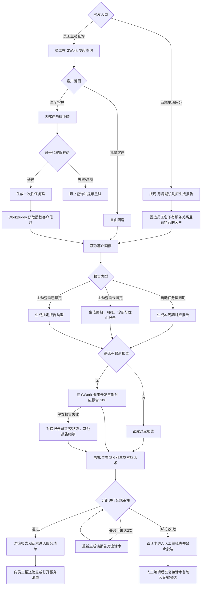

# 投后理财账户服务报告

## 1. 项目概览

**项目名称**：投后理财账户服务报告  
**平台类型**：Web 网页 / GWork（WorkBuddy）与内部服务清单  
**版本**：v1.0

### 背景与目标

周报、月报及诊断与优化报告生成后，员工需要一个统一入口查看报告、理解客户情况并执行服务。本产品支持周期自动推送和员工主动查询，连接客户圈选、画像、报告 Skill、对应话术、合规审核和服务清单。

员工批量查询使用自由圈客；单客查询必须先经过内部安全任务码中转，不把客户姓名、资金账号等敏感信息直接传给 WorkBuddy。两个查询分支最终汇入同一套报告、话术和服务清单流程。

### 目标用户原型

- **用户特征**：负责名下客户经营的客户经理或投顾，日常通过 GWork、内部服务清单和企微开展客户服务。
- **底层动机**：按周期或按需掌握客户账户服务报告，并能基于报告内容完成有依据的沟通。
- **典型场景**：收到周报、月报或诊断与优化报告推送；批量查询一组客户；或在权限保护下查询单个客户。

### 核心价值主张

为客户经理和投顾提供安全、可分类型查看、可审核触达的账户服务报告，减少报告查找和服务准备成本。

### 成功判定标准

- **用户侧**：员工能够通过周期推送、批量自由圈客或单客任务码查询，查看报告及其对应话术并完成服务。
- **业务侧**：报告与对应话术按类型可追溯，单客敏感信息不直接传给 WorkBuddy，异常报告和不可触达话术不会被误发送。

## 2. 产品发现结论

### 价值层级分析

| 价值层级 | 表面需求 | 底层动机 | 隐含假设 |
|---|---|---|---|
| 报告可得 | 查看周报、月报和诊断报告 | 查询时能拿到最新可用内容 | 开发三部 Skill 能复用或现场生成报告 |
| 查询安全 | 单客使用任务码中转 | 保护客户敏感信息和访问权限 | 内部系统能校验权限并生成一次性凭证 |
| 分类型服务 | 每类报告生成对应话术 | 沟通内容与报告主题严格对应 | 话术 Skill 能按报告类型独立生成和审核 |

### 风险评估

| 价值层级 | 价值风险 | 可用性风险 | 可行性风险 | 商业可行性风险 |
|---|---|---|---|---|
| 报告可得 | 低 | 中 | 高 | 低 |
| 查询安全 | 低 | 中 | 中 | 中 |
| 分类型服务 | 低 | 中 | 中 | 中 |

## 3. 产品结构图

### 核心功能清单

| 功能 | 优先级 | 一句话说明 |
|---|---|---|
| 周期自动推送 | P0 | 每周推送周报，每月推送月报和诊断与优化报告。 |
| 批量自由圈客查询 | P0 | 先明确客户范围，再按资产、画像、排序和排除条件生成服务清单。 |
| 单客任务码中转 | P0 | 内部校验资金账号和权限，生成一次性任务码后安全交由 WorkBuddy 取数。 |
| 三类报告读取/生成 | P0 | 优先读取最新报告，缺失时在 GWork 内现场调用开发三部对应 Skill。 |
| 对应话术与合规 | P0 | 周报、月报、诊断报告分别生成对应话术并独立审核。 |
| 账户服务清单 | P0 | 展示客户画像、三类报告状态、对应话术和独立触达权限。 |
| 标准方案与受控群发 | P0 | 按客户展示可用标准方案素材，并按报告/话术状态组织群发。 |

### 页面组织方式

采用客户列表-详情结构。详情区按报告类型组织周报、月报、诊断与优化报告及对应话术；单客安全中转页是主动查询的独立入口，不作为全局导航。

### 功能/页面层级关系

```
周期自动任务 / GWork 主动查询
├── 批量自由圈客 → 客户投后理财账户服务报告
└── 单客查询 → 客户服务任务码中转 → 客户投后理财账户服务报告
    ├── 客户列表与画像
    ├── 周报 + 周报话术
    ├── 月报 + 月报话术
    └── 诊断与优化报告 + 对应话术
```

### 本期不做

| 本期不做 | 理由 |
|---|---|
| 两个理财场景页面互跳 | 两个场景独立使用，串联指业务链路而非页面关系。 |
| 账户报告以外场景使用任务码 | V1.0 任务码只服务单客账户报告查询。 |
| 把多类报告合成一份综合话术 | 每类报告必须生成与自身内容对应的话术。 |
| 人工编辑后再次强制合规审核 | 已确认人工编辑后立即恢复该话术复制和企微触达。 |
| 报告 Skill、任务码和接口技术设计 | 属于技术方案，不属于主 PRD。 |

## 4. 业务流程图

### 核心业务流程



### 关键业务规则

#### 自动推送

- 每周一推送名下客户理财账户周报服务清单。
- 每月第一个交易日推送月报服务清单。
- 每月第二个交易日推送诊断与优化报告服务清单。
- 自动任务仅圈选员工名下有基础服务关系且有持仓的客户。
- 对应报告、对应话术和合规处理完成后，才推送该部分服务清单。

#### 主动查询与安全中转

- 批量查询必须先明确客户范围，使用自由圈客模式生成服务清单。
- 单客查询不能直接把客户姓名或资金账号传给 WorkBuddy。
- 单客查询进入内部中转页，校验资金账号和员工权限后生成一次性、不含敏感信息的任务码。
- 任务码仅限当前服务场景使用，有效期 10 分钟；无权限、账号错误、过期或对接失败时阻止查询并支持重试。
- 任务码中转 V1.0 仅用于本场景。

#### 报告与对应话术

- 员工未指定报告类型时默认生成周报、月报、诊断与优化报告三类；指定时只生成指定类型。
- 有最新报告时优先读取；没有最新报告时在 GWork 内现场调用开发三部对应 Skill。
- 三类报告独立处理，单类报告失败不阻塞其他报告和话术；失败报告 Tab 展示异常或空状态，并支持重试。
- 一个客户按周报、月报、诊断与优化报告分别生成对应话术；每份话术只使用对应报告，不混合其他报告内容。
- 报告和对应话术完成后才进入服务清单，不展示中间生成态。

#### 合规与触达

- 每份话术独立提交合规审核，违规后最多自动重新生成 3 次。
- 某份话术三次仍未通过时，客户仍进入服务清单，该话术显示“AI生成话术未通过合规审核，请自行编辑话术”。
- 人工编辑前，该话术禁止一键复制、企微单聊和企微群发；同一客户其他通过审核的话术不受影响。
- 员工自行编辑后，该话术立即恢复复制和企微触达，无需再次合规审核。
- 清单顶部展示实际生成来源和生成时间；来源为员工消息时展示动态消息名称。
- 完整报告使用长图只读预览，预览不提供发送操作；报告支持下载。AI 话术可在清单内直接编辑并失焦保存，人工编辑话术不标记“合规通过”。
- 小 C/大 C 标准方案是当前客户的公共素材，独立于三类报告；五档选择按客户隔离保存，仅作为该客户群发的附加素材。
- 左侧企微一键群发按客户和报告类型计算可发送内容；异常报告、待人工编辑话术和已触达报告不发送，成功回执用于防重。

## 5. 页面索引

| 序号 | 页面名 | 一句话用途 | 状态/浮层备注 | 设计状态 |
|---|---|---|---|---|
| 01 | 客户投后理财账户服务报告 | 查看客户列表、画像、三类报告、方案素材、对应话术和触达状态 | 报告长图预览/下载；方案抽屉；报告成功/异常/空；话术审核通过/人工编辑态 | 已确认 |
| 02 | 客户服务任务码中转 | 单客查询时完成账号权限校验并安全对接 WorkBuddy | 输入、校验失败、生成中、成功、对接失败、过期 | 已确认，未纳入本次原型 |

## 6. 变更记录

| 版本 | 日期 | 变更说明 | 影响范围 |
|---|---|---|---|
| v1.0 | 2026-10-30 | 初始版本，建立账户报告到服务清单的完整链路 | 全部 |
| v1.0 | 2026-11-03 | 同步最终服务清单展示、公共方案素材、长图预览、话术编辑和按报告群发规则 | 页面与业务规则 |
