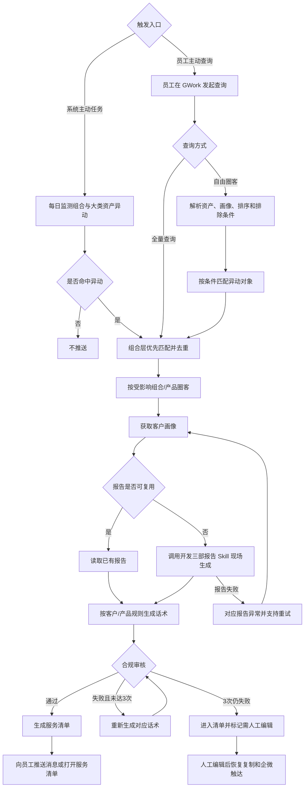

# 理财投后异动服务报告

## 1. 项目概览

**项目名称**：理财投后异动服务报告  
**平台类型**：Web 网页 / GWork（WorkBuddy）与内部服务清单  
**版本**：v1.0

### 背景与目标

市场出现组合净值或大类资产异动时，客户经理需要知道哪些客户和产品真正受到影响，并快速获得可解释、可审核、可执行的服务内容。本产品将异动监测、异动与产品匹配、客户画像、报告生成、话术生成、合规审核和服务清单串成一条业务链路。

系统主动任务按日监测并向员工推送；员工也可在 GWork 中全量查询或自由圈客。两种入口最终进入同一套异动匹配、报告、话术和服务清单流程，不做两个页面互相跳转。

### 目标用户原型

- **用户特征**：负责名下客户经营的客户经理或投顾，日常通过 GWork、内部服务清单、电话和企微开展服务。
- **底层动机**：在市场异动后快速判断服务优先级，避免遗漏受影响客户，也避免向不相关客户重复触达。
- **典型场景**：收到异动推送，或在 GWork 中查询某类资产/组合异动影响客户时，需要直接获得报告、话术和客户清单。

### 核心价值主张

为客户经理和投顾识别可解释的异动影响范围，提供经过合规控制的客户/产品服务清单，帮助员工完成及时、准确的投后服务。

### 成功判定标准

- **用户侧**：员工能够从自动推送或 GWork 查询完成异动识别、受影响对象查看、报告阅读和话术触达。
- **业务侧**：同一异动周期内，组合层与资产层不重复推送；服务清单中的每个对象均能追溯至具体异动条件和匹配依据。

## 2. 产品发现结论

### 价值层级分析

| 价值层级 | 表面需求 | 底层动机 | 隐含假设 |
|---|---|---|---|
| 准确匹配 | 展示异动影响客户和产品 | 只服务真正需要关注的对象 | 组合映射、资产穿透、持仓占比和资格数据准确可用 |
| 可解释服务 | 提供异动报告和沟通话术 | 员工能理解异动并向客户说明 | 报告 Skill 能提供可读内容，话术能严格引用报告 |
| 安全执行 | 审核、编辑和企微触达 | 服务动作可控且可留痕 | 合规审核和人工编辑状态能控制对客触达 |

### 风险评估

| 价值层级 | 价值风险 | 可用性风险 | 可行性风险 | 商业可行性风险 |
|---|---|---|---|---|
| 准确匹配 | 中 | 中 | 高 | 低 |
| 可解释服务 | 低 | 中 | 中 | 低 |
| 安全执行 | 低 | 中 | 中 | 中 |

## 3. 产品结构图

### 核心功能清单

| 功能 | 优先级 | 一句话说明 |
|---|---|---|
| 系统主动异动监测 | P0 | 每日检测组合和大类资产异动，命中后进入生成与推送链路。 |
| GWork 主动查询与自由圈客 | P0 | 支持全量异动查询，以及资产、画像、排序和排除条件圈客。 |
| 异动与产品匹配 | P0 | 按组合风险阈值、资产阈值、10%占比和产品资格匹配。 |
| 客户画像与报告生成 | P0 | 获取客户画像，优先读取报告，无可用报告时调用开发三部 Skill。 |
| 话术生成与合规控制 | P0 | 客户维度生成个性化话术，产品维度生成通用话术并独立审核。 |
| 双维度服务清单 | P0 | 按客户和产品查看报告、话术、触达权限和服务结果。 |
| 清单元数据与受控触达 | P0 | 展示生成来源/时间；以长图只读预览、下载、编辑和按规则群发完成服务动作。 |

### 页面组织方式

采用单一服务清单的列表-详情结构。页面内部通过“全部异动/组合异动/大类资产异动”和“客户维度/产品维度”切换结果范围，不增加全局导航，也不与账户服务报告页面互跳。

### 功能/页面层级关系

```
系统主动任务 / GWork 主动查询
└── 理财投后异动服务报告
    ├── 异动事件范围：全部 / 组合 / 大类资产
    ├── 客户维度：受影响客户 → 客户画像 → 产品、报告、话术、触达
    └── 产品维度：受影响产品 → 持有客户 → 报告、话术、触达
```

### 本期不做

| 本期不做 | 理由 |
|---|---|
| 两个理财场景页面互相跳转 | 两个场景独立使用，串联指业务链路而非页面关系。 |
| 异动场景单客任务码中转 | V1.0 任务码中转只用于账户服务报告。 |
| 自动调仓、产品推荐和收益承诺 | 本产品提供服务依据，不替员工做投资决策。 |
| 在主 PRD 中定义接口、数据库和模型部署 | 属于后续技术方案，不属于产品结构设计。 |

## 4. 业务流程图

### 核心业务流程



### 关键业务规则

#### 组合层异动匹配

- 组合净值当日跌幅达到所属风险类别阈值，或连续下跌达到 5 个交易日，或连续 3 个交易日累计跌幅达到所属阈值时触发。
- 同一组合最近 5 个交易日内已触发过，不重复触发。
- 组合类别与示例匹配：货币类 0.1%（货币优享组合）；固收类 0.4%（盈理财富专区债券型基金组合、短债优享、货益最多）；固收+类 0.5%（目标盈、全球稳健、盈理财富专区固收）；权益类 5%（指数盈专区）；多资产低波类 0.8%（全球平衡）；多资产中波类 2.0%（多元优选）；多资产高波类 2.5%（全天候，管理型及建议型）。

#### 大类资产异动匹配

- 黄金：连续 4 个交易日累计跌幅大于 4%，或当日跌幅超过 2.5%。
- 中债：连续 4 日累计跌幅大于 0.6%，或当日跌幅超过 0.4%。
- 美债：连续 4 日累计跌幅大于 1.6%，或当日跌幅超过 1.2%。
- 中证 800、标普 500：连续 4 日累计跌幅大于 5%、当日跌幅超过 3%，或近 20 个交易日最大回撤超过 10%。
- 原油：当日跌幅超过 6%。其他资产沿用业务确认的尾部风险阈值。

#### 产品匹配与优先级

- 投顾组合中，对应大类资产的基金持仓占比超过 10%时，纳入该资产层异动匹配。
- 单产品按底层资产下跌匹配，底层资产占比超过 10%时纳入异动产品。
- 产品层服务报告仅推送满足资格的场外公募产品；纯财富委托经纪人客户合并保有规模须不低于 2,000 万，基金投顾保有客户不受该规模门槛限制。
- 同期间同时命中组合层和资产层时，仅生成组合层服务任务。

#### 报告、话术和触达

- 报告优先复用；无可用报告时在 GWork 内现场调用开发三部 Skill。
- 报告完成后才生成话术，话术未完成前不进入服务清单。
- 客户维度话术综合同一客户涉及的多个异动和受影响产品；产品维度话术按单产品生成通用内容。
- 话术审核失败最多重新生成 3 次。三次仍失败时仍进入清单，但需人工编辑；编辑前禁止一键复制、企微单聊和企微群发，编辑后无需再次审核即可恢复。
- 清单顶部展示实际生成来源和生成时间；来源为员工消息时展示动态消息名称。
- 异动服务报告以 Report Skill 实际返回的文件为单位展示；客户与产品详情均逐份提供固定宽度横向报告卡。每张卡标明报告名称、关联异动名称和异动层级，并独立支持长图只读预览和下载；页面端不额外合并、拆分或补造报告。无文件、部分文件异常和全部文件异常按真实文件状态展示。AI 话术可在清单内编辑并失焦保存，人工编辑话术不标记“合规通过”。
- 客户维度仅从受影响客户列表发起一键群发，逐客户发送报告长图和综合话术；产品维度按产品群发，逐客户发送该产品的同一报告长图和通用话术。成功回执用于防重。

## 5. 页面索引

| 序号 | 页面名 | 一句话用途 | 状态/浮层备注 | 设计状态 |
|---|---|---|---|---|
| 01 | 理财异动服务报告看板 | 查看异动事件、受影响客户/产品、报告、话术和服务动作 | 全部/组合/大类资产；客户/产品；多份报告横向卡、逐份长图预览/下载；异常、空状态、人工编辑态 | 已确认 |

## 6. 变更记录

| 版本 | 日期 | 变更说明 | 影响范围 |
|---|---|---|---|
| v1.0 | 2026-10-30 | 初始版本，建立异动监测到服务清单的完整链路 | 全部 |
| v1.0 | 2026-11-03 | 同步最终服务清单展示、报告长图预览、话术编辑和群发约束 | 页面与业务规则 |
| v1.0 | 2026-11-10 | 报告模块按 Report Skill 返回的文件逐份展示，支持多报告横向浏览及逐份预览/下载 | 页面与业务规则 |
