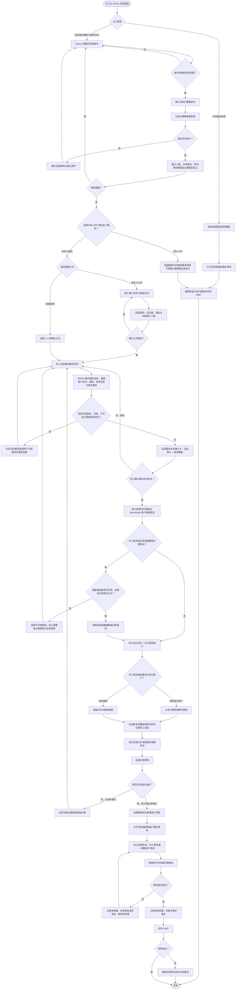

# 自由圈客与通用客户服务清单（阶段一）PRD

## 1. 项目概览

**项目名称**：自由圈客与通用客户服务清单（阶段一）  
**平台类型**：既有 GWork 客户端（Skill 串联）及浏览器服务清单

### 背景与目标

一线客户经理 / 投顾的临时客户经营需求无法完全被固定服务场景覆盖。阶段一在既有 GWork 中串联自然语言圈客 Skill、服务内容生成与合规审查能力，将审查通过的服务包交由浏览器端通用客户服务清单执行，并将结果回传 iSMP。

### 目标用户原型

- **用户特征**：服务本人基础服务关系客户的一线客户经理或投顾，日常需要根据市场、客户状态或经营目标发起服务。
- **底层动机**：快速将客户经营意图转化为可解释、可执行、可追溯的服务动作。
- **典型场景**：员工在 GWork 输入圈客条件和服务目的，确认客群后选择已有 SOP 或自定义服务；自定义服务生成合规内容后，进入浏览器服务清单完成触达。

### 核心价值主张

> 为一线客户经理 / 投顾，将临时客户经营意图转化为可解释、合规、可执行且可回传的服务闭环。

### 核心术语

| 术语 | 说明 |
|---|---|
| GWork | 公司内部私有化部署的既有客户端，承载自然语言圈客 Skill 及服务包生成、合规分流和服务清单跳转。 |
| 自然语言圈客 Skill | 将员工的自然语言条件转化为可执行圈客规则，并返回可解释客群结果的既有能力。 |
| 服务诉求协议 | 员工自由描述经 GWork 最少必要补问和确认后形成的结构化生成依据，包含服务目标、期望客户动作、渠道、内容参考和表达要求。 |
| 服务包 | 某次自定义服务生成并通过初始合规审查的内容、素材、渠道和客户集合。 |
| 客户分流规则 | 员工为本次客群定义的“客户条件—触达渠道”规则，包含规则优先级及未命中客户的兜底去向。 |
| 渠道子清单 | 服务包内按电话、企微 RPA 群发、企微一键群发拆分的可执行清单。 |
| 通用客户服务清单 | 浏览器端承接服务包、执行触达、留存记录并回传 iSMP 的服务清单。 |

### 成功判定标准

1. 首批试点中，发起自由圈客的员工至少 60% 完成“确认客群至生成至少一个可执行渠道子清单”。
2. 相比试点前的人工准备方式，“圈客至可执行服务清单”的中位耗时下降，并以试点前后同口径数据验证。
3. 未通过初始合规审查的内容进入服务清单或被执行的情况为 0。
4. 已执行服务结果回传 iSMP 的成功率不低于 95%，失败记录可见且支持重试。

## 2. 产品发现结论

### 价值层级分析

| 价值层级 | 表面需求 | 底层动机 | 隐含假设 |
|---|---|---|---|
| 自由圈客与可解释结果 | 用自然语言圈选并持续缩圈 | 员工能从固定场景外发起可信的客户经营动作 | 圈选条件、命中原因和客群特征足以帮助员工判断结果是否可用 |
| 按需服务包 | 按员工直接选择渠道，或按员工定义的客户分流规则生成 1-3 种渠道内容 | 在业务灵活性与生成成本之间取得平衡 | 员工能够判断本次需要哪些渠道、分流条件和数据参考信息 |
| 合规执行与可追溯回传 | 仅将初审通过的内容交给服务清单 | 在合规约束下完成服务并保留全过程依据 | 内容审查、触达结果和 iSMP 回传可稳定串联 |

### 风险评估

| 价值层级 | 价值风险（要不要） | 可用性风险（会不会用） | 可行性风险（做不做得出） | 商业可行性风险（撑不撑得住） |
|---|---|---|---|---|
| 自由圈客与可解释结果 | 中 | 中 | 中 | 中 |
| 按需服务包 | 中 | 高 | 高 | 中 |
| 合规执行与可追溯回传 | 低 | 中 | 高 | 高 |

## 3. 产品结构图

### 核心功能清单

| 功能 | 优先级 | 一句话说明 |
|---|---:|---|
| GWork 自然语言圈客 Skill 串联 | P0 | 在既有 GWork 中完成条件澄清、圈客、缩圈、结果解释、服务路径选择和服务包交接。 |
| 已有 SOP 直达 | P0 | 员工选择已有 SOP 时，直接打开对应既有服务清单；画像、话术、合规和回传均沿用该 SOP 已定义的既有逻辑。 |
| 自定义服务包生成与合规分流 | P0 | 员工直接选择 1-3 种渠道，或定义客户分流规则将客户分配到 1-3 种渠道，按需生成并仅交接初审通过的内容。 |
| 服务诉求澄清与确认 | P0 | 员工以一句自由描述发起，GWork 仅补问必要信息并回显服务诉求确认卡，确认后才生成三类渠道内容。 |
| 通用客户服务清单 | P0 | 承接服务批次，支持电话、RPA 群发和一键群发的执行、素材、记录和回传。 |
| 服务执行与版本追溯 | P0 | 电话完成服务或企微发送成功后记录初审版本、人工编辑版本、素材和执行结果。 |
| iSMP 回传与重试 | P0 | 回传既有服务结果及自由圈客补充信息，并展示失败与重试状态。 |

### 页面组织方式

采用“既有 GWork 客户端 + 浏览器端列表详情工作台”的组合模式。GWork 仅承接 Skill 串联，不新增页面；浏览器端通用客户服务清单承接服务批次并完成执行。

### 功能/页面层级关系

```text
既有 GWork 客户端
├── 自然语言圈客 Skill
│   ├── 条件澄清、圈客结果、继续缩圈
│   ├── 已有 SOP → 对应既有服务清单
│   └── 自定义服务
│       ├── 渠道直接选择或客户条件自定义分流
│       ├── 服务诉求澄清与确认（全局默认 + 渠道覆盖）
│       ├── 内容参考信息与表达要求确认
│       ├── 服务包生成与初始合规审查
│       └── 通过内容 → 浏览器端通用客户服务清单
浏览器端通用客户服务清单
├── 电话子清单
├── 企微 RPA 群发子清单
├── 企微一键群发子清单
└── 服务记录与 iSMP 回传
```

### 本期不做（Non-Goals）

| 本期不做 | 理由 |
|---|---|
| GWork 页面改造、页面 PRD 或原型 | GWork 是既有客户端，本期只串联其已有能力与相关 Skill。 |
| 团队固定 SOP 配置及团队服务方向管理 | 属于阶段二能力。 |
| 管理人员圈选团队客户、下发任务与团队进度管理 | 属于阶段三能力。 |
| 服务清单内重新调用模型生成话术、素材或诊断 | 内容在 GWork 生成并完成初审后才进入服务清单。 |
| 触达方式智能推荐 | 渠道由员工选择，避免在本期引入未经验证的推荐规则。 |
| 全量客户画像模块 | 服务清单仅展示基础信息、圈客条件与单客命中原因；详细信息通过既有客户视图查看。 |

## 4. 业务流程图

### 核心业务流程



### 关键业务规则

| 节点 | 规则 |
|---|---|
| GWork 圈客结果 | 本地化与非本地化环境按既有规则展示；非本地化环境仅展示客群聚合信息。 |
| 近期联系 | 当日已联系和近 7 日已联系客户均明确标记，不自动排除；由员工决定继续服务或排除，并在生成前再次校验。 |
| 客户分流 | 员工可直接多选渠道，也可定义“客户条件—渠道去向”规则；GWork 回显条件、优先级、兜底去向、预计人数及单客分流原因。每位客户按优先级仅进入一个渠道。 |
| 已有 SOP 边界 | 自由圈客后选择已有 SOP，或直接发起已有服务场景时，均直接打开对应既有服务清单；不进入本期自定义服务的诉求澄清、客户画像选择、话术生成、初始合规审查或通用客户服务清单。该 SOP 已定义的画像、话术、合规、执行和 iSMP 回传规则保持不变。 |
| 服务诉求协议（仅自定义服务） | 员工可仅输入一句自由描述；GWork 不重复询问已识别信息，只补问无法生成或校验的字段。服务目标、期望客户动作和至少一种触达渠道为生成前必备信息。多渠道先继承全局默认，再允许按渠道覆盖服务目标、期望客户动作、画像/素材及表达要求。 |
| 内容参考信息（仅自定义服务） | 默认使用命中原因及《workbuddy 客户画像数据梳理》中的客户基础信息；近期沟通、风险等级、持仓盈亏等其他客户画像数据仅在员工明确指定，且已接入、权限和合规规则允许时调用。 |
| 话术生成（仅自定义服务） | 电话与 RPA 按单客生成，电话输出沟通提纲、RPA 输出一段个性化企微消息；一键群发只按共同特征生成一段统一文案，不得引用单客画像或个体诊断。所有内容仅使用确认协议中已确认且可用的数据、Skill 结果和素材。 |
| 生成前预校验（仅自定义服务） | 对收益承诺、确定性推荐、不当施压、无权限数据、不可用 Skill 或一键群发引用单客字段等情形，GWork 必须在生成前说明原因并要求调整；不得仅依赖后续合规审查拦截。 |
| 合规分流（仅自定义服务） | 电话与 RPA 按逐客内容审查；一键群发按统一文案与素材组合审查。仅通过内容进入通用客户服务清单。 |
| 服务清单 | 服务清单只渲染 GWork 已生成并通过初审的内容，不再次调用模型生成。 |
| 触达成功判定 | 电话点击“完成服务”即为成功触达；企微以发送成功回执为成功触达。成功后记录执行结果、内容与素材版本并回传 iSMP，不增加二次触达判断或二次跟进原因。 |
| 状态与素材同步 | 每位客户按分流规则仅归属一个渠道子清单；企微以逐客户回执更新成功或失败，失败保留待处理。RPA 按客户、一键群发按批次维护“随企微发送”素材，服务详情与群发编辑使用同一份选择结果。 |
| 人工编辑 | 编辑不触发二次合规审查，但须保留初审通过版本、编辑信息、最终执行版本与实际发送素材。 |

## 5. 页面索引

| 序号 | 页面名 | 一句话用途 | 状态/浮层备注 | 设计状态 |
|---:|---|---|---|---|
| 02 | [通用客户服务清单](./pages/02-通用客户服务清单.md) | 在浏览器端承接通过初审的服务包，执行电话、RPA 群发和一键群发并回传结果 | 多渠道子清单、近期联系标记、触达成功/失败、渠道不可用、回传失败重试 | ✅ 已确认 |

## 6. 变更记录

| 版本 | 日期 | 变更说明 | 影响范围 |
|---|---|---|---|
| v1.0 | 2026-11-25 | 初始版本 | 全部 |
| v1.1 | 2026-11-26 | 增加员工自定义客户分流规则；完成通用客户服务清单页面 PRD 和选型 | GWork Skill 串联、通用客户服务清单 |
| v1.2 | 2026-11-26 | 服务清单增加“本次服务画像”，完整展示客户基础信息及本次员工补充画像 | 通用客户服务清单 |
| v1.3 | 2026-11-26 | 调整服务清单右侧布局：服务素材下依次展示话术和服务记录；回传与审计不在页面展示 | 通用客户服务清单 |
| v1.4 | 2026-11-26 | 群发入口按 RPA / 一键渠道命名，默认选择全部待服务客户；诊断素材默认勾选并统一按“诊断名称-标的名称”展示 | 通用客户服务清单 |
| v1.5 | 2026-11-27 | 移除服务清单中的二次触达判断与二次跟进原因；电话完成服务或企微发送成功后直接记录并回传 | 业务流程、通用客户服务清单 |
| v1.6 | 2026-11-27 | 修正渠道归属、企微回执、素材同步与统计口径；搜索时群发默认选择当前搜索结果的规则维持不变 | 通用客户服务清单原型与页面 PRD |
| v1.7 | 2026-11-27 | 补充服务诉求协议、最少必要补问、确认卡及电话/RPA/一键群发的话术生成规则 | GWork 自定义服务串联、服务包生成与合规分流 |
| v1.8 | 2026-11-27 | 修正画像默认使用范围：默认仅使用命中原因与 Workbuddy 客户基础信息，其他画像须由员工明确指定 | 服务诉求协议、话术生成 |
| v1.9 | 2026-11-27 | 明确已有 SOP 为独立直达链路，不进入自定义服务的画像、话术、合规和通用清单流程；修正流程图节点复用 | 业务流程、关键规则 |
