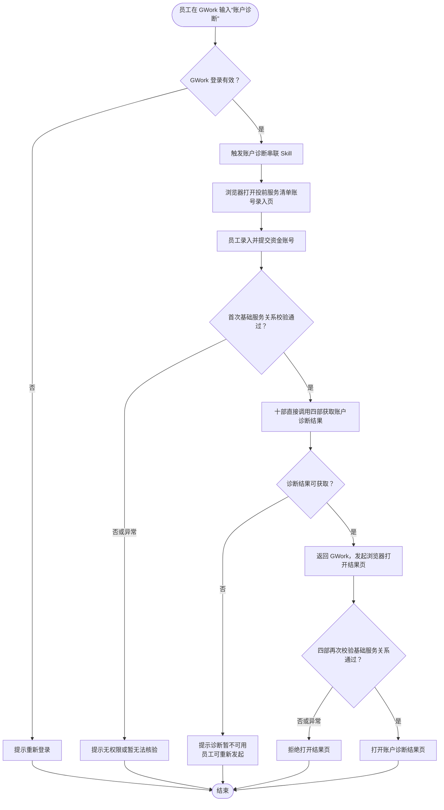

# 产品需求文档：账户诊断串联

## 1. 项目概览

**项目名称**：账户诊断串联  
**平台类型**：Web 网页（GWork 入口及浏览器承接）

### 背景与目标

客户经理或投顾需要查看客户的账户诊断结果，但资金账号属于客户敏感信息，不能在 GWork 对话中传递。当前缺少一条从 GWork 发起、在受控页面录入资金账号、完成基础服务关系校验并打开账户诊断结果的标准路径。

本期新增账户诊断串联能力。员工在 GWork 输入“账户诊断”后，由账户诊断串联 Skill 触发浏览器流程；资金账号录入及首次基础服务关系校验复用理财产品投前服务清单既有页面和逻辑。校验通过后，十部直接调用四部获取账户诊断结果；账户诊断结果页打开前，四部再次校验员工与客户的基础服务关系。任一校验未通过时，员工不得进入结果页。

### 目标用户原型

- **用户特征**：已登录 GWork、日常需要为本人服务关系内客户提供账户服务的客户经理或投顾。
- **底层动机**：在不通过 GWork 传递客户资金账号的前提下，快速、合规地查看客户账户诊断结果。
- **典型场景**：员工在服务客户前需查看账户诊断，在 GWork 输入“账户诊断”，按流程录入资金账号、完成服务关系校验后打开诊断结果。

### 核心价值主张

为需要查看客户账户诊断的客户经理或投顾，提供一条不在 GWork 传递资金账号、并通过两次基础服务关系校验受控打开账户诊断结果的标准流程。

### 成功判定标准

- **用户侧**：具备基础服务关系的员工可从 GWork 发起流程，在浏览器录入资金账号后打开账户诊断结果，无需在 GWork 输入资金账号。
- **权限侧**：首次基础服务关系校验或结果页打开前的再次校验未通过时，员工均不能进入账户诊断结果页。
- **业务侧**：业务能够区分诊断结果成功打开、诊断暂不可用及权限拒绝三类流程结果，以验证该串联链路是否可用；具体统计方式由技术确定。

## 2. 产品发现结论

### 价值层级分析

| 价值层级 | 表面需求 | 底层动机 | 隐含假设 |
|---|---|---|---|
| 敏感账号受控录入 | 在浏览器录入资金账号，不发送至 GWork | 降低客户敏感信息在会话场景中的暴露 | 理财产品投前服务清单既有账号录入及校验页面可复用到账户诊断场景。 |
| 诊断结果受控打开 | 获取并打开账户诊断结果，阻止越权查看 | 缩短员工服务准备路径，确保只有具备服务关系的员工可查看 | 十部可直接调用四部获取诊断结果，四部可在结果页打开前再次校验服务关系。 |

### 风险评估

| 价值层级 | 价值风险（要不要） | 可用性风险（会不会用） | 可行性风险（做不做得出） | 商业可行性风险（撑不撑得住） |
|---|---|---|---|---|
| 敏感账号受控录入 | 低：不在 GWork 传递资金账号是明确约束 | 低：员工使用已有投前服务清单页面录入 | 中：依赖既有页面和校验能力可承接账户诊断场景 | 低：内部服务工具，无新增商业模式 |
| 诊断结果受控打开 | 低：直接服务员工查看诊断结果的需求 | 中：跨 GWork、浏览器与结果页，失败状态需明确 | 中：依赖十部直连四部及四部再次校验能力 | 低：依赖既有账户诊断能力，无独立商业模式 |

## 3. 产品结构图

### 核心功能清单

| 功能 | 优先级 | 一句话说明 |
|---|---|---|
| GWork 账户诊断触发 | P0 | 识别员工“账户诊断”输入，校验登录状态并启动串联流程。 |
| 账号录入与首次关系校验 | P0 | 复用理财产品投前服务清单的资金账号录入页面和基础服务关系校验逻辑。 |
| 诊断结果获取 | P0 | 首次校验通过后，由十部直接调用四部获取账户诊断结果。 |
| 受控结果页打开 | P0 | GWork 发起浏览器打开动作，四部再次校验基础服务关系后展示结果页。 |
| 流程状态反馈 | P0 | 向员工反馈登录失效、无权限、诊断暂不可用、打开失败或成功打开等状态。 |

### 页面组织方式

采用无新增全局导航的单任务串联模式。账户诊断不新建独立工作台或账号录入页面，员工从 GWork 指令直接进入浏览器承接的复用流程。

```text
GWork
└── 账户诊断串联
    ├── 复用：理财产品投前服务清单资金账号录入与校验页
    └── 复用：四部账户诊断结果页
```

### 本期不做

| 本期不做 | 理由 |
|---|---|
| 新建独立资金账号录入页面 | 已有投前服务清单页面及校验逻辑可复用。 |
| 改造投前服务清单原有场景 | 本期仅复用页面与校验能力，不改变其原有业务行为。 |
| 设计账户诊断结果页内容、指标或交互 | 诊断结果由四部提供，本期只定义受控打开流程。 |
| 在 GWork 或 Skill 中传递资金账号、诊断结果内容 | 资金账号属于敏感信息，GWork 仅承接触发与状态反馈。 |
| 定义接口字段、调用协议、凭证规则或技术架构 | 属于技术评审范围，不在本 PRD 定义。 |

## 4. 业务流程图

**核心业务流程**



**流程关键口径**：资金账号仅在复用的浏览器录入页面中由员工填写，不进入 GWork 对话或账户诊断串联 Skill。首次基础服务关系校验未通过或异常时，不获取诊断结果；结果页打开前四部再次校验未通过或异常时，不打开结果页。诊断暂不可用或结果页打开失败时，员工需重新发起完整流程。

## 5. 页面索引

| 序号 | 页面或承接面 | 一句话用途 | 状态/浮层备注 | 设计状态 |
|---|---|---|---|---|
| 01 | GWork 会话 | 发起账户诊断并反馈流程状态 | 登录失效、流程进行中、无权限、诊断暂不可用、打开失败、成功打开 | 复用，不新增独立页面 |
| 02 | 理财产品投前服务清单资金账号录入与校验页 | 员工录入资金账号并完成首次基础服务关系校验 | 账号录入、校验通过、无权限、校验异常、取消或关闭 | 复用，不改造原页面 |
| 03 | 四部账户诊断结果页 | 展示账户诊断结果，并在打开前完成再次关系校验 | 二次校验通过、拒绝打开、校验异常 | 四部提供，本期不设计 |

---

## 变更记录

| 版本 | 日期 | 变更说明 | 影响范围 |
|---|---|---|---|
| v1.0 | 2026-11-13 | 初始版本，定义账户诊断从 GWork 触发到诊断结果页受控打开的串联流程 | 全部 |
