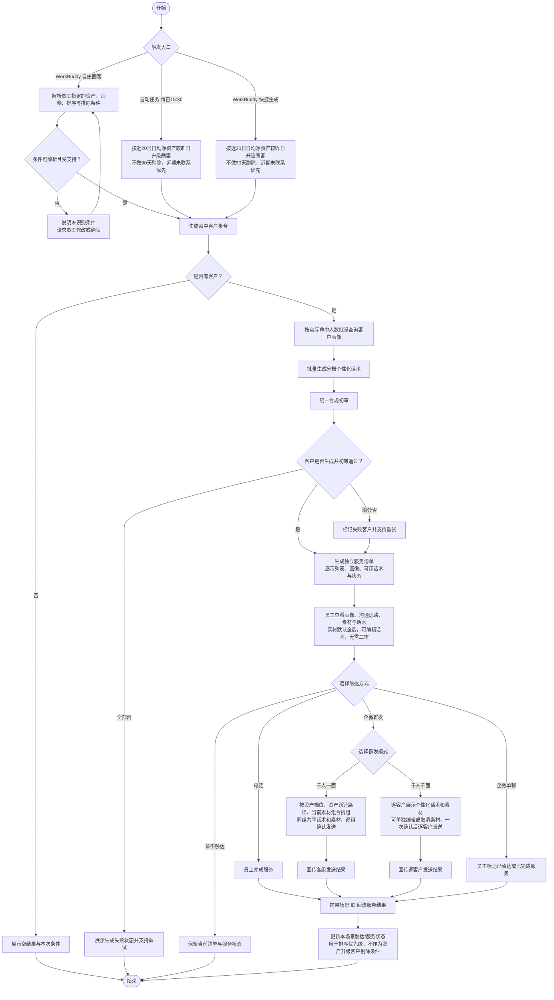

# 产品需求文档：高净值客户资产升级服务清单

## 1. 项目概览

**项目名称**：高净值客户资产升级服务清单  
**平台类型**：PC Web

### 背景与目标

客户因资金转入或账户盈利达到更高资产等级后，客户经理需要及时识别客户、理解账户与风险画像，并按对应等级完成升级服务。当前圈客、画像查看、话术准备和触达记录分散，难以形成持续、可追踪的服务闭环。

本期新建独立的高净值客户资产升级服务清单场景，统一承接每日自动任务和 WorkBuddy 主动查询。系统完成圈客、画像、分层沟通思路、沟通素材、合规初审话术和服务结果回流，帮助员工开展分层经营。本次沟通能力属于未上线前的 1.0 需求完善，不单独升版本。

### 目标用户原型

- **用户特征**：负责自己名下客户经营的客户经理或投顾，日常使用内部服务清单、电话和企微工具。
- **底层动机**：以较少的准备成本识别真正需要升级服务的客户，并据此完成有针对性的服务。
- **典型场景**：员工收到自动生成的服务清单，或在 WorkBuddy 主动查询目标客群后，查看画像和话术并开展服务。

### 核心价值主张

为客户经理 / 投顾解决高净值客户升级经营中圈客、服务准备和结果追踪分散的问题，提供可直接执行的服务清单与场景化服务闭环。

### 成功判定标准

- **用户侧**：员工可从自动任务或 WorkBuddy 生成并打开可服务客户清单，初审通过的客户可直接进入触达。
- **业务侧**：可按资产档位统计清单生成、完成服务、财富诊断 / 配置复盘预约及进入 1+N 专家团队的数据。
- **质量侧**：未初审通过的话术不能用于触达；当前场景近期未联系客户可优先展示，资产再次升级客户不因近90天已联系而被排除。

## 2. 产品发现结论

### 价值层级分析

| 价值层级 | 表面需求 | 底层动机 | 隐含假设 |
| --- | --- | --- | --- |
| 精准识别 | 按资产升级条件自动或主动圈客 | 将有限服务资源投入更需要经营的客户 | 资产、历史推送与服务结果数据能准确识别和回流 |
| 服务准备 | 批量提供客户画像与合规初审话术 | 降低服务前的信息整理与话术准备成本 | 画像完整度足以支撑个性化服务建议 |
| 服务闭环 | 记录触达与服务结果，并参与后续排除 | 避免重复经营并衡量经营效果 | 电话、企微等工具能够携带场景标识回流结果 |

### 风险评估

| 价值层级 | 价值风险 | 可用性风险 | 可行性风险 | 商业可行性风险 |
| --- | --- | --- | --- | --- |
| 精准识别 | 中：需保证资产升级识别与近期触达记录的排序口径一致 | 低：自动与主动入口均贴合当前工作方式 | 中：依赖圈客、历史记录数据准确性 | 低：服务对象与既有高客经营策略一致 |
| 服务准备 | 低：画像和话术直接服务于员工准备动作 | 中：生成失败或内容质量会影响采用 | 中：依赖画像、模型与合规服务协同 | 低：减少重复人工准备成本 |
| 服务闭环 | 中：员工是否完整标记单聊与电话服务结果需验证 | 中：不同渠道的完成状态定义不同 | 中：需要触达工具按场景回写 | 低：可直接支撑经营过程和结果统计 |

## 3. 产品结构图

### 核心功能清单

| 功能 | 优先级 | 一句话说明 |
| --- | --- | --- |
| 双入口圈客 | P0 | 支持自动任务、WorkBuddy 自由圈客与快捷生成。 |
| 全量圈客生成 | P0 | WorkBuddy 按实际命中客户数量直接生成，不设置人数上限，不增加确认或分阶段生成交互。 |
| 批量画像与话术生成 | P0 | 对入选客户批量获取画像、生成话术并完成统一合规初审。 |
| 高净值客户服务清单 | P0 | 按资产档位与资产规模展示可服务客户、状态和优先级。 |
| 客户画像与话术准备 | P0 | 查看画像、分层沟通思路、沟通素材，使用或编辑话术、识别失败并重试。 |
| 沟通素材与发送组合 | P0 | 按资产跃迁路径匹配信件、权益清单和配置一页通，默认全选并允许取消；单聊和群发时同步当前勾选素材。 |
| 企微群发双模式 | P0 | 支持千人一面分组群发与千人千面个性化群发；股票/理财不作为拆分条件。 |
| 触达与服务结果回流 | P0 | 回流电话完成服务、企微群发成功和企微单聊人工标记结果。 |
| 场景经营数据输出 | P1 | 向 ABI 输出场景 ID 与服务结果。 |

### 页面组织方式

采用无新增全局导航的列表-详情结构。员工从既有消息盒子或 WorkBuddy 进入对应的本次服务清单，在同一页面完成客户选择、画像查看、话术准备和触达。

```text
既有入口（消息盒子 / WorkBuddy）
└── 高净值客户资产升级服务清单
    ├── 客户列表与筛选结果
    └── 客户详情
        ├── 客户画像
        ├── 沟通素材 / 投顾沟通思路
        ├── AI 初审话术 / 人工编辑话术
        └── 电话、企微单聊、企微群发及服务状态
```

### 本期不做

| 本期不做 | 理由 |
| --- | --- |
| 修改 AI+选好股服务清单 | 两个场景并列，本期不影响既有规则或数据。 |
| 修改消息盒子入口 | 复用现有自动任务入口即可满足触达需求。 |
| 员工编辑话术后二次合规审核 | 本期仅接入初审结果，避免新增审批链路。 |
| 新增电话、企微单聊、企微群发之外的触达渠道 | 先覆盖既有工具；其他渠道需具备明确服务完成回流后再评估。 |
| 历史清单查询、跨场景防重和统一频控 | 不影响当前场景的最小服务闭环。 |

## 4. 业务流程图

**核心业务流程**



**沟通素材规则**：素材由资产跃迁前后档位决定。300 万以内→300–500 万展示 300 万信件和股票/理财权益清单；300–500 万→500–1000 万展示 500 万信件和 500 万资产配置一页通；直接跨档时覆盖中间权益；500–1000 万→1000 万以上展示 1000 万信件和 1000 万资产配置一页通；300 万以内直接到 1000 万以上时覆盖 300 万权益。素材进入清单时默认全部勾选，投顾可以取消单份；配置一页通进入清单时从资产配置平台实时获取，当前清单会话内沿用同一版本，获取失败时该素材不可发送但不影响其他服务动作。沟通思路仅供投顾参考，不进入对客发送内容。

**服务话术生成规则**：大模型先按客户资产跃迁路径匹配对应档位的完整沟通思路，再结合风险等级、持仓结构、交易行为、账户盈亏、合格投资者认证状态和待处理任务选择 1–2 个最相关的画像切入点生成对客话术。话术采用摘要式表达，固定为“价值开场—个性化价值—轻量邀约”三个自然段：第一段以研究观点、账户复盘或服务权益开场，不提具体资产金额；第二段说明可提供的服务或复盘方向；第三段提出 1–2 个了解客户需求的问题，并明确客户可先了解、暂不操作。各档位的话术必须与对应沟通思路的服务权益、沟通重点和收口方向一致，但不逐条复述内部沟通框架。不得堆砌画像数据、提及内部沟通思路或模型判断过程，不承诺收益，不教育或施压客户；涉及私募或资管计划时，须以“合格投资者认证和适当性匹配结果为前提”的中性表述。千人一面仅对同一资产档位、跃迁路径和素材组合生成同一摘要话术；千人千面在相同框架下按客户画像生成不同摘要。

**企微群发模式规则**：默认进入“千人一面”，系统按客户资产档位、资产跃迁路径和当前勾选素材组合自动拆组；股票/理财客户不作为拆分条件，同组客户共享同一份对客话术和素材组合，员工逐组确认发送，完成一组后可继续下一组。切换为“千人千面”后，每位客户独立展示其个性化对客话术和当前素材选择，员工可以单独编辑话术、取消素材或移除客户，确认后系统逐客户发送并回写成功/失败结果。沟通思路始终只供投顾参考，不进入任何群发内容；沿用 AI+服务清单既有防重发规则：当前服务场景企微群发成功后回写“已群发”标记和发送时间，客户从后续群发选择中排除，手动选择或发送前再次校验时提示不可重复发送。该防重发仅约束当前场景群发，不影响客户因再次资产升级进入新的服务清单。

**流程关键口径**：自动任务每日 15:30 生成近20日日均净资产较昨日发生升级的全量客户，且不设人数上限；不增加近90天剔除逻辑，即使客户在近90天内已通过本服务场景联系过，只要再次发生资产升级，仍需进入新的服务清单。WorkBuddy 自主查询的快捷生成与自动任务采用同一资产升级命中逻辑，不做近90天剔除。自动任务和快捷生成的结果排序均优先展示当前服务场景近期未通过企微群发或电话完成服务的客户，再按现有资产档位和近20日日均净资产排序。

**数据口径规则**：私募合格投资者资格、认证状态和认证有效期统一取认证平台返回结果，资格判断沿用监管口径及公司核验规则，清单不自行推算。近6个月股票、ETF、场外基金交易次数及近1/3/6个月账户盈亏统一复用 AI+助手数据结果，不在本场景重新计算。资产跃迁以客户近20日日均净资产与昨日对应数据对比判断，页面同时展示跃迁前档位与当前档位；仅“300–500 万 → 1000 万以上”额外展示 300 万理财和股票权益清单。客户画像中的“现有持仓与产品结构”“风险承受与操作风格”模块标题下统一展示“数据口径与 AI+助手保持一致”。

## 5. 页面索引

| 序号 | 页面名 | 一句话用途 | 状态/浮层备注 | 设计状态 |
| --- | --- | --- | --- | --- |
| 01 | [高净值客户资产升级服务清单](./pages/01-高净值客户资产升级服务清单.md) | 展示本次生成客户、画像、话术和服务动作 | 正常态、无客户、任务加载/空/失败、话术可用/人工编辑、已完成服务 | ✅ 已确认 |

---

## 变更记录

| 版本 | 日期 | 变更说明 | 影响范围 |
| --- | --- | --- | --- |
| v1.0 | 2026-10-09 | 初始版本，新增高净值客户资产升级服务清单页面 | 全部 |
| 1.0-需求完善 | 2026-10-14 | 未上线前补充沟通素材、分层沟通思路、动态配置材料和群发组合发送 | 页面信息、触达组合、平台依赖 |
| 1.0-需求完善 | 2026-10-16 | 明确摘要式服务话术的大模型生成框架、画像取值与合规约束 | 话术生成、群发话术 |
| 1.0-需求完善 | 2026-10-16 | 业务评审后细化认证信息、跨级权益、AI+助手数据源并取消 WorkBuddy 人数上限 | 客户画像、沟通素材、圈客流程 |
| 1.0-需求完善 | 2026-10-16 | 明确资产画像展示跃迁前后档位，并统一画像模块数据口径说明 | 客户画像展示 |
