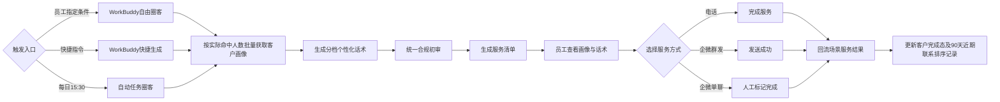

# 高净值客户资产升级服务清单｜业务评审说明

> 评审版本：业务评审版 v1.0  
> 评审日期：2026-10-09  
> 评审目标：确认业务规则、页面信息和服务闭环；本版近90天口径已完成业务拍板，可进入研发需求澄清与技术评审。

## 一、评审结论摘要

本期新增独立的「高净值客户资产升级服务清单」，与现有 AI+服务清单并列，不修改原清单。新版以 AI+服务清单为页面和交互母版，保留客户基础信息、ISMP 待处理任务、企微群发、电话外呼、服务内容记录和完成服务等既有能力，仅替换资产等级筛选、客户画像、资产升级话术及相应圈客逻辑。本次沟通素材和沟通思路属于未上线前 1.0 需求完善，不单独升版本。

业务评审已确认三类内容：

1. 自动任务与 WorkBuddy 的圈客、人数和排序规则符合经营策略；
2. 客户列表、客户画像和服务话术是否足以支撑员工开展资产升级服务；
3. 电话、企微群发和企微单聊的服务完成口径可准确回流；90 天仅用于近期联系优先排序，不作为资产升级客户的剔除条件。

## 二、已确认业务方案

### 2.1 场景与入口

- 正式名称为「高净值客户资产升级服务清单」。
- 与现有 AI+服务清单并列，不修改原清单及原有防重逻辑。
- 自动任务复用员工消息盒子现有入口，本次不开发新入口。
- WorkBuddy 支持自由圈客和快捷生成两种主动问询方式。

### 2.2 自动任务

- 每日 15:30 自动执行。
- 覆盖 300–500 万、500–1000 万、1000 万以上三个资产档位。
- 对全部符合条件的客户一次性生成，不设人数上限，不拆分批次。
- 自动完成客户画像查询、服务话术生成及统一合规初审。

### 2.3 WorkBuddy 主动生成

| 类型 | 员工示例 | 圈客规则 | 历史客户排除 |
| --- | --- | --- | --- |
| 自由圈客 | “圈选近20日日均资产300–500万，且90天内未通过资产升级服务清单联系的客户” | 按员工明确提出的资产、画像、排序和排除条件执行 | 仅执行员工明确提出的排除条件；未提出时不默认排除 |
| 快捷生成 | “给我高净值客户资产升级服务清单” | 默认圈选三个资产档位全部符合要求客户；按近20日日均净资产较昨日发生升级识别 | 不剔除近90个自然日内已联系客户；近期未联系客户优先展示 |

WorkBuddy 命中多少客户就生成多少客户，不再判断是否超过 100 人，不需要员工确认、指定排序或等待超时。

### 2.4 页面与信息展示

- 页面整体布局和视觉完全沿用 AI+服务清单。
- 左侧为客户列表；在资产等级筛选上方提供“姓名/资金账号”合并搜索框，输入实时筛选并支持清空，搜索与资产等级筛选叠加生效；企微一键群发位置不变。
- 客户列表展示姓名、资金账号、风险等级、近20日日均净资产。
- 已完成服务客户置灰并移动到列表底部，仍可点击查看。
- 右侧客户基础信息与 ISMP 待处理任务完全复用 AI+服务清单。
- 客户画像展示近20日日均净资产、私募与资管两类合格投资者认证（各自含认证资格、认证状态和有效期）、资产大类及标的明细、近6个月分品种交易次数、近1/3/6个月账户盈亏。
- 服务话术展示合规审核通过状态、完整话术、人工编辑状态和一键复制。
- 在服务话术上方展示“沟通素材”和“沟通思路”：沟通素材按客户资产跃迁路径匹配，默认全部勾选，投顾可取消单份；沟通思路默认展开第一步、其余步骤按标题收起，使用方向箭头指示展开状态，支持一键展开/全部收起和单步展开，完整内容仅供投顾参考，不发送给客户；不展示“完整原文”标签。
- 500 万、1000 万资产配置一页通进入清单时从资产配置平台实时获取，当前清单会话内沿用同一版本；获取失败时显示“暂不可用，可重试”，该素材不可发送但不影响其他服务动作。
- 底部保留服务内容记录和完成服务按钮。

### 2.5 话术与触达闭环

- 初始 AI 话术必须合规审核通过后才可使用。
- 话术文本区直接可编辑，无单独“编辑话术”按钮；内容失焦后自动保存并显示“人工已编辑”，无需再次审核。
- 电话：员工点击“完成服务”后，计入本场景成功服务。
- 企微群发：发送成功后，计入本场景成功联系。
- 企微群发防重：当前服务场景发送成功后回写“已群发”标记和发送时间；后续进入群发选择时默认排除，手动选择或发送前再次校验时提示不可重复发送。该防重仅约束当前场景群发，不影响客户再次资产升级进入新的服务清单。
- 企微单聊：员工手工标记已触达或已完成服务后，计入本场景成功联系。
- 服务结果必须携带本场景标识回流，避免把其他场景的电话或企微行为误计入。
- 群发确认弹框同步展示当前勾选素材和对客话术；允许移除单份素材，沟通思路不进入发送内容。
- 企微群发默认进入“千人一面”：按资产档位、资产跃迁路径和当前素材组合自动拆组，股票/理财不作为拆分条件，员工逐组确认发送；可切换“千人千面”，逐客户编辑话术、取消素材或移除客户后一次确认发送。

## 三、业务流程

### 3.1 沟通素材匹配

| 资产跃迁 | 默认沟通素材 |
| --- | --- |
| 300 万以内 → 300–500 万 | 300 万信件、理财权益清单、股票权益清单 |
| 300–500 万 → 500–1000 万 | 500 万信件、500 万资产配置一页通 |
| 300 万以内 → 500–1000 万 | 500 万信件、理财权益清单、股票权益清单、500 万资产配置一页通 |
| 500–1000 万 → 1000 万以上 | 1000 万信件、1000 万资产配置一页通；不再补发 300 万权益 |
| 300 万以内 → 1000 万以上 | 1000 万信件、理财权益清单、股票权益清单、1000 万资产配置一页通 |
| 300–500 万 → 1000 万以上 | 1000 万信件、300 万理财权益清单、300 万股票权益清单、1000 万资产配置一页通 |

素材进入清单时默认全部勾选，投顾允许取消单份。资产配置一页通在进入清单时实时从资产配置平台获取，当前清单内保持同一版本；获取失败时不影响固定素材、沟通思路、对客话术和其他服务动作。

## 四、已拍板：自动任务与快捷生成的近 90 天口径

- 自动任务和 GWork 自主查询快捷生成均按“近20日日均净资产较昨日发生升级”识别客户。
- 不增加近 90 天剔除逻辑；即使客户近 90 天内已通过本服务场景企微群发或电话联系过，只要再次发生资产升级，仍进入新的服务清单。
- 近 90 天联系记录（企微群发、电话）仅用于排序：优先展示当前服务场景近期未联系客户，再按资产档位和近20日日均净资产排序。
- 自由圈客仍执行员工明确提出的条件和排除条件，不因本规则替换员工明确指定的条件。

## 五、本期范围边界

- 不修改现有 AI+服务清单页面、规则和数据。
- 不修改员工消息盒子入口。
- 不新增历史清单查询、跨场景防重或统一频控。
- 不新增电话、企微单聊和企微群发以外的触达渠道。
- 不改画像源数据的计算口径，不允许模型推断补齐缺失字段。
- 不增加人工编辑话术的二次审核流程。

## 六、建议评审顺序

1. 先阅读本说明，确认业务目标、双入口规则和已拍板的近90天排序口径；
2. 打开高保真原型，检查客户列表、基础信息、画像、话术、群发和完成服务；
3. 对照业务评审检查清单逐项确认；
4. 如需追溯细节，再查阅主 PRD、页面 PRD和需求规格；
5. 业务确认后，进入字段口径、接口依赖、异常状态和验收标准的研发需求澄清。

## 七、业务评审结论模板

- 评审结论：通过 / 有条件通过 / 不通过
- 自动任务与 GWork 快捷生成近90天口径：不剔除，近期未联系优先排序
- 需修改内容：
- 业务负责人：
- 确认日期：2026-10-16
