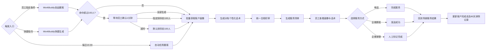

# 高净值客户资产升级服务清单｜业务评审说明

> 评审版本：业务评审版 v1.0  
> 评审日期：2026-10-09  
> 评审目标：确认业务规则、页面信息和服务闭环；确认后进入研发需求澄清与技术评审。

## 一、评审结论摘要

本期新增独立的「高净值客户资产升级服务清单」，与现有 AI+服务清单并列，不修改原清单。新版以 AI+服务清单为页面和交互母版，保留客户基础信息、ISMP 待处理任务、企微群发、电话外呼、服务内容记录和完成服务等既有能力，仅替换资产等级筛选、客户画像、资产升级话术及相应圈客逻辑。

业务评审需要确认三类内容：

1. 自动任务与 WorkBuddy 的圈客、人数和排除规则是否符合经营策略；
2. 客户列表、客户画像和服务话术是否足以支撑员工开展资产升级服务；
3. 电话、企微群发和企微单聊的服务完成口径是否能准确回流并参与 90 天防重复服务。

## 二、已确认业务方案

### 2.1 场景与入口

- 正式名称为「高净值客户资产升级服务清单」。
- 与现有 AI+服务清单并列，不修改原清单及原有防重逻辑。
- 自动任务复用员工消息盒子现有入口，本次不开发新入口。
- WorkBuddy 支持自由圈客和快捷生成两种主动问询方式。

### 2.2 自动任务

- 每日 15:30 自动执行。
- 覆盖 300–500 万、500–1000 万、1000 万以上三个资产档位。
- 对全部符合条件的客户一次性生成，不设人数上限，不拆分批次。
- 自动完成客户画像查询、服务话术生成及统一合规初审。

### 2.3 WorkBuddy 主动生成

| 类型 | 员工示例 | 圈客规则 | 历史客户排除 |
| --- | --- | --- | --- |
| 自由圈客 | “圈选近20日日均资产300–500万，且90天内未通过资产升级服务清单联系的客户” | 按员工明确提出的资产、画像、排序和排除条件执行 | 仅执行员工明确提出的排除条件；未提出时不默认排除 |
| 快捷生成 | “给我高净值客户资产升级服务清单” | 默认圈选三个资产档位全部符合要求客户 | 默认剔除近90个自然日内通过本场景成功联系的客户 |

WorkBuddy 命中超过 100 人时：

- 等待员工确认最长 1 分钟；
- 员工可确认一次性生成全部客户；
- 员工可指定排序规则并生成前 100 人，例如按近20日日均净资产从高到低；
- 超过 1 分钟未确认，系统按默认排序生成前 100 人，并反馈已按默认条件执行。

默认排序为：资产档位从高到低；同档位按近20日日均净资产从高到低。

### 2.4 页面与信息展示

- 页面整体布局和视觉完全沿用 AI+服务清单。
- 左侧为客户列表及资产等级筛选，企微一键群发放在客户列表顶部。
- 客户列表展示姓名、资金账号、风险等级、近20日日均净资产。
- 已完成服务客户置灰并移动到列表底部，仍可点击查看。
- 右侧客户基础信息与 ISMP 待处理任务完全复用 AI+服务清单。
- 客户画像展示近20日日均净资产、私募合格投资者认证、资产大类及标的明细、近6个月分品种交易次数、近1/3/6个月账户盈亏。
- 服务话术展示合规审核通过状态、完整话术、人工编辑状态和一键复制。
- 底部保留服务内容记录和完成服务按钮。

### 2.5 话术与触达闭环

- 初始 AI 话术必须合规审核通过后才可使用。
- 员工可编辑话术，编辑后显示“人工已编辑”，无需再次审核。
- 电话：员工点击“完成服务”后，计入本场景成功服务。
- 企微群发：发送成功后，计入本场景成功联系。
- 企微单聊：员工手工标记已触达或已完成服务后，计入本场景成功联系。
- 服务结果必须携带本场景标识回流，避免把其他场景的电话或企微行为误计入。

## 三、业务流程

## 四、唯一待业务确认项

### 自动任务的 90 天排除口径

| 方案 | 规则 | 优点 | 风险 |
| --- | --- | --- | --- |
| A：按已成功联系排除（建议） | 剔除近90天内通过本场景已成功联系的客户 | 与 WorkBuddy 快捷生成一致；以真实服务结果为准；不会因仅推送但未服务而漏掉客户 | 若服务结果未及时回流，客户可能再次进入清单 |
| B：继续按已推送排除 | 剔除近90天内已推送过本场景服务清单的客户 | 控制清单重复出现，系统判断简单 | 客户仅被推送但员工未服务，也会在90天内被排除，可能造成服务遗漏 |

**产品建议：选择方案 A。** 该场景的目标是完成资产升级服务，排除依据应是“是否真正完成联系”，而非“是否进入过清单”。同时应通过待同步状态和失败重试，降低服务结果回流不及时带来的重复风险。

## 五、本期范围边界

- 不修改现有 AI+服务清单页面、规则和数据。
- 不修改员工消息盒子入口。
- 不新增历史清单查询、跨场景防重或统一频控。
- 不新增电话、企微单聊和企微群发以外的触达渠道。
- 不改画像源数据的计算口径，不允许模型推断补齐缺失字段。
- 不增加人工编辑话术的二次审核流程。

## 六、建议评审顺序

1. 先阅读本说明，确认业务目标、双入口规则和唯一待确认项；
2. 打开高保真原型，检查客户列表、基础信息、画像、话术、群发和完成服务；
3. 对照业务评审检查清单逐项确认；
4. 如需追溯细节，再查阅主 PRD、页面 PRD和需求规格；
5. 业务确认后，进入字段口径、接口依赖、异常状态和验收标准的研发需求澄清。

## 七、业务评审结论模板

- 评审结论：通过 / 有条件通过 / 不通过
- 自动任务 90 天排除口径：方案 A 已成功联系 / 方案 B 已推送
- 需修改内容：
- 业务负责人：
- 确认日期：

